<h1 align="center">HK Frontend</h1>

Home Assistant dashboards inspired by Apple’s Home app. 
Built from your own rooms and devices, and set up entirely in the UI.

Built and designed using <b>Claude Opus</b> for the code and <b>Codex</b> for the image assets.

<b><a href="https://github.com/jazzphone/hk-frontend/wiki/Install">Install</a></b> ·
<b><a href="https://github.com/jazzphone/hk-frontend/wiki">Documentation</a></b> ·
<b><a href="https://github.com/jazzphone/hk-frontend/wiki/Gallery">Gallery</a></b> ·
<b><a href="https://github.com/jazzphone/hk-frontend/releases">What’s new</a></b>

## Screens that build themselves

Add a screen and HK Frontend builds it from your floors, areas and devices: the clock and weather, status chips, cameras, scenes, favorites, a section for every room, a page for each room and each kind of device, and a [calendar](https://github.com/jazzphone/hk-frontend/wiki/Calendar) of the month, week or day. A new light shows up on its own. The same screen works on a wall tablet, a computer, an iPad and a phone.

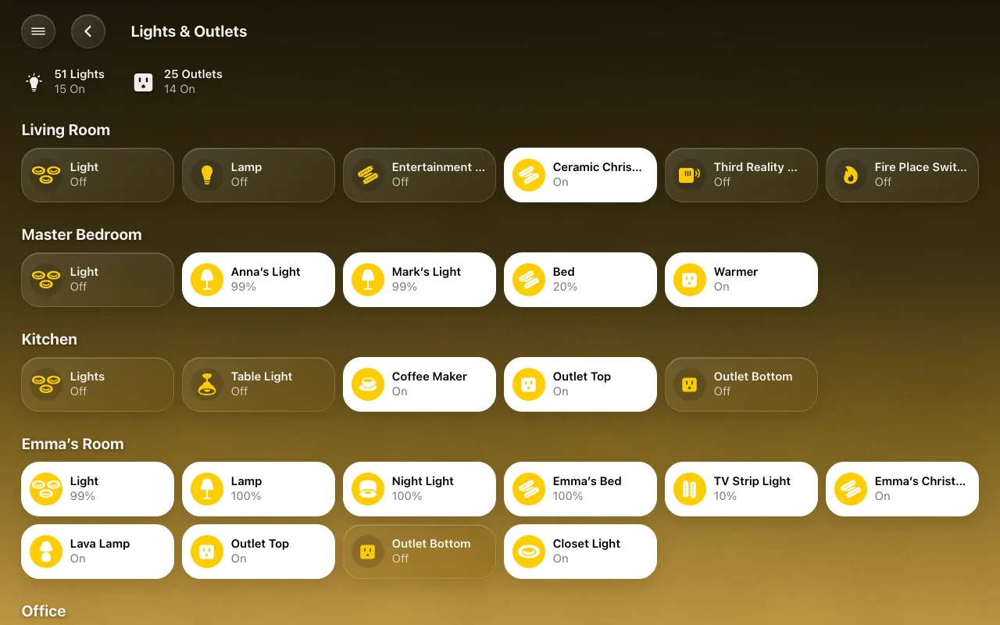
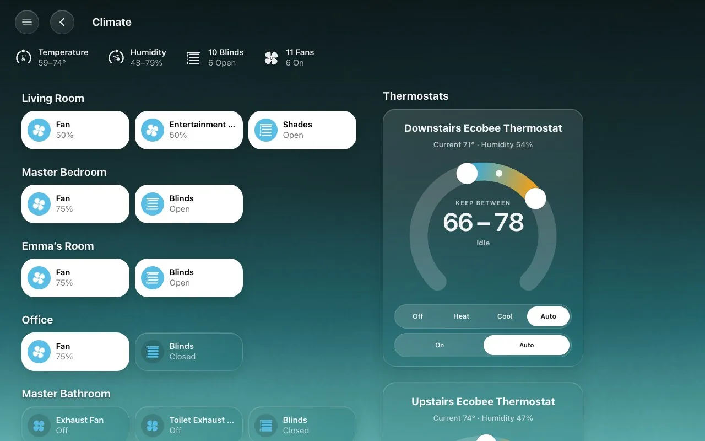

## Get around your way

Every screen chooses how you move between its pages and rooms.

- **A menu like the Home app's sidebar**: always open beside the page, behind a button, or pulled out with a swipe from the left edge. ([Menu](https://github.com/jazzphone/hk-frontend/wiki/Menu))
- **A floating tab bar like iOS apps have**, along the bottom or the top, or as a rail down either side of a tablet.
  - It can shrink to a small button or hide as you scroll, and even start small.
  - Small, Medium or Large, and you choose how many pages get a tab.
  - The page moves smoothly clear of it, so nothing important hides underneath.
  - **More** holds the rest: the other pages, every room, and Home Assistant's own Settings, Integrations and Notifications, as icons or as a list. ([Tab Bar](https://github.com/jazzphone/hk-frontend/wiki/Tab-Bar))

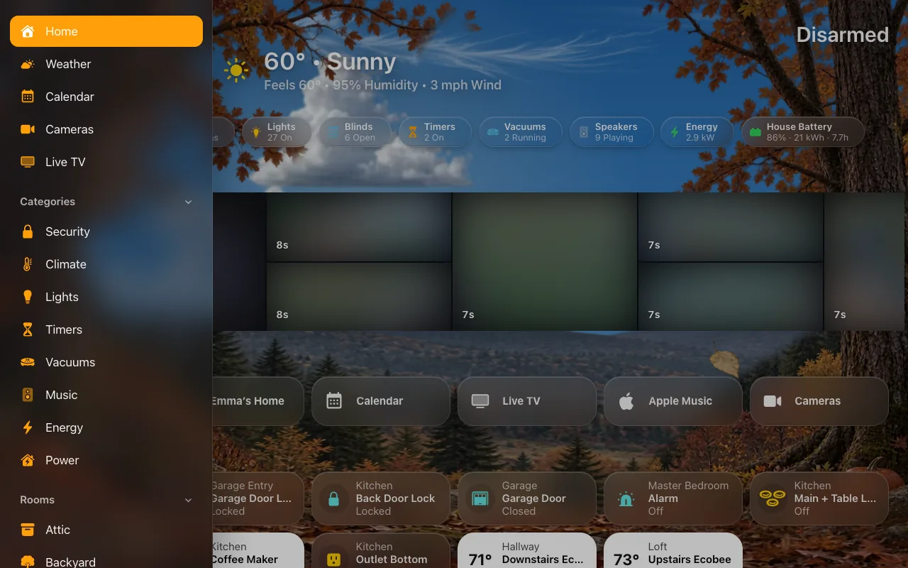
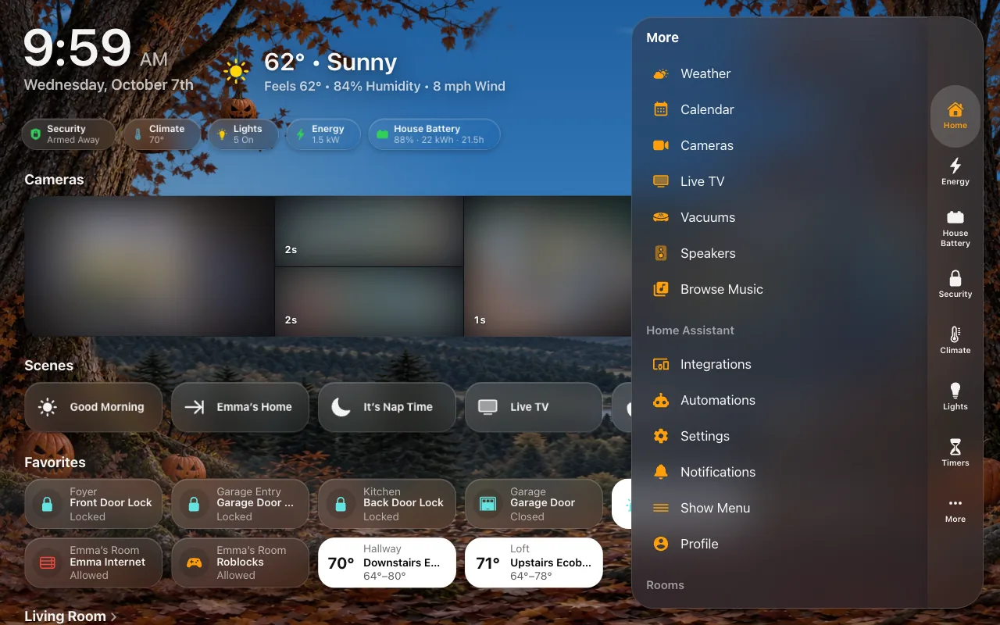

## Tap for the controls

Tap a light, thermostat, lock, garage door, speaker or vacuum and a sheet opens with the controls it needs. Each room and category page has a [status row](https://github.com/jazzphone/hk-frontend/wiki/Status-Rows) like the Home app's: *Motion · Emma’s Room*, *Valve · Running*. Pop-ups show the doorbell camera or the alarm keypad, and an automation can open one on chosen screens. Tiles have the Home app’s own size and spacing, in Apple’s font wherever it is there. Every accessory can have its own name, icon (any of Apple’s Home glyphs, or Home Assistant’s), tile size and place among its neighbors. Touch a graph for its value, drag a thermostat’s dial and watch it follow your finger.

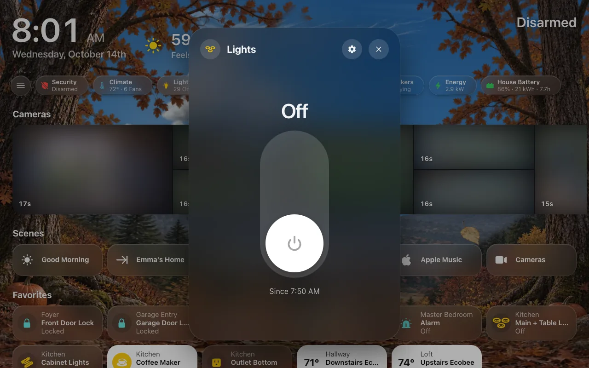
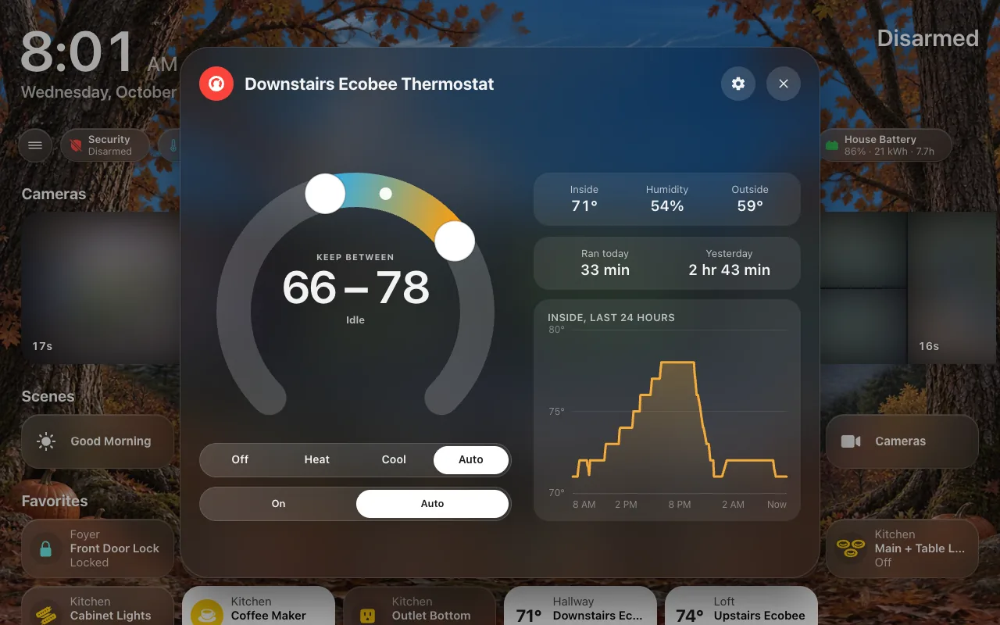

## A live sky

Behind every page, a sky that follows the weather and the time of day: clear and starry, golden at sunset, gray and flashing in a thunderstorm, with rain or snow when it falls. Choose **[Realistic clouds](https://github.com/jazzphone/hk-frontend/wiki/Live-Sky#choose-its-look)** — photographic clouds picked from the weather and lit by the sun — and **[New Decorations](https://github.com/jazzphone/hk-frontend/wiki/Seasonal-Decorations)**, woodland scenery that comes alive for autumn, Halloween, Christmas, birthdays and the rest of the year. Or set the Background to a still **Color**, a **Photo** of your own, or **[Landscapes](https://github.com/jazzphone/hk-frontend/wiki/Live-Sky#landscapes)** — fifty photos that come with it, a new one each time the screen wakes or on a schedule — softened with its own blur, dim and tint, for every screen, one screen, a page or a room. **Liveliness** sets how much moves in it — the bats, leaves and fireflies, and how often something crosses the moon — for each occasion and each screen, calming down when nobody is around.

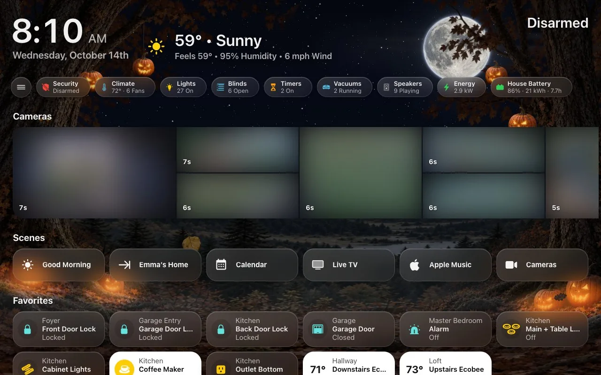
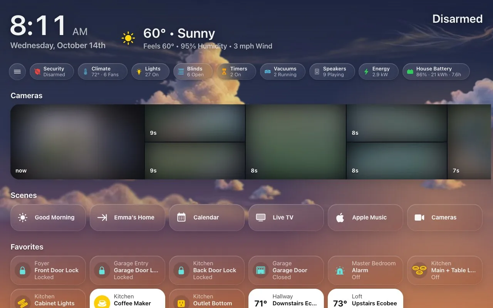

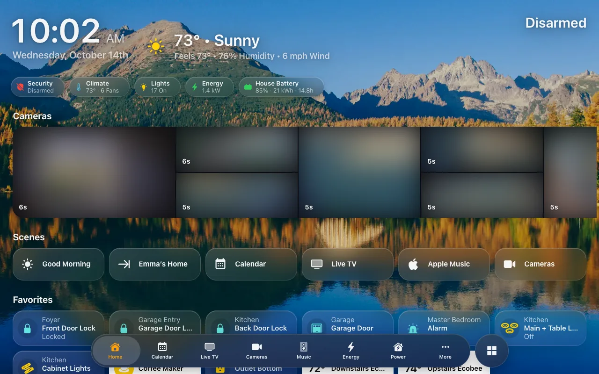
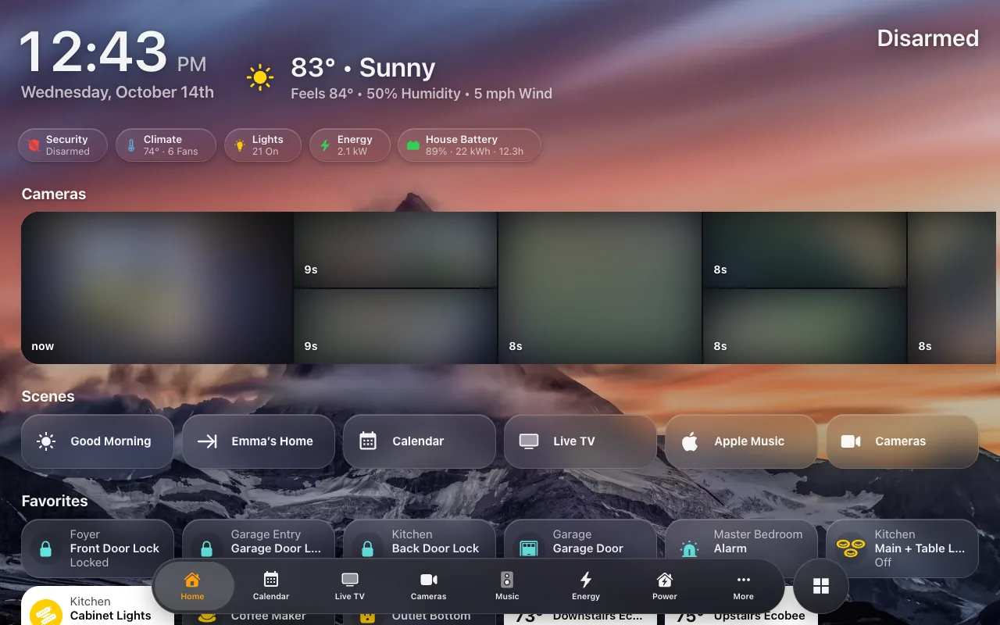

## Made for the wall

Put a screen on a wall tablet and it looks after itself. It returns to Home when left alone, and fills the screen with no Home Assistant header or sidebar. Each tablet has its own page in HK Settings: whether it is awake, on the screensaver or dark, and why, its battery, what it does when left alone, and its Sleep Screen. ([Wall Tablets](https://github.com/jazzphone/hk-frontend/wiki/Wall-Tablets))

When nobody is using it, it shows your photos (one at a time, or a mosaic of up to five), a full-screen **clock** in fifteen styles over a moving background or fifty landscape photos that come with it (with a dim red Night Mode), or the forecast over a living landscape: the sky, the clouds and the light of the moment. Now and then **Weather** (today at a glance, over the live sky) or **Home Energy** (today's energy, cost and water against a usual day, in the Energy page's rings) comes in. The landscape dresses up for Halloween, Christmas, the Fourth of July and birthdays, like the dashboards. Over the top go the clock, the weather, what's playing, the timers and whether the house is secure, with your coming events beside them if you like. ([Screensaver and idle](https://github.com/jazzphone/hk-frontend/wiki/Screensaver-and-Idle))

**[Sleep Screen](https://github.com/jazzphone/hk-frontend/wiki/Sleep-Screen)** keeps each tablet dark when nobody needs it and awake the moment somebody does. HK Frontend decides from the room’s presence sensors, quiet hours, the doorbell, smoke and away mode, sets the brightness for day and night, and fades in from black without a flicker — or your own automations decide, with one action.

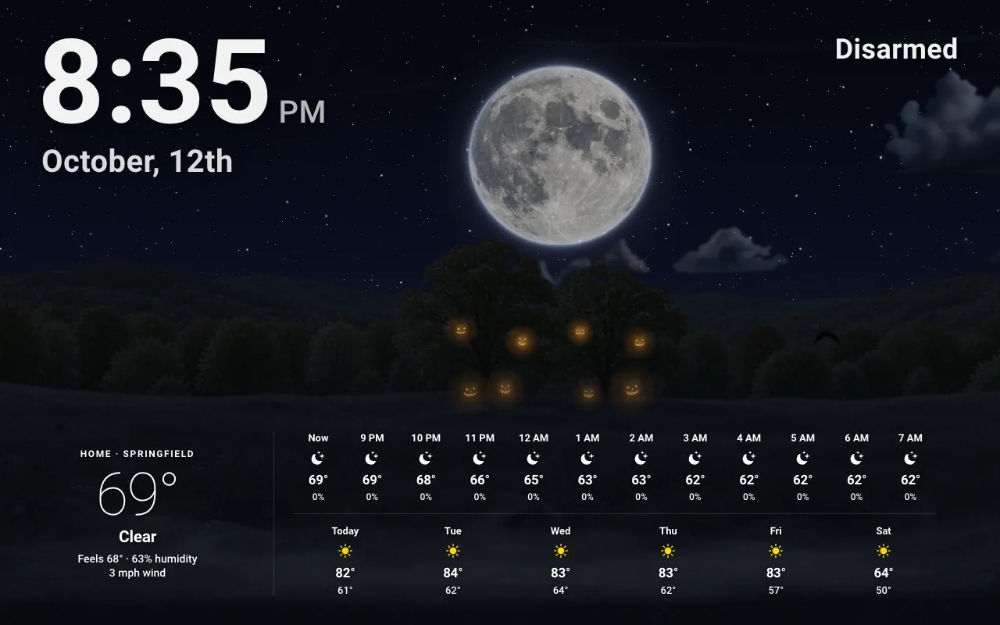
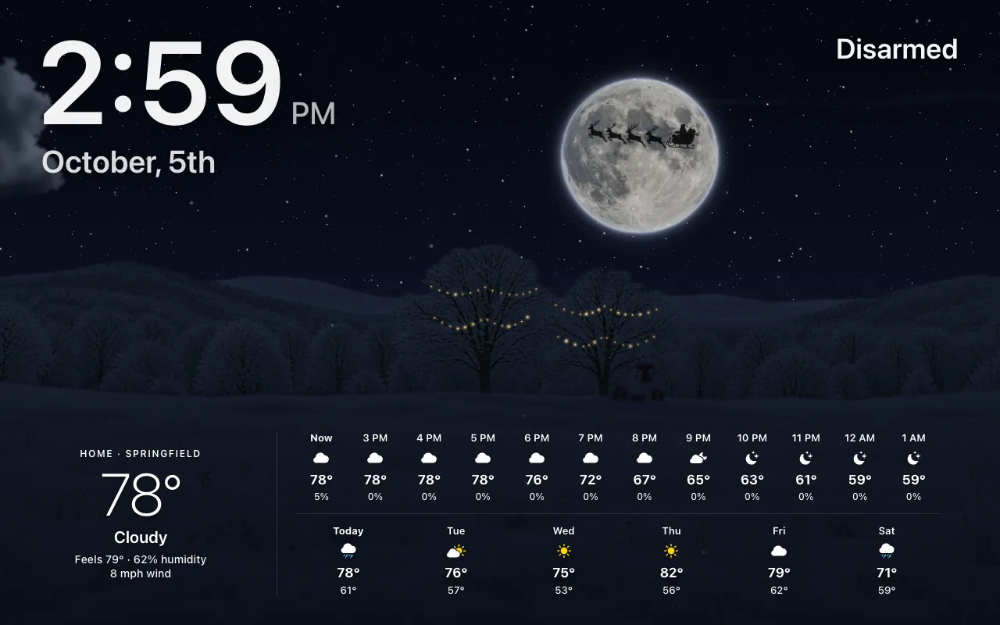

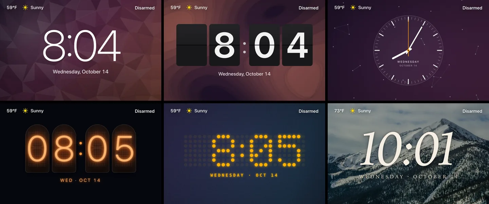

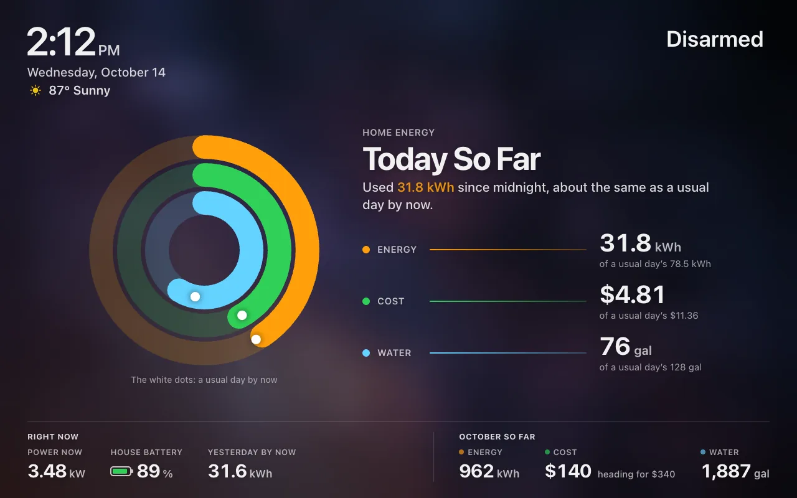

## Energy at a glance

The **[Energy](https://github.com/jazzphone/hk-frontend/wiki/Energy)** feature builds an Energy page from Home Assistant’s own Energy settings, with four tabs: **Now** (the whole home live, what is drawing the most, the house battery and the cars), and **Today**, **This Week** and **This Month** (rings against a usual day, where the energy went, the month as a calendar, and the meters you track). Every circuit, room, appliance and outlet has a tile, with a power button where there is a switch. Beside it, a **[Power](https://github.com/jazzphone/hk-frontend/wiki/Energy#the-power-page)** page for right now and the controls: the grid, the sun, a house battery with its mode and levels, the cars charging, and every device marked when the battery backs it up. A screen can show only some pages — a wall panel that is just the Energy page, say.

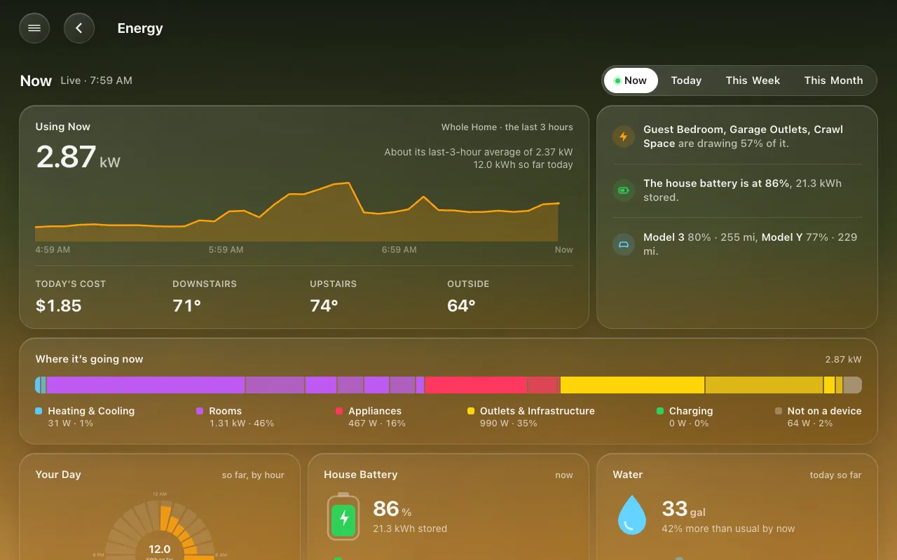
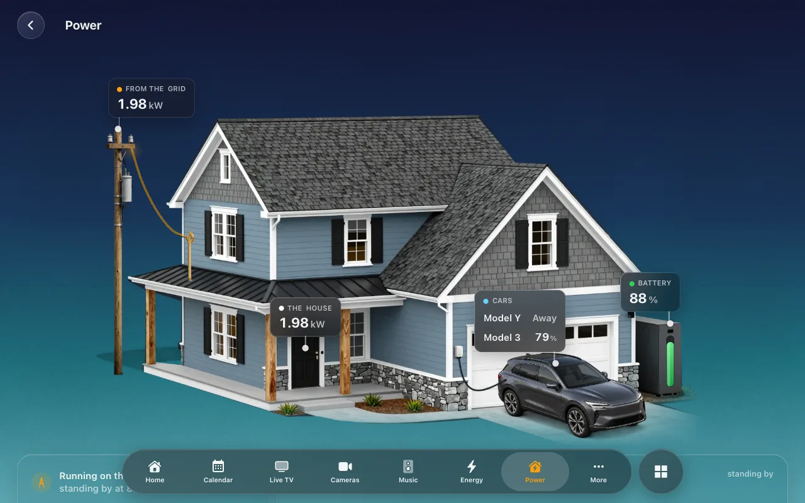

## Set up in the UI

**HK Settings** in the sidebar holds everything, with a live preview of each screen as a phone, an iPad, a wall tablet, a desktop or a car. Choose the glass: see-through, frosted, blurred, or **Tinted**, the Home app’s flat dark plate. A Setup Assistant makes your first screen, and Setup Check says what is missing. There is nothing to add to `configuration.yaml`.

## Install

You need **Home Assistant 2026.8** or newer and **[HACS](https://hacs.xyz)**.

1. In **HACS**, open **⋮** → **Custom repositories**, add `https://github.com/jazzphone/hk-frontend` as an **Integration**, then download **HK Frontend**.
2. Restart Home Assistant.
3. In **Settings** → **Devices & services**, select **Add integration** and choose **HK Frontend**.
4. Open **HK Settings** in the sidebar. The Setup Assistant starts on its own.

Step by step, with what you should see: **[Install](https://github.com/jazzphone/hk-frontend/wiki/Install)**. Apple’s font and glyphs are optional and can’t be bundled; **[Your files](https://github.com/jazzphone/hk-frontend/wiki/Your-Files)** shows how to add your own.

## Optional features

Add each from **Settings** → **Devices & services** → **HK Frontend** → **Add feature**.

| | |
|---|---|
| **[Music](https://github.com/jazzphone/hk-frontend/wiki/Music)** | Whole-home music through Music Assistant: one Music page to play and browse, rooms, speaker groups and playlists, a docked Now Playing bar, and the music on the screensaver |
| **[Live TV](https://github.com/jazzphone/hk-frontend/wiki/Live-TV)** | An HDHomeRun tuner’s channels and guide, full screen on any screen |
| **[Clean Areas](https://github.com/jazzphone/hk-frontend/wiki/Clean-Areas)** | Pick rooms and send the vacuums that reach them |
| **[Alarm PIN](https://github.com/jazzphone/hk-frontend/wiki/Alarm-PIN)** | A PIN in front of an alarm panel that takes no code of its own |
| **[Energy](https://github.com/jazzphone/hk-frontend/wiki/Energy)** | An Energy page built from Home Assistant’s Energy settings, with a live tile per circuit and device, and a Power page for right now: the grid, the sun, a house battery and the cars |
| **[Notifications](https://github.com/jazzphone/hk-frontend/wiki/Notifications)** | A banner at the top of the screens when something happens at home, with a camera’s snapshot; whole categories at once — doors, locks, leaks, cameras, vacuums, the alarm — and your calendars’ events before they start. A tap opens the accessory’s sheet with the notification on it. Do Not Disturb, and a wake up to the screensaver |

The **[Weather page](https://github.com/jazzphone/hk-frontend/wiki/Weather)** combines current conditions, hourly Temperature / Rain / Wind tabs, the daily forecast and detail tiles over the live sky. Its built-in radar uses NOAA or RainViewer over OpenStreetMap, with a centered regional view and controls in the expanded map. Choose its sources, forecasts and radar in **HK Settings → Pages → Weather**; no separate HACS radar card is required.

**Built in, nothing to add:** the **[Calendar](https://github.com/jazzphone/hk-frontend/wiki/Calendar)** (month, week or day, and your coming events on the screensaver), **[Weather](https://github.com/jazzphone/hk-frontend/wiki/Weather)**, **[Cameras](https://github.com/jazzphone/hk-frontend/wiki/Cameras)**, **[Pop-ups](https://github.com/jazzphone/hk-frontend/wiki/Detail-Sheets-and-Popups)** an automation opens (the doorbell, the alarm keypad), the **[Screensaver](https://github.com/jazzphone/hk-frontend/wiki/Screensaver-and-Idle)** and the **[Sleep Screen](https://github.com/jazzphone/hk-frontend/wiki/Sleep-Screen)**.

## HK Frontend and Mantel

HK Frontend is HK inside Home Assistant. **Mantel** is its sibling: the same screens, from the same code, served by a
server of its own beside Home Assistant, with people and roles, wall tablets that sign themselves in and an audit log
of every command. Use either, or both together: linked, Mantel's Owner picks who runs each wall tablet, and every
entity keeps its id. While Mantel runs the house, HK Frontend’s dashboards use Mantel’s settings, one copy.
**[Mantel Link](https://github.com/jazzphone/mantel-link)** is Mantel's integration in Home Assistant.
[HK Frontend and Mantel](https://github.com/jazzphone/hk-frontend/wiki/HK-Frontend-and-Mantel) explains running
them together; [Mantel's guide](https://github.com/jazzphone/mantel/wiki) installs Mantel.

<!-- products-table: copied from tools/products_table.md in Mantel by tools/products_table.py; edit it there -->
| | **Mantel App** (Home Assistant App) | **Mantel with Docker or the LXC** | **HK Frontend alone** | **HK Frontend linked to Mantel** | **Mantel Link** |
|---|---|---|---|---|---|
| **Use this when** | You run Home Assistant OS and want people, roles and wall tablets with nothing extra to look after | Mantel should run on its own machine, at its own address | You want HK on Home Assistant's own dashboards, for people who already use Home Assistant | You want both, with one copy of the settings | You run Mantel and want its tablets, actions and notifications in Home Assistant |
| **Where the screens are** | **Mantel** in Home Assistant's sidebar and the Companion app; its own address too, if you turn on direct access | Its own `https://` address; in Home Assistant's sidebar with Mantel Connect | Home Assistant's own dashboards | Mantel's pages, and HK Frontend's dashboards in Home Assistant | No screens of its own; puts a Mantel screen in Home Assistant's sidebar as a dashboard |
| **HK's cards on dashboards you build** | No | No | Yes | Yes, HK Frontend's | — |
| **Wall tablets (kiosk)** | Enrolled tablets with their own credential and role, in Fully Kiosk, Kiosk Satellite or any browser | The same | A full-screen look inside Home Assistant's page; tablets sign in as Home Assistant users | Each tablet is run by Mantel or by HK Frontend, never both | Each tablet's black screen, screensaver and Sleep Screen as entities |
| **Screensaver and Sleep Screen** | Yes | Yes | Yes | Yes, from whichever runs the tablet | Their switches, for automations |
| **People, roles, passkeys** | Mantel's roles; Home Assistant signs people in to the sidebar; passkeys and passwords at its own address | Mantel's own sign-in: passkeys, passwords, authenticator codes, or Home Assistant | Home Assistant's users | Mantel's people; a change made on HK Frontend's dashboards is saved as the person linked to your Home Assistant user | — |
| **Every command checked and in the audit log** | Yes | Yes | No | On Mantel's screens, and for saves from Home Assistant | — |
| **Remote access** | Home Assistant's own, for the sidebar; a Cloudflare Tunnel for its own address | A Cloudflare Tunnel or your own reverse proxy, with stricter rules away from home | Home Assistant's own | Each one's own | — |
| **Mantel Photos** (albums for the screensaver) | Yes | Yes | No; the screensaver shows a folder of Home Assistant's media | On Mantel's screens | — |
| **iPhone, iPad and Mac apps** | Yes, at its own `https://` address | Yes | No; Home Assistant's Companion app | Yes, with Mantel | Sends Mantel's notifications to Companion-app phones |
| **Music** | Music Assistant, through Mantel | The same | Music Assistant, as an HK Frontend feature | Mantel's; HK Frontend's music actions are run by Mantel | Music actions for your automations |
| **Settings** | **Mantel Settings**: HK's settings, plus people, tablets, connections and the audit log | The same | **HK Settings** in Home Assistant's sidebar | **Mantel Settings**; HK Settings steps aside while Mantel runs the house | None; set up in **Devices & services** |
| **Backups** | Inside Home Assistant's backups, plus **Back Up Now**, download and restore in Mantel Settings | Mantel's own nightly encrypted backups, with download and restore in Mantel Settings | Inside Home Assistant's backups | Each one's own | Inside Home Assistant's backups |
| **Who runs the house** (Seasonal Decorations, the Alarm PIN keypad, Live TV) | Mantel | Mantel | HK Frontend | Mantel or HK Frontend: **The House**, in Mantel Settings | Holds the house's entities when Mantel runs it |
| **Needs Home Assistant** | Yes: Home Assistant OS or Supervised, 2026.8 or newer | Yes: any Home Assistant 2026.8 or newer it can reach | Yes: 2026.8 or newer | Yes | Yes: any install type, 2026.9 or newer |
| **Installed from** | Home Assistant's App store, with Mantel's repository | Docker Compose, or a script that makes a Proxmox LXC | HACS (custom repository) | HACS, plus Mantel | HACS (custom repository) |

**Why you would use each.** **HK Frontend** is the simplest: install it from HACS and HK's screens appear on Home Assistant's own dashboards, for everyone who already signs in to Home Assistant. **Mantel** is for a household: people who shouldn't need a Home Assistant account, roles per room, wall tablets that sign themselves in, an audit log of every command, and screens that Home Assistant's updates can't disturb. Run it as the **Mantel App** if you have Home Assistant OS, or with **Docker or the LXC** to keep it on a machine of its own. **Mantel Link** goes with Mantel: it is how Home Assistant's automations, entities and Companion-app notifications reach Mantel. And you can **link HK Frontend to Mantel** to keep HK on Home Assistant's dashboards while Mantel runs the tablets and keeps one copy of the settings.

[Mantel](https://github.com/jazzphone/mantel) ([guide](https://github.com/jazzphone/mantel/wiki)) ·
[HK Frontend](https://github.com/jazzphone/hk-frontend) ([guide](https://github.com/jazzphone/hk-frontend/wiki)) ·
[Mantel Link](https://github.com/jazzphone/mantel-link) ·
[Running them together](https://github.com/jazzphone/mantel/wiki/HK-Frontend-and-Mantel)
<!-- /products-table -->

## Help

Start with **[Troubleshooting](https://github.com/jazzphone/hk-frontend/wiki/Troubleshooting)**. To report a problem, [open an issue](https://github.com/jazzphone/hk-frontend/issues) and attach the diagnostics (**Settings** → **Devices & services** → **HK Frontend** → **⋮** → **Download diagnostics**).

---

Screenshots are of one home that has added Apple’s font and glyphs; camera pictures are blurred. HK Frontend is an independent project, not affiliated with or endorsed by Apple Inc. Apple, HomeKit, SF Pro and SF Symbols are trademarks of Apple Inc. The seasonal sky illustrations were generated with OpenAI’s image tools, and the cloud, rain and snow textures by `tools/sky/gen_sky.py`; until you add your own glyphs, icons come from [Material Design Icons](https://pictogrammers.com/library/mdi/) (Apache 2.0). [MIT license](LICENSE).
