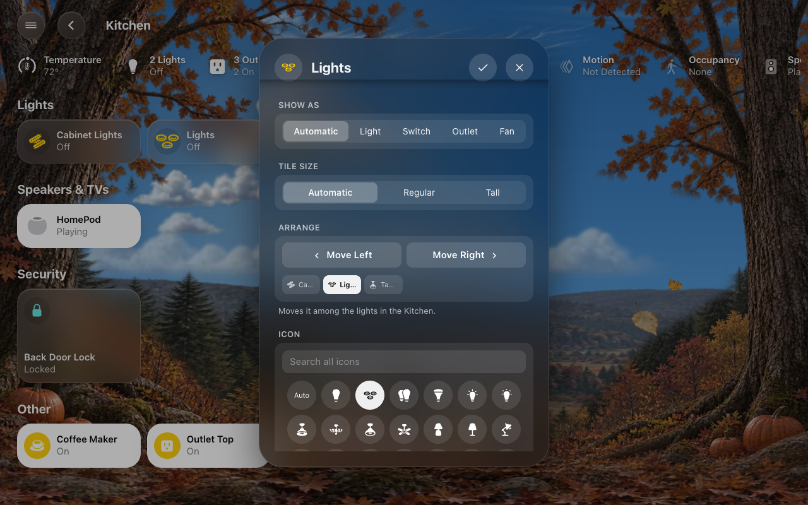
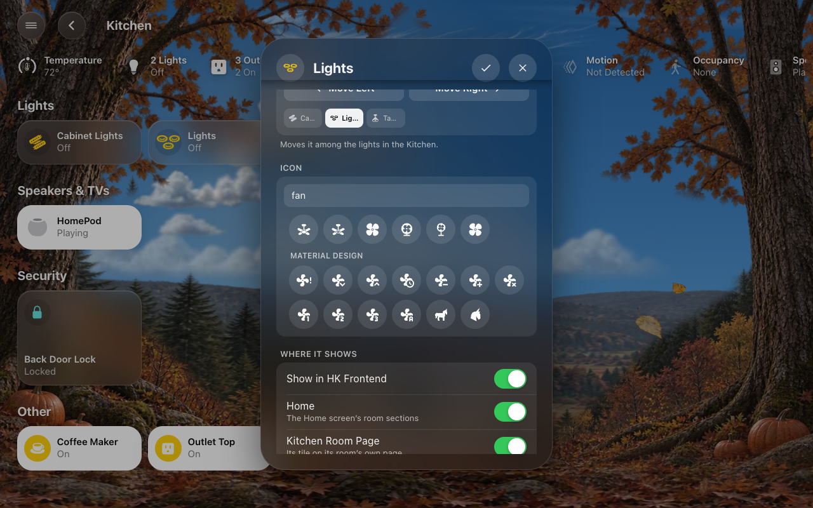
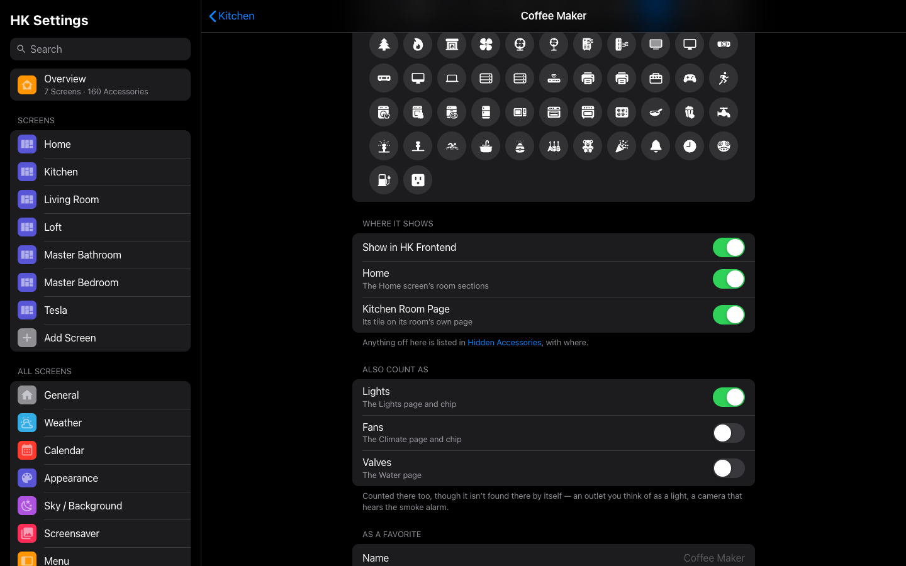
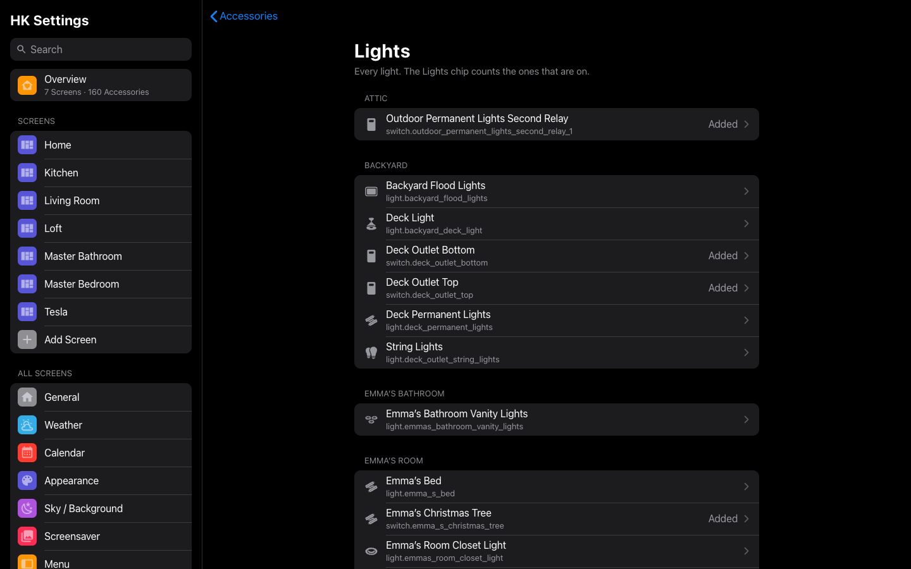
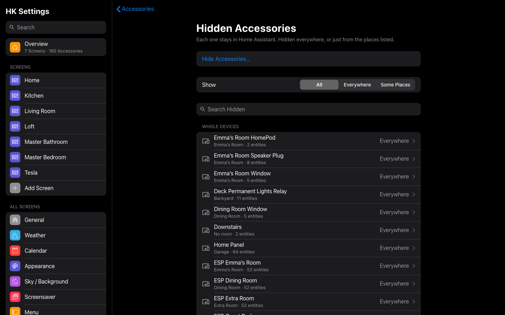
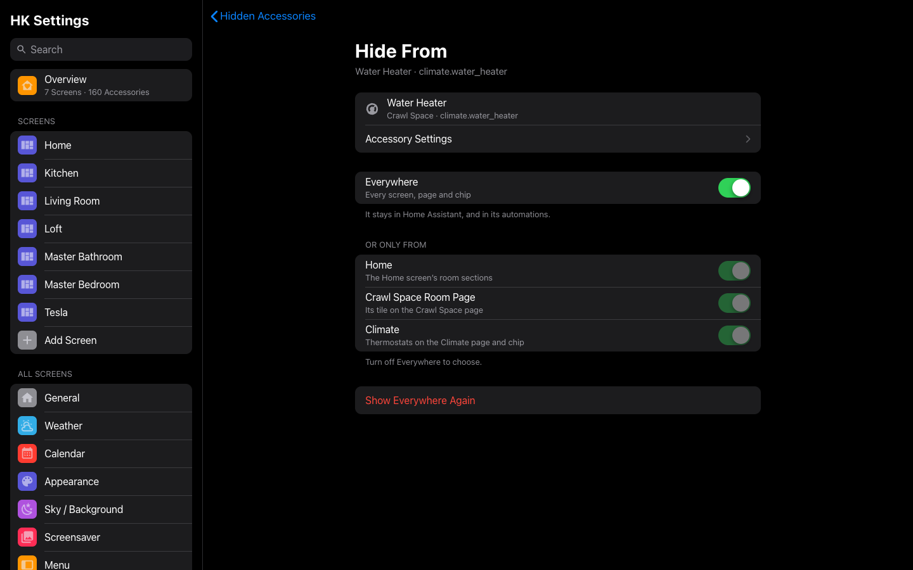
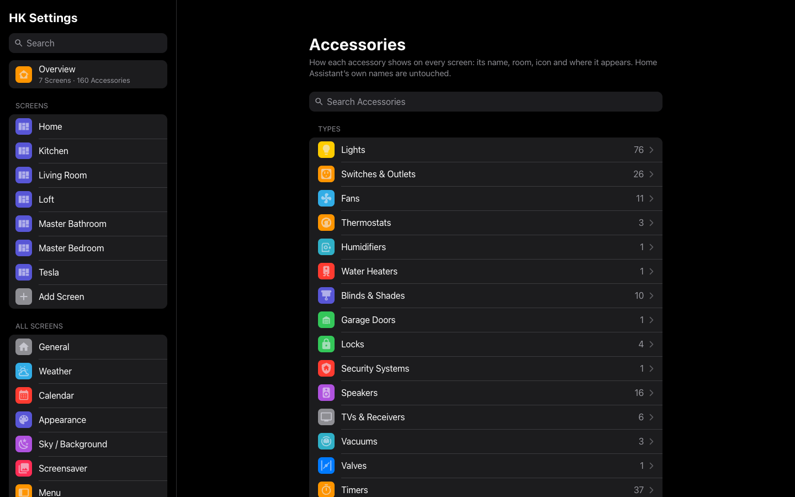

# Accessories

How one accessory shows up on every screen: its name, room, icon, what its
states are called, and where it appears. These don’t change Home Assistant’s
own names or icons (only the room is Home Assistant’s own), so voice assistants
and other dashboards are untouched.

There are two ways in, to the same settings:

- **On a screen**: open the accessory’s detail sheet and tap the **gear**
  beside the close button. Tap it again (a check mark) when you are done. The
  gear is there for administrators only, and not on a camera sheet or a sheet
  of several accessories.
- **In HK Settings**: **Library → Accessories**, then its type or its room
  (or search).

Everything saves as you change it and reaches every screen; a generated screen
redraws within about ten seconds. Each setting and its default:
[Accessories](#accessories-settings).

## Name and room

- **Name**: the name on its tiles and sheet, short and room-relative like the
  Home app’s: “Lamp”, not “Living Room Lamp”. Empty: the entity’s name with its
  room’s name dropped.
- **Only on this dashboard** (on a screen’s sheet): the name is this screen’s
  alone.
- **Room**: Home Assistant’s own area for the entity. Choosing the device’s
  area goes back to following the device.

On Doors & Windows each tile shows its room above its name; on Security and
Climate the room goes in front of a name you give it (“Hallway Thermostat”).

## Show as

For switches, lights and input booleans: **Light**, **Switch**, **Outlet** or
**Fan**. It sets the tile, the glyph, and which chip counts it: a lamp on a
smart plug shown as a Light is counted by the Lights chip; a coffee maker shown
as an Outlet isn’t.

## Tile size

**Automatic**, **Regular** or **Tall**: the height of its tile on a generated
screen’s rooms, room pages and category pages. Automatic is what its kind is
drawn as — a pill for a light, a tall tile for a lock, a thermostat, a garage
door or a vacuum. Tall makes any accessory a tall tile (a lamp you reach for
most), Regular makes a lock or a thermostat a pill. The tiles around it move
to make room. A favorite keeps the favorites’ one height.

## Arrange

*Opened from a tile on a generated screen.* **Move Left** and **Move Right**
move the tile one place among the tiles it sits with, under a small copy of
them laid out as the screen shows them, with this one picked out. Left and
right go in reading order, so moving right from the end of a row puts it at
the start of the next. A line underneath says what it moves among:

- On **Home**: the tiles in its room’s section.
- On a **room page**: its group there (the lights, the speakers and TVs…).
- In **Favorites**: the favorites on this screen only.

Home and room pages share the room’s **Tile Order**, on every screen: the
first move saves the room’s current order as its own, and its Tile Order
(in [Rooms](Rooms.md#a-rooms-settings)) then says Custom. Each tap saves; the
screen shows the new order when the sheet closes. Arrange isn’t shown when
there’s nothing to move it past, or on pages like Lights that follow each
room’s order.

## What it says

For switches and input booleans: what its states are called, **When on** and
**When off**, on its tiles and as a favorite. For example “Blocked” and
“Allowed” for a switch that blocks a game console. Whether it looks lit still
follows its state.

## Icon

A glyph for its tiles and sheet. It first offers the ones that suit what it
is: Apple’s Home glyphs for that kind of accessory (a ceiling fan, a desk fan
and an air purifier for a fan; curtains, a Roman shade and a skylight for a
shade). A door or window sensor’s glyph comes as an open and a shut pair.

**Search all icons** finds any glyph by name, then any of Home Assistant’s
Material Design icons by name or keyword (“burger” finds the hamburger). A
Material icon with an Apple glyph of the same name is drawn as the Apple one.

## Spinning

*For a fan, or something drawn as one.* Whether its tile’s glyph turns while
it is on. A fan’s glyph spins by default, but a chosen icon isn’t always one
that reads as a fan — a ceiling fan does, a purifier doesn’t. **Automatic**
keeps its kind (a fan spins, anything else doesn’t), **Spin** makes it turn,
**Still** keeps it still. It only turns while the fan is on, and never with
the sky’s **Animations** off ([Live Sky](Live-Sky.md#choose-its-look)); a favorite’s
glyph keeps the favorites’ still, one-height look. It is set in the accessory’s
settings (the gear on its sheet), not with the fan’s own controls.

## Where it shows

- **Show in HK Frontend**: off, it is hidden everywhere: every generated
  screen, page and chip. It stays in Home Assistant and its automations.
- Then a switch for each place it shows, to hide it from just that one: **Home**
  (the Home screen’s room sections), **Room Page** (its tile on its own room’s
  page), and the pages and chips of its kinds — **Climate** for a thermostat
  (the Climate page and chip), **Lights**, **Security** for a lock, **Water**
  for a leak sensor, and so on. Only the places it can be in are listed. Off
  in one place, it still shows everywhere else: off Home, it keeps its room
  page and the category pages, as in the Home app.
- **Favorite on this dashboard** (on a generated screen’s sheet): adds it to,
  or removes it from, this screen’s Favorites.

These are the same settings as its row in
[Hidden Accessories](#hidden-accessories), which lists anything turned off
here, and where.

## Also Count As

A switch for each kind it isn’t found in by itself but could be counted in: a
switch as **Lights**, **Fans** or **Valves**, a camera that hears the smoke
alarm as **Smoke & CO**, a temperature sensor as **Temperature** (a reading,
only for what reports one). On, it is counted there too — by that kind’s chip,
its page and its status row — on every screen. Turning it off is how it
leaves a kind it was only added to. Shown only when there is a kind it could
join. Its type’s page in [Accessories](#types) lists it in its room, marked
**Added**.

A group helper (“Motion - Kitchen”) is never counted by itself, since what is
in it would count twice, but it can be added: its Also Count As offers the
kinds it could join, and so does **Add…** on the type’s page.

## As a favorite

Shown for something that is a favorite on any screen:

- **Name**, **Room** and glyph as a favorite, on the Favorites row of every
  screen where it is one. **Room** is for something with no area of its own,
  such as a helper.
- **Together with** (lights, switches and input booleans): up to eight more it
  controls as one favorite. “Main + Table Lights” turns both on and off, is lit
  while either is, and shows their brightness.

## Color

One color for the accessory, everywhere it appears: its tile on its room’s
page, on Home and on category pages like Lights, its favorite, its chip, and —
for a scene, script or button — its button in the **Scenes** row. A tile or
favorite shows it as the Home app does: the glyph in that color while off, a
circle of it behind a white glyph while on. A scene’s button shows the glyph in
that color, and the circle when you tap it (or while a script runs). **Auto**
keeps the color of its kind (lights yellow, fans blue …); a scene’s is plain
white.

## As a chip

For an accessory shown as a chip: **Show only when it is** (a state),
**Shows** (its state or one of its attributes) and **Label** (words to show
instead).

## Reset to Automatic

Clears every setting of the accessory and this screen’s name for it. The room,
other screens’ names and favorites stay.

A YAML dashboard’s tiles keep the names and glyphs written in its YAML; its
detail sheets use these settings.

## Types

**HK Settings → Library → Accessories** starts with your accessories by
type:

- **Types**: **Lights**, **Switches & Outlets**, **Fans**, **Thermostats**,
  **Humidifiers**, **Water Heaters**, **Blinds & Shades**, **Garage Doors**,
  **Locks**, **Security Systems**, **Speakers**, **TVs & Receivers**,
  **Vacuums**, **Valves**, **Timers**, **Cameras** and **Circuits & Meters**.
- **Sensors**: **Doors**, **Windows**, **Smoke & CO**, **Leak Sensors**,
  **Motion**, **Occupancy**, **Temperature** and **Humidity**.

Only the types your home has are listed, each with how many. Then come
**Rooms**, and **Hidden & Added**: [Hidden Accessories](#hidden-accessories)
and [Added Accessories](#added-accessories).

A type’s page lists its accessories room by room. Tap one for its settings.
For a type a chip or a page counts (Lights, Locks, Doors, Temperature…), the
list is what that chip and page count, the same on every screen — what used to
be a page of its own, **What Counts** ([what each one finds](Status-Chips.md#what-counts));
its old links open the type’s page:

- **Hidden** beside one: it is hidden from this type’s page and chip. Tap it to
  change [where it shows](#where-it-shows).
- **Added** beside one: counted though it isn’t found by itself, with its
  [Also Count As](#also-count-as).
- **Added → Add…**: count something more as this type — an outlet with a
  lamp, a group helper. It joins its room above, marked **Added**.
- **Hidden → Hidden Everywhere**: how many of this type are on no screen at
  all. It opens [Hidden Accessories](#hidden-accessories).
- **Hidden → Show All on (the page) Again…** (*Show All on Climate Again…* for
  Thermostats): opens what is hidden from that page, where **Show All
  Again…** shows everything it finds again. What was added stays.
- **Order → Tile Order**: *Locks, Garage Doors and Vacuums*
  ([below](#tile-order-for-locks-garage-doors-and-vacuums)).
- **Chips**: the [status chips](Status-Chips.md) that count this type (Lights
  for lights, Doors & Windows for doors, windows and garage doors…), each with
  where it shows (“Always on 6 · When Active on 1”). Tap one for that chip’s
  page under **All Screens → Status Chips**, which sets it for every screen at
  once ([Status Chips settings](Status-Chips.md#status-chips-settings)). Smoke
  & CO says it leads every screen’s row when an alarm goes off.

*Accessories → Lights: what the Lights page and chip count, room by room.*

**Add…** (and **Hide Accessories…**) use the picker every page shares: search
by name, entity ID or room, the choices under their rooms, tick several at
once ([HK Settings](HK-Settings.md#how-the-controls-behave)).

A few types point elsewhere for their settings: **Security Systems** to
General’s **Alarm Panel** (which alarm the Security page and chip follow),
**Cameras** to **Cameras Settings** ([Cameras](Cameras.md)), and **Circuits &
Meters** — the [Energy](Energy.md) page’s circuits, plugs and meters, listed by
section — to **Energy Devices** and **Energy Page**.

A room’s page in Accessories is the other way round: its accessories grouped
by type.

## Tile Order for Locks, Garage Doors and Vacuums

Pages that mix rooms list things A to Z. Two pages can have an order of your
own, under **Order → Tile Order** on the type’s page in
**HK Settings → Library → Accessories** (it was called Page Order):

- **Vacuums**: the order of the vacuums on the Vacuums page.
- **Locks** and **Garage Doors**: the order of the locks and garage doors on
  the Security page — one order, from either type (automatic: the locks A to
  Z, then the garage doors), so you can list them the way you think of them:
  Front Door, Garage Door, Back Door.

## Added Accessories

**HK Settings → Library → Accessories → Added Accessories** (it was called
Also Shown). Tiles for things HK Frontend doesn’t show by itself: a script, a
scene, a sensor. Each one gets a tile in its room on Home and on its room’s
page, or in a section called **More** at the end of Home when it has no room.
**Add…** offers only what isn’t an accessory already; remove one to take its
tile away. It stays in Home Assistant. [Hidden Accessories](#hidden-accessories)
is the other way.

## Hidden Accessories

**HK Settings → Library → Accessories → Hidden Accessories.** One list of
everything kept off your screens, and where. Each one stays in Home Assistant,
and in its automations.

- **Accessories**: each hidden accessory, with its room and entity ID, and on
  the right where it is hidden: *Everywhere*, or the places, such as
  *Climate* or *Home, Lights*. Tap one to change where it is hidden, or to
  **Show Everywhere Again**.
- **Whole Devices**: a device hidden with all its accessories, one row each.
- **Whole Rooms**: a hidden room. It opens the room’s settings, where a room is
  hidden and shown again (**Show on Screens**, in
  [Rooms](Rooms.md#a-rooms-settings)).
- **By Page**: each page or chip with something hidden from it, and how many.
  Its page lists them, and **Show All Again…** shows everything that page finds
  again. What was added with [Also Count As](#also-count-as) stays.
- **No Longer in Home Assistant**: hidden once, then removed from Home
  Assistant. **Clear These** forgets them.
- **Just Now**, at the top: what you just changed, until you leave the page.

**Show** narrows the list to **Everywhere** or **Some Places**, and **Search
Hidden** finds one by name, entity ID, room or place.

To hide something:

1. Select **Hide Accessories…**.
2. Tick one or several (search finds them by name, entity ID or room), or
   switch to **Whole Devices** and tick devices. Select **Next**.
3. In **Hide From**, leave **Everywhere** on, or turn it off and choose under
   **Or Only From**. With several picked, a place only some of them have says
   so: *applies to 2 of 3*. A whole device is always hidden everywhere.
4. Select **Hide**.

A row’s **Hide From** is the same page; each switch saves as you change it.

The same switches are on the accessory itself, under
[Where it shows](#where-it-shows).

| Place | Hides it from |
|---|---|
| Everywhere | Every generated screen, page and chip |
| Home | The Home screen’s room sections |
| Room Page | Its tile on its own room’s page |
| Climate | Thermostats on the Climate page and chip |
| Lights | The Lights page and chip |
| Security | Locks on the Security page and chip |
| Water | Leak sensors on the Water page and chip |
| Doors, Windows | The Doors & Windows page and chip |
| Garage | The Security page and the Doors & Windows chip |
| Blinds | The Blinds chip and the Climate page |
| Fans | The Climate page and chip |
| Valves | The Water page |
| Smoke & CO | The Smoke & CO chip |
| Timers, Vacuums | Their pages and chips |
| Speakers | The Speakers chip |
| Temperature, Humidity | The Climate page’s ranges |
| Motion, Occupancy | The rooms with motion, or with someone in them, on status rows |

Only the places an accessory can be in are offered. A water heater that
shows up as a thermostat, for example, can be hidden from **Climate** alone:
it leaves the Climate page and chip and keeps its tile in its room. A kind it
was only added to with Also Count As isn’t a place to hide it from; turn
Also Count As off instead.

## Accessories settings

**Library → Accessories.** How each accessory shows up on every screen: its
name, room, icon and where it appears. Home Assistant’s own names and icons
are untouched.

| Setting | Default | What it does |
|---|---|---|
| Search Accessories | — | Find an accessory by name, entity ID or room; each result shows its entity ID beside its room. It also finds the sensors a chip could count, so their pages (with [Also Count As](#also-count-as)) can be opened. |
| Types | — | Each type your home has, with how many: its accessories room by room, what its page and chip count, and what is hidden from it or added to it. See [Types](#types). |
| Sensors | — | Doors, Windows, Smoke & CO, Leak Sensors, Motion, Occupancy, Temperature and Humidity: what the chips and status rows count. |
| Rooms | — | Every room with accessories, then Timers and No Room. |
| Hidden & Added → Hidden Accessories | None | Every hidden accessory and where it is hidden: everywhere, or just from some places (Home, its room’s page, the Climate page…). See [Hidden Accessories](#hidden-accessories). |
| Hidden & Added → Added Accessories | None | Tiles for things a generated screen wouldn’t show by itself: scripts, scenes, sensors. Each appears in its room, or in a section called **More** at the end of Home if it has no room. See [Added Accessories](#added-accessories). |
| Tapping an Accessory → HK Detail Sheets | On | Tapping an accessory’s name opens a Home app–style [detail sheet](Detail-Sheets-and-Popups.md) (a slider, the thermostat, the player, a graph), on every screen. Off: Home Assistant’s own more-info dialog. Either way, locks, the alarm, garage doors and thermostats never change from a single tap. A card keeps Home Assistant’s dialog with `detail: false` in its YAML. |

A type’s page:

| Setting | Default | What it does |
|---|---|---|
| Its accessories, by room | — | Each one in its room. **Hidden**: hidden from this type’s page and chip. **Added**: counted though it isn’t found by itself. Tap one for its settings. |
| Added → Add… | — | *Types a chip or page counts.* Count something more as this type (an outlet with a lamp, a group helper), with its [Also Count As](#also-count-as). |
| Chips | — | *Types a chip counts.* Each chip that counts it, with where it shows; opens that chip’s page in **All Screens → Status Chips** (Always or When Active, for every screen). |
| Hidden → Hidden Everywhere | — | *Shown when some are hidden everywhere.* How many; opens [Hidden Accessories](#hidden-accessories). |
| Hidden → Show All on (the page) Again… | — | *Shown when some are hidden from its page.* Opens what is hidden from it, with **Show All Again…**. |
| Order → Tile Order | Automatic | *Locks, Garage Doors and Vacuums.* The order of the Security or Vacuums page’s tiles, on every screen. See [Tile Order](#tile-order-for-locks-garage-doors-and-vacuums). |

A room’s page lists its accessories grouped by type, with **Room Settings** to
open that room’s own settings in [Rooms](Rooms.md#a-rooms-settings): its scenes, tile
order, whether it shows and what it’s part of.

An accessory’s page holds the same settings as the gear on its
[detail sheet](Detail-Sheets-and-Popups.md) (below):

| Setting | Default | What it does |
|---|---|---|
| Name | The entity’s name, less its room’s | The name on its tiles and sheet on every screen (“Lamp”, not “Living Room Lamp”). |
| Only on this dashboard | Off | *On a dashboard’s sheet only.* The name above is this dashboard’s alone. Turning it off shows the house-wide name again. |
| Room | Its area | Home Assistant’s own area for the entity: the one setting here that changes Home Assistant. Choosing the device’s area goes back to following the device. |
| Show as | Automatic | *Switches, lights and input booleans.* **Light**, **Switch**, **Outlet** or **Fan**: the tile it gets, its glyph, and which chip counts it (a lamp on an outlet counts as a light; a coffee maker doesn’t). |
| Tile size | Automatic | **Regular** or **Tall**: its tile’s height on generated screens, over what its kind is drawn as. Favorites keep their one height. |
| What it says → When on · When off | On · Off | *Switches and input booleans.* What its states are called on its tiles and as a favorite (“Blocked” and “Allowed” for a switch that blocks a game). Whether it is lit still follows its state. |
| Icon | Auto | A glyph offered by what it is, or any glyph or Material Design icon found with **Search all icons**. A door or window sensor’s glyph comes as an open and shut pair. |
| Spinning | Automatic | *Shown for a fan, or something drawn as one.* **Spin** or **Still**: whether its tile’s glyph turns while it is on. Automatic is its kind (a fan spins, anything else doesn’t). |
| Where it shows → Show in HK Frontend | On | Off: hidden everywhere — every generated screen, page and chip. The same as hiding it Everywhere in [Hidden Accessories](#hidden-accessories). |
| Where it shows → each place | On | One switch per place it can be in: **Home**, **Room Page** (its tile on its own room’s page) and the pages and chips of its kinds (**Climate**, **Lights**, **Security**…). Off: hidden from just that place. See [Where it shows](#where-it-shows). |
| Also Count As | Off | *Shown when there is a kind it could join.* One switch per kind it isn’t found in by itself (a switch as Lights, Fans or Valves; a camera’s alarm as Smoke & CO; a temperature sensor as Temperature). On: counted there too, on every screen. |
| Favorite on this dashboard | Off | *On a generated screen’s sheet only.* Adds it to, or takes it off, this screen’s Favorites. |
| As a favorite → Name · Room · glyph · Together with | Its own | *Shown for a favorite.* Its name, the room line above it and its glyph on the Favorites row of every screen where it is a favorite. **Room** is for something with no area of its own (a helper). **Together with** (lights, switches and input booleans): up to 8 more it controls as one favorite (“Main + Table Lights”). |
| Color | Auto | White, Yellow, Orange, Red, Pink, Purple, Blue, Teal, Mint or Green: its color everywhere it appears — its tiles on every page, its favorite, its chip and its button in the Scenes row. Auto: its kind’s color (a scene’s: white). |
| Show only when it is | Any state | *Shown for an accessory chip.* The chip appears only in this state. |
| Shows | Its state | *Shown for an accessory chip.* One of its attributes instead of its state. |
| Label | What it shows | *Shown for an accessory chip.* Words to show instead. |
| Reset to Automatic | — | Asks first. Clears every setting above and this dashboard’s name. The room, other dashboards’ names and favorites stay. |

A YAML screen’s tiles keep their own YAML names and glyphs; its detail sheets
use these.
