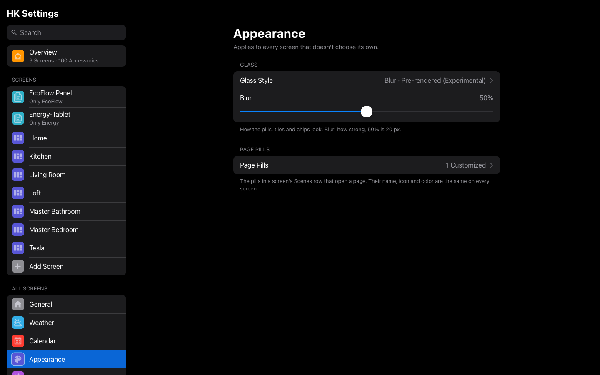
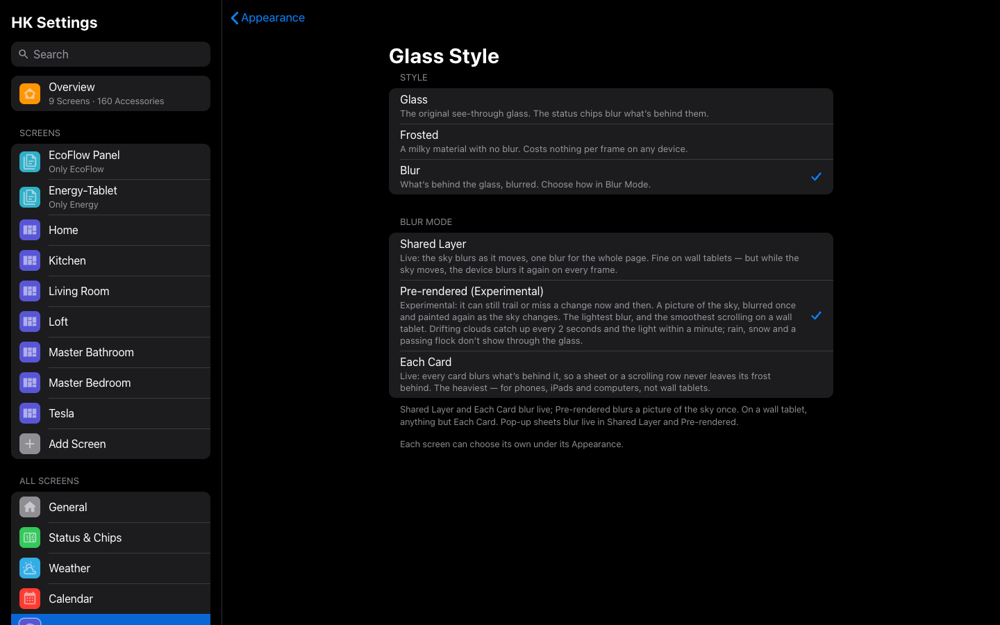
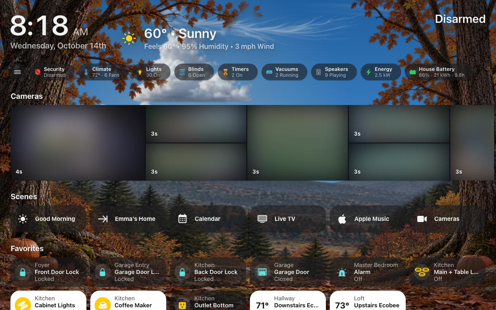
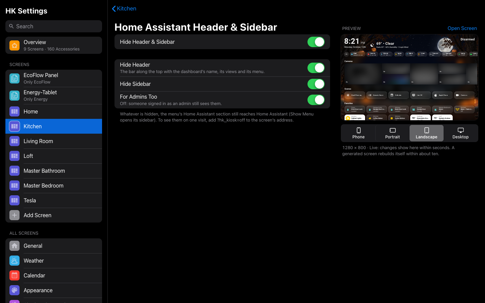

# Appearance

How the glass looks, for every screen and for one screen, and whether Home
Assistant’s header and sidebar show.

## Every screen

**All Screens → Appearance.** How the glass looks on every screen that doesn’t
choose its own. Under Appearance Style, one line names the screens that have
their own look (each a link to it), since a change here doesn’t reach them.

| Setting | Default | What it does |
|---|---|---|
| Glass Style | Glass | How pills, tiles, chips, scenes and keypads look: **Glass**, the original see-through glass, with the status chips and the round menu button beside them blurring what’s behind them. **Frosted**, a milky material with no blur: it costs nothing per frame on any device. **Tinted**, the Home app’s look: a flat dark plate with no blur anywhere on the page, the lightest on any device — see [Tinted](#tinted) below. **Blur**, what’s behind the glass blurred — choose how with **Blur Mode**. |
| Blur Mode | Shared Layer | Shown when the Glass Style is Blur: **Shared Layer**, **Pre-rendered (Experimental)** or **Each Card**. What each costs and can’t do: [Blur Mode](#blur-mode) below. |
| Frost | 50% | Shown when the Glass Style is Frosted. How milky it is, 0 to 100%. |
| Tint from Background | Off | Shown when the Glass Style is Frosted. On: each card's frost takes the color of the page behind it (the sky at the card's height, the scenery's ground lower down) instead of one gray, at one darkness so white text reads the same on every page. It changes with the live sky through the day. Cards in pop-ups, the screensaver and Music (album art) keep the gray. Costs nothing per frame. |
| Blur | 50% | Shown when the Glass Style is Blur, in any Blur Mode. How strong the blur is, 0 to 100%: 50% is 20 px, 100% is 40 px. |
| Darkness | 50% | Shown when the Glass Style is Tinted. How much of the background shows through an off card: 0% is 40% dark, 50% is 75%, 100% is 90%. |
| Icon Circles | Dark | Shown when the Glass Style is Tinted. **Dark**, as the Home app draws the circle behind an off accessory’s icon, or **Light**, which keeps its shape over dark scenery. |
| Page Pills | Default | Every page pill: the pills in a screen’s Scenes row that open a page. Tap one to set its name, icon and color, the same on every screen ([Home Page](Home-Page.md#scenes-and-page-pills)). |

*All Screens → Appearance → Glass Style: the four styles, and with Blur chosen, its Blur Mode below.*

The four styles side by side:

| Style | What blurs | What it costs | Best for |
|---|---|---|---|
| **Glass** (the default) | Only the status chips and the round menu button | Little | Most screens |
| **Frosted** | Nothing: a milky plate | Nothing per frame | Any device; the plate can take the page's color (**Tint from Background**) |
| **Tinted** | Nothing on the page: the Home app's flat dark plate | The least of all | A slow wall tablet, or anyone who wants the Home app's look |
| **Blur** | Whatever is behind the glass, made as **Blur Mode** says | From light (Pre-rendered) to the heaviest (Each Card) | The see-through look; see [Blur Mode](#blur-mode) |

### Blur Mode

With the Glass Style on **Blur**, **Blur Mode** chooses how the blur is
made. All three look alike standing still; they differ in what they cost
and what they show while things move.

| Mode | Good at | Gives up | Best for |
|---|---|---|---|
| **Shared Layer** (the default) | Live: the sky blurs as it moves, drifting clouds and rain included. One blur for the whole page, so a wall tablet keeps its frame rate standing still. | While the sky moves, the device blurs it again on every frame, and scrolling pays for it. Something fixed over the page that blurs live — the Now Playing bar — adds to it. | Most screens; wall tablets that rarely scroll. |
| **Pre-rendered (Experimental)** | A picture of the sky, blurred once, behind every card. The lightest blur: almost nothing per frame, so scrolling stays smooth on a wall tablet even with the bar up. | Motion that doesn’t drift across the sky — rain, a passing flock, a flicker — doesn’t show through the glass. The picture is painted again as the sky changes: at once for a new page, size, weather, season or song; every 2 seconds while clouds drift (a little work each time, never while a finger is on the page or it scrolls); and as the light changes. It can still trail the sky a moment or briefly not match it, which is why it is marked Experimental. Pop-up sheets and pages with no sky blur live, as in Shared Layer. | Wall tablets, especially ones that scroll or show the Now Playing bar. |
| **Each Card** | Live, and every surface blurs exactly what is behind it, so a sliding sheet or a scrolling row never leaves its frost behind. | The heaviest by far: one blur per card (over a hundred on a typical Home). | Phones, iPads and computers, not wall tablets. |

Scrolling Home on a wall tablet (a Samsung Galaxy Tab A9+, sky animations
on), measured for 1.7:

| Mode | Bar off | With the Now Playing bar |
|---|---|---|
| Pre-rendered | 59 frames a second, 1.5% of frames late | 59, 1.8% late |
| Shared Layer | 58, 3.6% late | 54.5, 10.3% late |
| Each Card | 32, 72% late | 28, 83% late |

Standing still, every mode is close to 60 frames a second; on these tablets
most of the work is the animated sky itself, whatever the glass. Glass and
Frosted scroll about as smoothly as Pre-rendered, and Tinted, with nothing
on the page blurring at all, is lighter still.

A screen or All Screens set to **Baked**, a mode tried before 1.7 and taken
out, now uses Pre-rendered.

### Tinted

*Home in the Tinted look.*

**Tinted** draws every card the way the Home app does: a flat, dark,
see-through plate, opaque white when the accessory is on, and a tight shadow
right under the edge instead of a soft glow. Nothing on the page blurs: no
shared layer, no picture of the sky, no card blurring itself. The status
chips, the menu’s edge tab and the round menu button are Tinted plates too,
and the menu panel and the tab bar (set to **Same as Screen**) are near-solid.

The Home app’s plate blurs the wallpaper behind it, so it can stay light.
Tinted doesn’t, so the scenery shows through sharply, and it is darker to make
up for it. Choose how dark with **Darkness**.

Detail sheets, pop-ups and notifications still blur what is behind them while
they are open, as the Home app’s do. Cards inside a sheet get a lighter plate,
so they never turn into dark holes on the dark sheet.

A card can stay out of the shared blur with `glass: false`. Whether tapping an
accessory opens an HK detail sheet is **HK Detail Sheets**, under
[Library → Accessories](Accessories.md#accessories-settings).

## One screen

**Screens → (a screen) → Appearance.**

| Setting | Default | What it does |
|---|---|---|
| Glass Style | Same as All Screens | **Same as All Screens** (the row says *Same as All Screens* under its name, and the glass it follows, *Glass*), or under **Just This Screen** **Glass**, **Frosted**, **Tinted** or **Blur** — and with Blur, its **Blur Mode**: **Shared Layer**, **Pre-rendered (Experimental)** or **Each Card**. See [Appearance](#every-screen) for what each looks like and costs. |
| Frost / Blur / Darkness | Same as All Screens | Shown for the amount this screen’s glass uses. Moving it gives this screen its own amount. |
| Icon Circles | Same as All Screens | Shown when this screen uses Tinted. Choosing one gives this screen its own; **Reset to All Screens** goes back to following All Screens. |
| Reset to All Screens (50%) | — | Shown once the screen has its own amount, with All Screens’ amount. Goes back to following All Screens. |
| Tint from Background | Same as All Screens | Shown when this screen uses Frosted. Turning it on or off gives this screen its own; **Reset to All Screens** goes back to following All Screens. |
| Sky / Background | Same as All Screens | The screen’s [Sky / Background](Live-Sky.md#the-background) page, which starts with its **Background**: **Live Sky**, **Color**, **Photo** or **Landscapes**, Same as All Screens until changed. With the Live Sky, its own **Moving Things**, **Pause When Not in Focus**, **Rain & Snow**, Clouds and the rest are there too, each Same as All Screens until changed. Reads **Black** for a screen whose Live Sky was turned off before (it shows Black; any choice there turns it back on). A YAML screen shows the Background wherever its YAML puts the sky. |

## Home Assistant header & sidebar

**Screens → (a screen) → Header → Home Assistant Header & Sidebar.** Whether
Home Assistant’s own header and sidebar show around the screen. The row reads
**Off**, **Both Hidden**, **Header Hidden**, **Sidebar Hidden** or **Kiosk
Mode Plugin**.

| Setting | Default | What it does |
|---|---|---|
| Hide Header & Sidebar | Off (Wall Tablet, Car and Energy Display presets: on) | The whole window is the screen. HK Frontend does it itself, on any screen, an existing dashboard too. The menu’s Home Assistant section still reaches Home Assistant (Show Menu). The settings below show only while it is on. |
| Hide Header | On | Hides Home Assistant’s header: the bar with the dashboard’s name, its views and its menu. |
| Hide Sidebar | On | Hides Home Assistant’s sidebar. |
| For Admins Too | On | Off: someone signed in as an admin still sees them. |
| Use the Kiosk Mode Plugin Instead | Off | *A generated screen, where [Kiosk Mode](https://github.com/NemesisRE/kiosk-mode) is installed from HACS.* The plugin hides them instead, with its own **Kiosk Mode Options**: Hide Header, Hide Sidebar, Show Header for Admins, and any other of its options in YAML. A screen that had Kiosk Mode Options of its own before 1.3 moves over to these settings when they can say the same (hiding the header, the sidebar, and admins seeing both), and otherwise keeps the plugin. |

Leaving the screen, for Settings say, always brings them back. `?hk_kiosk=off`
on a screen’s address shows them until the page is reloaded (a tablet you are
working on).
