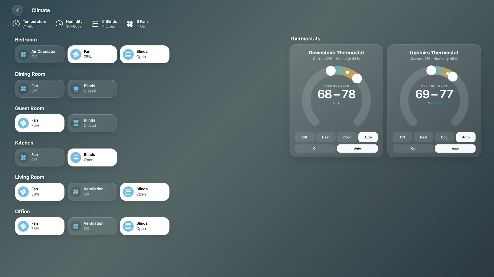
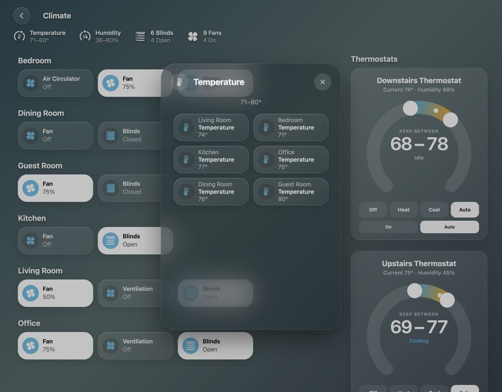
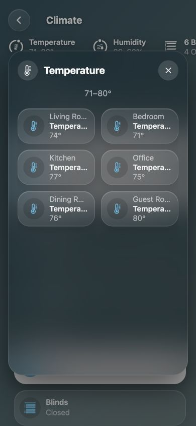
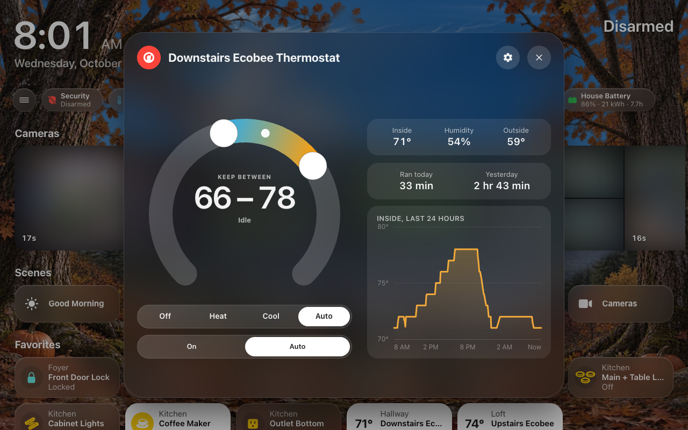
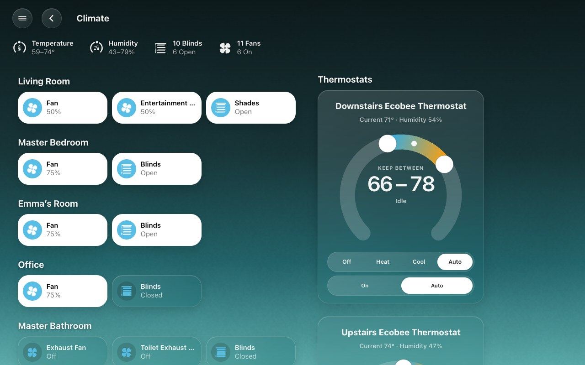

# Climate

Open **Climate** from the menu or the Home page’s Climate chip. The status row
sits directly below the Climate heading, above the room accessories and
thermostats.

These screenshots use fictional rooms, devices and readings.

## The status row

The row uses the same summaries as a room page, across the included rooms:

| Summary | Shows |
|---|---|
| Temperature | The lowest and highest current temperatures, in Home Assistant’s configured temperature unit. Equal rounded endpoints become one value. |
| Humidity | The lowest and highest humidity readings. Equal rounded endpoints become one value. |
| Blinds | How many blinds participate, and whether they are open, closed or a mixture. |
| Fans | How many fans participate, and whether they are on, off or a mixture. |

A kind with no sources does not show. Choose the summaries and their order
in **HK Settings → Pages → Climate → Status Row**. Turning all four off
hides the row. The Lights, Doors & Windows, Water and Security pages have rows
of their own ([Status rows](Status-Rows.md)).

## Tap for the accessory list

Tap any summary to open a sheet of accessory pills. Each pill carries its room
and current reading or state. Even a summary with only one source opens this
list.

Tap a pill to open that accessory’s controls or sensor details. **Back to
Temperature** (or the category you opened), closing the accessory sheet, or
browser Back returns to the category list. Closing the category returns to
Climate. Escape and the backdrop also dismiss a sheet. Left alone, an accessory
opened from a category closes together with the category.

The summary and its open list update as readings and membership change. An
unavailable reading stays in the list, labeled **Unavailable**, and does not
affect the range. If every reading is unavailable, the summary says so.

## Choose the sources

Automatic temperature and humidity discovery uses the sensors selected in
**Home Assistant → Settings → Areas → (the area) → Related sensors**. When
an area has no designated sensor for a reading, its thermostat’s **current**
reading is used instead. Target temperatures are never range readings.
Unrelated equipment and diagnostic sensors are not pulled in just because
they report temperature or humidity.

To adjust individual sources, change the source itself. To drop one, hide it
from **Temperature** or **Humidity** in **HK Settings → Library → Accessories
→ Hidden Accessories** ([Hidden Accessories](Accessories.md#hidden-accessories)).
To add a compatible sensor that isn’t found, turn on its **Also Count As →
Temperature** or **Humidity** on its own settings page
([Also Count As](Accessories.md#also-count-as)), or tap **Add…** on its type’s
page. **By Page → Temperature → Show All Again…** brings back everything
automatic discovery finds. **Accessories → Temperature** or **Humidity** (under
Sensors) lists what is counted now, room by room ([Types](Accessories.md#types)).

Fans and blinds follow what **Accessories → Fans / Blinds & Shades** count,
including any switches counted as fans. Anything hidden everywhere stays off
the page.

The thermostats on the page are the ones **Accessories → Thermostats** lists.
To keep one off the Climate page and chip but in its room (a water heater, for
example), hide it from **Climate** alone in Hidden Accessories, or turn off
**Climate** under its **Where it shows**.

To leave an entire area out of the Climate summaries, uncheck it in
**Pages → Climate → Status Row → Rooms**. This is useful for outdoor areas, an attic
or equipment spaces. It affects the Climate summary row and its lists; it
does not hide that area’s accessories from the rest of the dashboard.

## The dial

Each thermostat is a dial, as in the Home app: the current temperature, the
target and the mode buttons under it. Drag the dot around the dial, with a
finger or the mouse, to set the target: the dot and its colored band follow
you as you drag, and the number changes with them. A thermostat set to heat
and cool has two dots, one for each setpoint, and they never cross. Let go
and the thermostat is set; the dot stays where you put it while the
thermostat catches up, and a reading that arrives in the meantime doesn't
snap it back. The same dial is on the thermostat's detail sheet, and on a
water heater's.

*A thermostat's sheet: drag the dot to set the target.*

A water heater on the page has the same dial with its own controls, as on its
sheet: **Heat to** its setpoint, its own operation modes (Eco, Electric, Heat
Pump…) with **Off** first where it can be turned off, and **Home** / **Away**
when it has an away mode. It no longer shows a thermostat’s Off, Heat, Cool
and Auto.

## Thermostat layout

The rooms take only the width their busiest room needs — two to four pills
across — and the thermostats sit right beside them, as many dials across as
fit, with any spare width at the right as on every other page. On narrower
pages the rooms give way first and the dials stack. On a phone the room
accessories and thermostat section also stack, with no horizontal page
overflow. The Thermostats heading stays aligned with the first dial at every
width.

After updating HK Frontend, restart Home Assistant and reload each dashboard
to load the new source discovery and frontend files.
