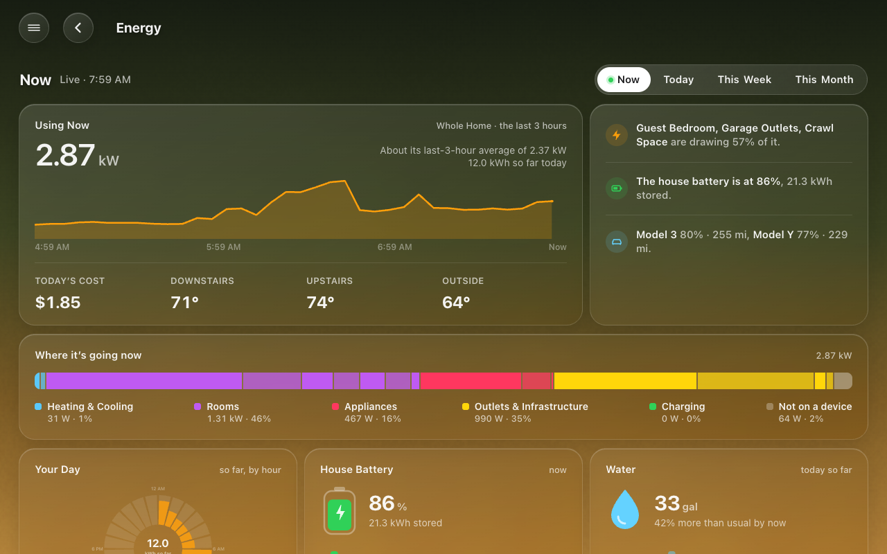
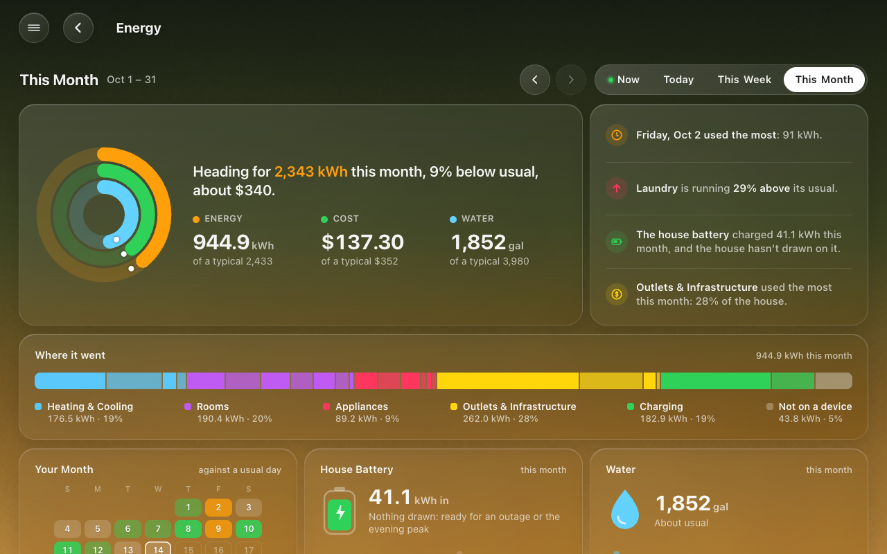
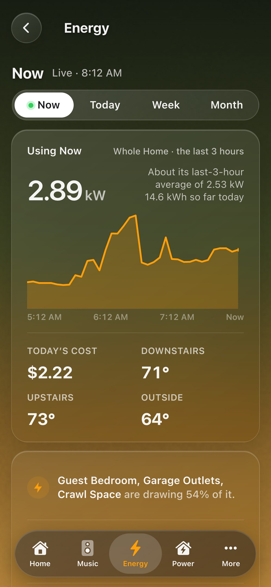
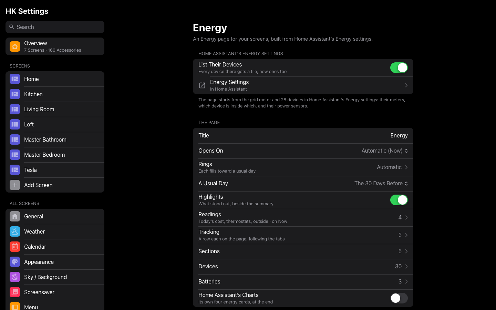

# Energy

An Energy page for your screens, built from Home Assistant’s own Energy
settings.

The page has four tabs, **Now**, **Today**, **This Week** and **This Month**,
which float at the top as you scroll, and every card keeps its size and place
on all four:

- **Now is power.** The whole home’s watts and its last three hours, your
  readings (today’s cost, thermostats, outside), what is drawing the most,
  the house battery and the cars.
- **Today, This Week and This Month are energy**, from Home Assistant’s
  statistics: the same numbers as its own Energy dashboard.
  - **Rings** fill toward a usual day (energy, cost, and solar, water or gas
    where you have them), with a sentence saying where the period is heading.
  - **Highlights**: the busiest hour or day, a device or AC running well off
    its usual, the battery, the section that used the most.
- **Where it went** (or, on Now, **where it’s going**): one bar of the
  house’s energy by section, and what is not on a device. Tap a section to
  light it on the whole page.
- **Your Day, Your Week, Your Month**: the day as a clock, the week as bars
  against a usual day (stacked by section), the month as a calendar in five
  steps from well below usual (green) to well above (red), with the period’s
  three figures under it. **Tap a day** on the calendar for that day: its kWh,
  cost and devices. With no battery or water beside it, the card widens and
  adds **Most Used**, every device in order.
- **The house battery** (its level, what it took in and gave back) and
  **water** (or gas, against a usual amount), each with the tab’s own bars.
- **Tracking**: the meters and runtimes you follow, a row each, with its
  figure and bars for the tab and how it compares with its usual.
- **A section of tiles for each group of devices** (Heating & Cooling, Rooms,
  Appliances, Outlets, Charging), each heading with its total. On Now a tile
  shows its watts and last three hours; on the other tabs its kWh, its last
  two weeks and how that compares with its usual. An AC with a runtime sensor
  also shows its hours (“Ran 1h 11m · ↓ 57%”).
- **A power button on a circuit's tile**, where there is something to switch
  (the device's **Switched By**, below): green while on, gray while off, the
  tile dimmed while it is off. Turning it on is one tap; turning it off asks
  first (“Turn off Office? Everything on this circuit loses power.”). A tile
  with nothing to switch has no button.

**Tap anything about one thing** and its sheet opens: a Tracking row its meter
or runtime, the battery's or water's level and meter, each ring's figure its
own meter or cost, a highlight what it is about, a Most Used row its device.

**This Week and This Month are the calendar week and month**: the week from
the first day of the week in your Home Assistant profile (Sunday for
English), the month from the 1st. Every day of the period has its place, so a
Monday shows Sunday's and today's bars and the days still to come in gray as
last week's same days. Everything is read against **the same point last
period**: on Tuesday at 6 PM, last Sunday to last Tuesday at 6 PM ("Last Week
by Now"). The rings fill toward a usual whole week or month, and a white dot on
each ring marks where a usual one would be by now: past the dot is above
usual. "Heading for" is what is used so far plus a usual day for each day
left; on the period's first morning the sentence says it has just started and
gives the last one's total. **‹ ›** beside the tabs step back through the
weeks (half a year) or months (a year), each one whole, against the one
before it; tap the tab again to come back to this week or month.

The graphs build when you open a tab: the rings sweep in like the Activity
rings, the bars rise, the bar grows from the left. **Reduce Motion** turns that
off. Once you scroll, the tabs float at the top of the page on a strip of
their own (in the [Tinted](Appearance.md#tinted) look a near-solid one, with no
blur); on a phone the strip is just the tabs.

*The Energy page on Now: power right now, with the tabs at the top.*

*This Month: the rings, and Your Month as a calendar. Tap a day for that day's use.*

| | |
|---|---|
|  |  |
| On a phone | **HK Settings → Features → Energy** |

## What it starts from

Everything comes from **Settings → Dashboards → Energy** in Home Assistant:

| From the Energy settings | On the page |
|---|---|
| The grid meter (kWh) and its price or cost | The Energy and Cost rings, Today’s Cost, Where it went |
| Solar, water, gas | Their rings (and water’s or gas’s card) |
| The house battery’s meters | The House Battery card |
| Each device’s meter | A tile’s kWh on Today, This Week and This Month |
| A device “inside” another (*Upstream device*) | Its sheet says *Part of*; the other’s sheet says *Includes* |
| A device’s power sensor | The tile’s live watts |
| The house battery’s level | A battery tile |

Most homes leave a device’s **power sensor** empty in the Energy settings, so
HK Frontend also looks for it:

1. The **Power Sensor** you pick for that device on HK Settings.
2. The device’s **power sensor** in Home Assistant’s Energy settings.
3. **The meter’s source.** A Utility Meter counts an Integral (Riemann sum)
   sensor, which integrates a power sensor. HK Frontend follows those helpers
   back to the watts.
4. **A power sensor on the same device**, such as a smart plug’s W beside its
   kWh (also on the device of the sensor a Utility Meter counts).

A device with none of these still gets a tile, showing its kWh today instead
of watts.

### Power and energy, kept apart

**Now** reads each device’s **power sensor** (watts). **Today, This Week and
This Month** read its **energy meter** (kWh), never watts added up. The sums are
Home Assistant’s:

- **What the house used** = from the grid − to the grid + solar + out of the
  battery − into the battery.
- **On a device** = the devices in Home Assistant’s Energy settings, less any
  marked as inside another. A device you add only here gets a tile but isn’t
  counted, as Home Assistant doesn’t count it either.
- **A usual day** is the average of the 30 days before today (or the 7 or 14
  you choose); for a past week or month, the days before it. Today is compared
  with the share of a usual day that has gone by, from yesterday’s own shape
  hour by hour.
- **A cost the statistics don't have** (a cost sensor that started over, or
  days before it existed) is priced at the grid meter's own rate from the
  other days, so no week or month shows a negative or a too-small cost.

What the Energy settings can’t say is guessed from each device’s name, and
every guess can be changed:

- **Its section.**
  - *Heating & Cooling*: an AC, air handler, heat pump or furnace.
  - *Charging*: a charger or wall connector.
  - *Outlets*: an outlet or plug.
  - *Rooms*: a name that is one of your areas (or two joined by “&”).
  - *Appliances*: everything else.
- **Its name.** “Office Utility” becomes “Office”: words like *Utility*,
  *Energy*, *Power* and *Consumption* at the end are dropped.
- **Its glyph and color.**

Cars are found by themselves: a battery level on a device that also reports
a range. They go into Charging, with their range under the level.

## Set it up

1. In Home Assistant, set up **Settings → Dashboards → Energy**: the grid and
   your devices. The more it lists, the less there is to do here.
2. Go to **Settings → Devices & services → HK Frontend → Add feature → Energy**.
3. Give a screen the page:
   - **Any generated screen.** With Automatic pages, Energy is included. With
     pages of its own, add **Energy** from **More** on its **Pages**. The
     Energy chip opens the page.
   - **A screen that is only the Energy page** (a page screen, see
     [Whole screens and page screens](Pages.md#whole-screens-and-page-screens)).
     In **HK Settings → Add Screen**, pick **Shown On → Energy Display**, or
     **Shows → Only the Energy Page**. It has no Home page, no menu, and Home
     Assistant’s header hidden. The same button is on the Energy settings
     page: **Add an Energy Display**.

## Settings

**HK Settings → Features → Energy**:

| Setting | Default | What it does |
|---|---|---|
| List Their Devices | On | Every device in Home Assistant’s Energy settings gets a tile, including ones you add there later. Off: only the devices you add here. |
| Title | Energy | The page’s name, in the menu and at the top of the page. |
| Opens On | Now | The tab the page shows first. |
| Rings | Automatic | Energy, Cost, Solar, Water and Gas, in that order, up to four. Automatic: every one the house has. |
| A Usual Day | The 30 Days Before | What the rings, the tiles and the calendar compare with: the 30, 14 or 7 days before today. |
| Highlights | On | The four sentences beside the summary. Off: the summary takes the whole row. |
| Readings | Automatic | On Now: Today’s Cost (on or off), then up to three readings. Automatic: the first two thermostats from [What Counts](Status-Chips.md#what-counts), then the outside temperature from [Weather](Weather.md). A thermostat opens the screen’s Climate page. |
| Tracking | Automatic | Automatic: no Tracking card; each device’s sheet has its own bars. Your own (**Add to Tracking**, up to nine: a power, energy or runtime sensor, each with a **Name**, **Color** and **Daily Use From**) are a row each on the page’s **Tracking** card, following the tabs: in two columns on a wide screen, and on This Week the week before dimmed beside it. A runtime sensor (hours) shows its hours, and its device’s tile shows them too (an *HVAC Run Time* or *AC Runtime* sensor is matched to its AC by name; or pick it as the device’s **Daily Runtime**). |
| Sections | Automatic | The sections in order. Rename one, give it a **Color** (its part of Where it went and its tiles’ lines), give its heading a **Link** to another page, drag tiles into order, or **Move Here** from another section. **Add Section** adds one. Turning Automatic off keeps the sections as they are now. A device you place in no section goes to the one its name suggests, or *Other*. |
| Devices | — | Each device’s **Name**, **Glyph** and **Color**, **Show on the Energy Page**, its **Section**, its **Power Sensor** (for Now), its **Energy Meter** (for the other tabs), its **Daily Runtime** (an AC’s hours; Automatic: a runtime sensor named after it), and **Switched By**: the switch the circuit or plug is on, which gives its tile a power button and its sheet the switch. The page says how its power sensor was found. **Add Device** adds one the Energy settings don’t list. |
| Batteries | Automatic | The house battery and the cars (**Add Battery**). Each has a name, and a reading under it: a range, or the energy stored. |
| Home Assistant’s Charts | Off | Home Assistant’s own four energy cards at the end of the page. |
| Whole Home | Automatic | The power sensor, energy meter and cost the top of the page uses. Automatic: the grid meter, its cost, and the power sensor behind it (or the Energy chip’s **Power Use**, on that chip’s page in [Status Chips](Status-Chips.md#status-chips-settings), the same on every screen). |

Its gear in **Devices & services** has **List Their Devices**. Everything
else is on the HK Settings page.

## A device’s sheet

Tap a tile and its sheet opens, as for any sensor. On the Energy page’s
devices it also shows:

- **Today, Cost Today and Usual Day.** Today’s kWh is compared with the usual
  day so far. The cost uses the grid’s price, or what a kWh has cost the house
  today.
- **Week and Month as daily bars** from the device’s meter, rather than a line
  of its watts: this calendar week or month, each day labeled under its bar,
  the days to come in gray as last week's or last month's, with **So Far**
  (and its cost), the **Daily Average** with its peak, and **Last Week by Now**
  under them. **‹ ›** over the ranges step back through the weeks or months.
- **Part of / Includes**: the circuit it sits inside and the ones inside it,
  with their watts now. Tap one to open its sheet.
- **Switch**: the plug or switch it is on, to turn it off and on.

The sheet’s **gear** (for admins) has an **On the Energy page** section:
**Name there**, **Section**, **Show there**, and **More energy settings**,
which opens the device on HK Settings.

## Notes

- **A custom page called `energy`.** A screen that showed one keeps showing
  it until the Energy feature is added. After that, the generated page takes
  that address on every screen.
- **Renaming an entity.** A rename is followed in the readings row and the
  whole home’s settings. A device’s own settings are kept by its meter’s
  entity id, so renaming the meter starts that device from automatic again.
- **Removing the feature** (**⋮ → Delete** on its item) removes the page from
  every screen. Nothing else changes.

## On your own dashboard

The page’s cards work on any dashboard, with no settings of their own: they
read the Energy feature and Home Assistant’s Energy settings. Add **HK Energy
Tabs** first, then any of the others; they all follow its tab. A tile
(**HK Reading Tile**) follows the tabs with **Follow the Energy tabs** on, and
its **Switched By** gives it the power button. See the
[Card Library](Card-Library.md#energy).

For a page about a home battery system, four more cards read the entities
you give them rather than the Energy settings, in the same look: **HK Power
Flow** (a flow chart of the grid, the house and the battery right now), **HK
Power Status** (the system in sentences, a grid outage or a fault first),
**HK House Battery** (the battery drawn as one, with its reserve, limit and
packs) and **HK Segmented Choice** (a select, such as its operating mode, as
a segmented control). They are in the [Card Library](Card-Library.md#energy)
too.
