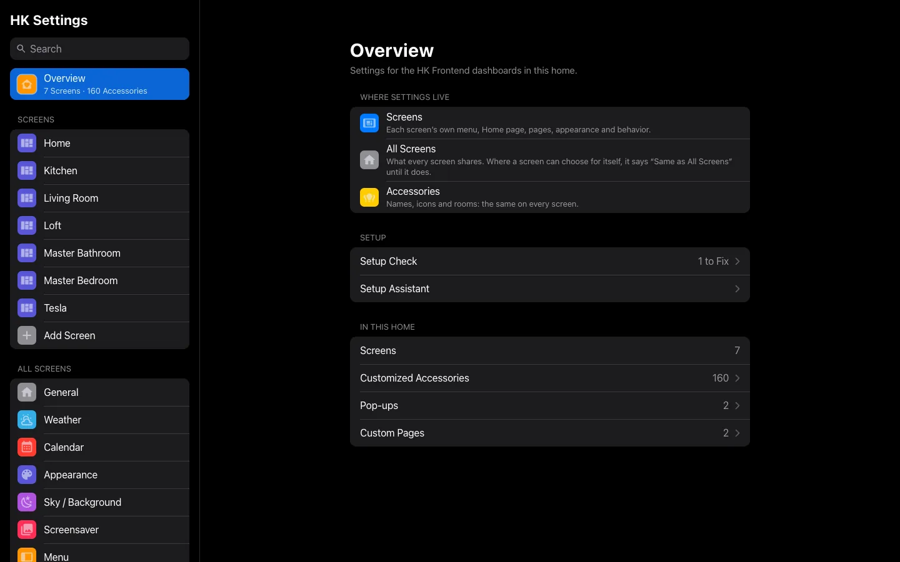
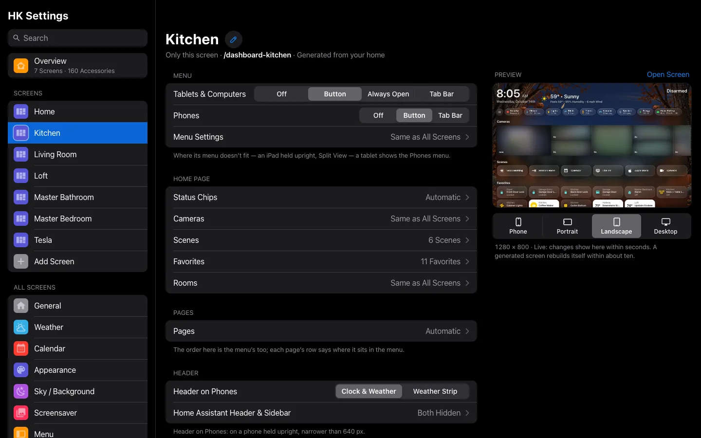
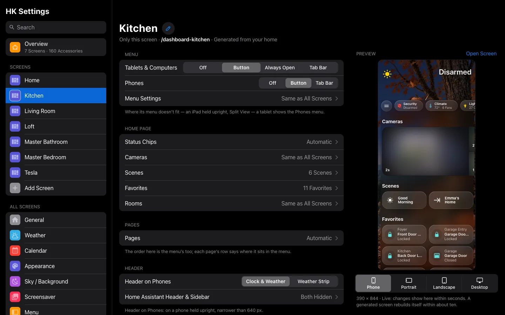

# HK Settings

**HK Settings** is the page where you set up everything HK Frontend draws: each
screen, the settings every screen shares, how your accessories show up, and the
optional features. It is in Home Assistant’s sidebar as **HK Settings**, at
`/hk-settings`. Only administrators can open it.

Each topic’s settings are on that topic’s page (the menu’s on [Menu](Menu.md),
the weather’s on [Weather](Weather.md), and so on). This page is how HK Settings
itself works.

## Open it

1. In Home Assistant’s sidebar, select **HK Settings**.
2. If it isn’t in the sidebar, go to **Settings → Devices & services →
   HK Frontend → Configure → HK Settings page** and use the link there.

The first time you open it, before any screen has settings, it starts the
**Setup Assistant** (see [Your First Screen](Your-First-Screen.md#run-the-setup-assistant)).

On a wide window the list sits on the left and the page you pick on the
right. On a phone the list is its own page, and each page has a back button.
The address in the browser follows the page you are on, so Back, reload and
bookmarks work.

## How it is organized

| Group | Pages | Applies to |
|---|---|---|
| **Overview** | Where settings live, the Setup Check status, and counts of your screens, customized accessories, pop-ups and custom pages | — |
| **Screens** | One page per screen, then **Add Screen** | That screen only |
| **Pages** | One page per page the house has, in the menu’s order: **Climate**, **Lights**, **Security**, **Water**, **[Energy](Energy.md)**, **[Power](Energy.md#the-power-page)**, **Timers**, **Vacuums**, **Music**, **[Cameras](Cameras.md)**, **Calendar**, **Weather**, **Live TV** (**Doors & Windows** too, in a home with no alarm). See [Pages](#pages). | Every screen that shows the page |
| **All Screens** | **Appearance** (with **[Sky / Background](Live-Sky.md)** under it), **[Screensaver](Screensaver-and-Idle.md#screensaver-settings)**, **Now Playing**, **[Notifications](Notifications.md)**, **Menu**, **[Rooms](Rooms.md)** (with the room pages’ [status row](Status-Rows.md)), **[Status Chips](Status-Chips.md)**, **[Wall Tablets](Wall-Tablets.md#wall-tablets-settings)** (each tablet its own page, then **Add Tablet…**) | Every screen |
| **Library** | **[Accessories](Accessories.md#accessories-settings)** (by [type](Accessories.md#types), then by room, with [Hidden Accessories](Accessories.md#hidden-accessories) and [Added Accessories](Accessories.md#added-accessories)), **Pop-ups**, **Custom Pages**, **Custom Chips** | Every screen that uses them |
| **System** | **Advanced**, **Setup Check** | — |

A screen’s page shows a live preview of that screen beside its settings (above
them on a narrower window). Changes show in the preview within seconds.
Under it, pick the size to look at -- **Phone** (390 × 844), **Tablet
Portrait** (an iPad upright, 820 × 1180), **Tablet Landscape** (1280 × 800,
a wall tablet), **Desktop** (1440 × 900), and **Car** (804 × 638, with the
car’s zoom) on a screen with Car Browser on. The preview is that size, so it
shows the layout that device really gets. It opens on the size the screen is
used at, and remembers your last choice for each screen in that browser.
When the preview column is too narrow for the full names, the two tablet
sizes read **Portrait** and **Landscape**.

**Open Screen** opens the screen itself in a new tab.

## How the controls behave

- **Every control saves as you change it.** There is no Save button, except on
  pages where you type YAML. The top bar says **Saved**, or says what went
  wrong beside the field. A value that can’t be saved is never quietly swapped
  for a default.
- **Changes reach open screens within about a second**, without a reload. A
  generated screen (see [Screens](Screens.md#two-kinds-of-screen)) rebuilds
  itself within about ten seconds when something it is built from changes, and
  stays on the page you were looking at. Nothing here needs a restart.
- **A screen setting that can follow All Screens says so.** Under its name a
  screen’s row reads *Same as All Screens*, beside the value it follows
  (*Blur*), until you choose one for that screen, and
  its amount sliders are marked *Same as All Screens* until you move them.
  Once it has its own, it reads *Just This Screen*, and a **Reset to All
  Screens (50%)** button follows All Screens again. The menu’s settings work
  the same way, one at a time. A screen that follows All
  Screens’ Rooms or Cameras lists the values it takes, in place, under
  **From All Screens**, ending with a link to that All Screens page.
- **Lists work the same way everywhere** (status chips, cameras, scenes,
  favorites, rooms, pages, Discover rows, a room’s tile order):
  - An **Automatic** switch at the top. On, the list follows your home: a
    light you add tomorrow shows up tomorrow. Turn it off to choose.
  - **Shown**: what is on the screen, in order. Drag a row by its handle to
    move it, or focus the handle and press the up and down arrow keys. Tap
    the red minus to remove a row.
  - **More**: what you can add. Tap the green plus.
  - **Add…** opens a searchable list. **Every picker works the same way**,
    as Hide Accessories’ does: the search matches a name, an entity ID or a
    room, and the choices are listed under their rooms, each with its glyph
    and entity ID. Where you can pick one, tap it. Where you can pick several,
    each has a check box from the start: tick them (they stay ticked while you
    change the search), and a bar says **N Selected**, with **Clear** and
    **Add**. While a search matches several, **Select All** ticks them all.
    Adding a dozen sensors to Added Accessories is one search and two taps.
- **Removing, deleting and going back to Automatic ask first.**
- **Back returns to the page you came from.** A page you reached from a link on
  another page (a status chip’s link to its type in Accessories, say) goes back
there.

## Search

Type in **Search** at the top of the list to find any setting by name or by a
word you might use for it (“blur”, “doorbell”, “idle”). A setting that every
screen has is listed once per screen. Search also finds screens, pop-ups,
custom pages, rooms and the features’ settings. Selecting a result opens its
page and highlights the setting.

## Which setting wins

When the same thing can be set in more than one place, the most specific wins:

1. A screen’s own setting (Screens → the screen).
2. A card’s own YAML (a weather card’s `entity:`, a keypad’s alarm).
3. The All Screens setting.
4. The default.

## Pages

**Pages → the page.** Everything about one page, on one page — the same
groups in the same order on each, the empty ones left out:

| Group | What it holds |
|---|---|
| Header | **Show Header**, then that header’s own settings, each saying what Automatic is. A screen that turns the header off for itself is listed under it. |
| Status Row | The row under the page’s name: what it shows, in order, and the rooms it leaves out ([Status Rows](Status-Rows.md)). |
| The page’s own | Security: **Alarm Panel**, [Alarm PIN](Alarm-PIN.md) and the **Wrong-Code Indicator**. Timers: **House Timers**. Vacuums: [Clean Areas](Clean-Areas.md) and the **Clean-Areas Script**. Energy, Music and Live TV open on their feature’s settings; Weather, Calendar and Cameras on theirs. |
| What’s on It | The page’s [accessory types](Accessories.md#types), its **Tile Order** where it has one (Security, Vacuums), and Hidden Accessories. |
| Look | The page’s **Background** and **Its Pill on Home**. |
| On Screens | Every screen, and whether it shows the page. Tap one to open that screen’s **Pages on This Screen** with the page’s row lit. |

| Header setting | Default | What it does |
|---|---|---|
| Water → Water Meter | Automatic | The meter Water Through the Day reads. Automatic: the water meter in Home Assistant’s Energy settings. |
| Water → Main Supply Valve | Automatic | The valve the header opens and closes. Automatic: a valve named main, supply or shut-off, else the home’s only valve that isn’t a sprinkler’s. |
| Timers → Quick Durations | 5, 10, 15, 20, 30, 60 min | Quick Start’s buttons, in order, up to six. |
| Timers → Quick Names | Pasta, Oven, Laundry, Tea, Kids, Break | The names Create a Timer offers, up to six. |
| Vacuums → Mission Counters | Automatic | The counters that say how a run ended. Automatic: each vacuum’s own successful, failed and canceled sensors. |
| House Timers | None | Timer helpers people start themselves (a nap, bedtime), shown as one-tap tiles on the Timers page, in order. |

**A screen’s own page headers.** Screens → the screen → **Page Headers**
turns a page’s header off on that screen alone. What the header held comes
back to the page: the Water page’s main valve as a tile, the Timers page’s
Quick Start beside what’s running.

**Old addresses still work.** A bookmark to All Screens → General, Weather,
Calendar, Cameras or Status Rows, or to Features → Energy, Music, Live TV,
Alarm PIN or Clean Areas, opens the page it moved to.

The chips’ Indoor Temperature and Power Use are on the Climate and Energy
chips’ own pages, under a screen’s
[Status Chips](Status-Chips.md#status-chips-settings); they are the same on
every screen.

## Advanced

**System → Advanced.** What almost nobody changes. Everything here works when
left empty.

| Setting | Default | What it does |
|---|---|---|
| Time Sensor | `sensor.time` | Home Assistant’s Time & Date sensor, which keeps every screen’s clock in step. Without it, each screen uses its own clock. |
| Date Sensor | `sensor.date` | The same, for the date. |
| Show in Sidebar | On | Off: HK Settings leaves the sidebar for everyone. It is still reachable from Configure (below). Each person can also hide it from their own sidebar in their profile. |
| Your Files → Folder | `hk_local` | A folder under `/config` for the files that can’t ship with HK Frontend: Apple’s SF Pro font (`fonts/SF-Pro.woff2`) and the SF Symbols glyphs (`iconset/hk-glyphs.js`). **SF Pro Font** and **SF Symbols Glyphs** say whether each is found. See [Your files](Your-Files.md). |
| Your Own Dashboards → YAML Reference | — | What a dashboard you write yourself can use, each ready to copy and filled in from your home: hiding Home Assistant’s header, the photo screensaver, the live sky, views in the menu, HK cards for Live TV, Clean Areas and Music, and HK Frontend’s actions. The same as [Your Own Dashboard](Your-Own-Dashboard.md). A dashboard of your own links to it from the bottom of its page. |
| Setup Assistant | — | Runs the [Setup Assistant](Your-First-Screen.md#run-the-setup-assistant) again. |

## Configure on the integration

**Settings → Devices & services → HK Frontend → Configure** is only the way to
HK Settings, plus two things you may need before it works:

| Page | Setting | Default | What it does |
|---|---|---|---|
| HK Settings page | (a link) | — | Opens HK Settings. |
| HK Settings page | Show HK Settings in the sidebar | On | The same as [Advanced → Show in Sidebar](#advanced). |
| Your files | Folder (under /config) | `hk_local` | The same as Advanced → Your Files. It is served without sign-in, like `/local/`, so use a folder that holds nothing else. A folder containing Home Assistant’s own files is refused. |
| Linked to Mantel | Linked to Mantel, address, Service credential | Off | Only for a house that is moving to Mantel. See below. |
| Setup check | — | — | The same report as [Setup Check](Troubleshooting.md#setup-check). Submitting it goes back. |

### Linked to Mantel

Off unless you switch it on, and nothing changes while it is off. Linked, HK
Frontend hands the house over one wall tablet at a time: Mantel’s Owner moves
each tablet to Mantel (and, last, the rest of the integration), and this page
says which tablets are Mantel’s. A tablet still Home Assistant’s runs exactly as
before. For a tablet Mantel owns, and once everything is Mantel’s, HK Frontend
keeps the same actions (`hk_frontend.set_black_screen`, `show_popup`,
`close_popup`, `notify`) and the same entities with the same entity ids, so
automations, scripts and history keep working, but they are Mantel’s: each
action is sent to it over one WebSocket, answered within 10 seconds or failed
with an error that says why, and it sends every entity’s state. The black
screen switch’s `confirmed` attribute still turns on when the tablet’s page has
gone black. While Mantel can’t be reached the entities are unavailable and the
actions fail; the link retries on its own. Pop-ups and notifications reach Home
Assistant’s screens and Mantel’s while some tablets are Mantel’s. Once
everything is Mantel’s, the features, the wall tablets’ Sleep Screen and HK
Settings don’t run in Home Assistant.

With **Mantel Link** (HACS, Mantel’s own integration) also installed, it usually takes the bridge over
(Mantel Settings → Connections → Mantel in Home Assistant): it shows Mantel’s
entities and actions under the same entity ids and action names, and HK
Frontend lets go of them. Handing back is the same button. The move, step by
step: [Moving from HK Frontend](https://github.com/jazzphone/mantel-link/blob/main/docs/Moving-from-HK-Frontend.md).
HK Frontend and Mantel are two products that can run together: [HK Frontend and Mantel](HK-Frontend-and-Mantel.md).
While Mantel runs the house, HK's settings are Mantel's: the dashboards draw with the last ones Mantel sent, a
change made on them is saved in Mantel as the person linked to your Home Assistant user (when an Owner has turned
on Changes from Home Assistant), and Repairs says so while a Home Assistant admin isn't linked. Moving the house
back, or unlinking, keeps Mantel's last settings here.

The address is Mantel’s LAN address, with `https://` (plain `http://` only to
this machine or the Mantel App on Home Assistant’s internal App network, so the
credential never crosses the network in clear); Mantel refuses this link
through its tunnel. It fills itself in when the Mantel App or Mantel Link is
installed. The credential is a Mantel Service account’s, with the `linked`
scope. Home Assistant keeps it in its own storage on disk
(`.storage/core.config_entries`), as it does every integration’s token, and it
is never shown again or put in diagnostics; revoke it in Mantel if a backup
with it leaks. Saving reloads the integration; switching it off brings back
everything above as it was.

The integration’s page also lists each screen, pop-up, custom page and custom
chip as an item. A screen’s gear links to its page in HK Settings.
**Download diagnostics** exports every setting (birthdays and PIN hashes are
left out). Features are added from **Add feature** on the same page.

## Settings that point at your own entities

Several settings can point at helpers or sensors you make yourself. All are
optional, and each has a fallback.

| Setting | Typically points at | Left empty |
|---|---|---|
| Advanced → Time Sensor, Date Sensor | `sensor.time`, `sensor.date` (Time & Date) | Each screen’s own clock |
| Status Chips → Climate → Indoor Temperature | Any temperature sensor (an average, say) | The first thermostat’s reading |
| Status Chips → Energy → Power Use | A whole-home power sensor | No Energy chip |
| Weather → Sensors → forecasts | Template sensors over `weather.get_forecasts` | Read from the weather entity |
| Weather → Sensors → Weather Alerts | The NWS Alerts integration (HACS) | No alerts chip or card |
| Sky → Sky Switch | An input boolean | Always on |
| Sky → Advanced → Holiday Season, Moon Phase | Template sensors | Worked out from the date |
| Sky → Advanced → Also Needs | An input boolean | Only the Seasonal decorations switch decides |
| A screen’s Cameras → Live Camera Follows | An input select set by your automation | The first camera is live |
| Advanced → Clean-Areas Script | A script that takes `areas` | The Clean Areas feature sends the vacuums |
| Advanced → Wrong-Code Indicator | An input boolean your alarm automation flashes | Refused codes are shown automatically |

## Sky / Background

**All Screens → Appearance → Sky / Background** starts with the **Background**: **Live
Sky** (the moving sky), **Color** (a still color, by day and by night),
**Photo** (a photo of your own) or **Landscapes** (HK Frontend’s own photos:
a new one each time the screen wakes, on a schedule, or the same one, with
**Choose a Landscape**). Below it are only that choice’s settings.
For the live sky: whether it animates (and, while it does, whether it holds
still when the window isn’t in focus, **Pause When Not in Focus**, and whether
its **Moving Things** pass behind the cards or in front of them), shows weather
(and its falling **Rain & Snow**), how its clouds look (**Clouds**: Classic or
Realistic), how bright its midday blue runs (**Daytime Sky**: Natural,
Balanced or Deep) and its **Sky Colors** (Live Sky, eight curated palettes,
Black, and Custom with four Day colors and four Night colors). Then seasonal
decorations, **Liveliness** -- how many little moving things, and how often
the crossers come -- one choice for every decoration, woodland season and the
night sky, or Custom for each its own
([Seasonal Decorations](Seasonal-Decorations.md#liveliness)) -- and the **Sky
Switch**. For a photo or the Landscapes, its **Look** (Blur, Dim, Saturation
and a Color Tint) and **Reset to Default**. At the foot, **Reset to
Defaults…** puts the whole page back, leaving the Pages’ own backgrounds
([Reset to Defaults](Live-Sky.md#reset-to-defaults)). **Pages** sets each page’s background, and
**Room Pages** each room’s own, with its own Look
([The live sky](Live-Sky.md)).

A screen has the same choice under **Appearance → Sky / Background**:
**Background** reads **Same as All Screens** until you choose one, then **Just
This Screen**, and **Reset to All Screens** follows All Screens again. A
Color, a Photo or a Landscape can be its own, too, and **Reset to
Defaults…** puts the whole page back to Same as All Screens. With the Live Sky, it has the same
controls, plus its own **Liveliness** (Same as All Screens, a preset for every
occasion, or Custom for each) and **Calm When Nobody’s Around**. Its Clouds,
Daytime Sky, Decoration Style and Moving Things are the same tabs as All
Screens’, saying **Same as All Screens** until changed; **Reset to All
Screens** follows them again. Each flag reads **Same as All Screens** until
changed, then **Just This Screen**; **Reset to All Screens (On)** follows All
Screens again. Its **Sky Colors** offers **Same as All Screens** or colors just
for that screen. Copy Settings includes these appearance settings.
See [Live Sky](Live-Sky.md#the-background) for the three Backgrounds and
[Choose its look](Live-Sky.md#choose-its-look) for what each switch changes.

### Music → Now Playing

**Ignore Announcements** is on by default and applies to every screen. Recognized
TTS and announcements stay out of the music bar, music activity count and
screensaver music view; playback and speaker controls are unchanged.

HK recognizes explicit TTS media URLs and observes Home Assistant `tts.speak`,
legacy TTS `*_say`, `media_player.play_media` with `announce: true`, and Music
Assistant `play_announcement` calls with explicit player entity targets. Native
Apple TV/HomePod players are matched to their Music Assistant AirPlay counterpart
by device identity. The bathroom reminder needs no automation changes.

Call-based recognition ends after the called player finishes, with a two-second
margin for its mirrored state. A call that never starts expires after 20 seconds;
all markers expire after two minutes. Announcements started outside Home Assistant,
area/device-only targets, or audio without recognizable metadata may still appear.
Short duration or missing song metadata alone never hides music. Turning the toggle
off restores the usual player-state display behavior immediately.
