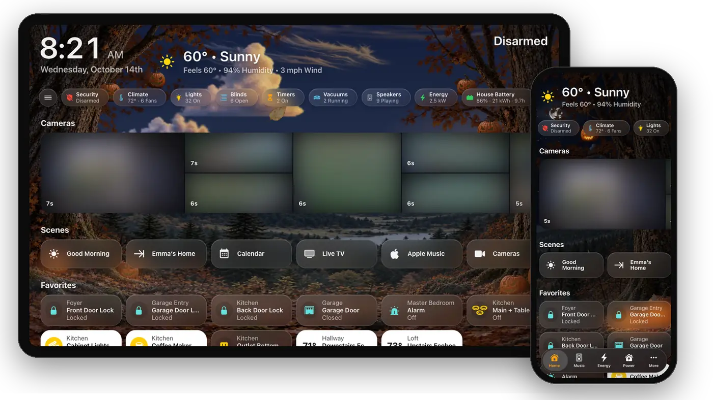

# HK Frontend

Home Assistant dashboards inspired by Apple’s Home app: built from your own
rooms and devices, and set up entirely in the UI.

New here? **[Install](Install.md)**, then **[Your First Screen](Your-First-Screen.md)**.
The sidebar has every page.

## What you get

- **Screens that build themselves.** A new screen is generated from your
  floors, areas and devices: a header with the clock, weather and alarm state,
  a row of status chips, a section of tiles per room, and a page per room. A
  new light shows up on its own. ([Screens](Screens.md))
- **Pages for what your home has.** Weather, Cameras, Security, Doors &
  Windows, Climate, Lights, Water, Timers and Vacuums, each only when there is
  something to show. ([Pages](Pages.md))
- **One screen for every device.** The same screen works on a wall tablet, a
  computer, an iPad and a phone; tiles and the weather reflow below 640 px.
  Tiles are the Home app’s own size and spacing (196 px, 10 apart; 170 on an
  iPad), in SF Pro wherever Apple’s font is there.
- **Status rows** under every room’s name and the Climate, Lights, Doors &
  Windows, Water and Security pages’ titles, as the Home app has them.
  ([Status Rows](Status-Rows.md))
- **A live sky** behind every page that follows the weather and the time of
  day, with seasonal decorations, optional realistic clouds and woodland
  [New Decorations](Seasonal-Decorations.md) -- or a still color, or a photo
  of your own, for the house, a screen, a page or a room. ([Live Sky](Live-Sky.md))
- **Glass tiles and detail sheets.** Tap a light, thermostat, lock, garage
  door, speaker or vacuum and a sheet opens with the controls it needs.
  ([Detail Sheets and Pop-ups](Detail-Sheets-and-Popups.md))
- **A menu of pages and rooms**, open beside the page, behind a button or a
  swipe from the left edge, with an optional Home Assistant section — or an
  iOS-style **tab bar** along the bottom or the top, or a rail down either
  side of a tablet, that can shrink or hide as you scroll and keeps the rest
  in More. ([Menu](Menu.md), [Tab Bar](Tab-Bar.md))
- **HK Settings**, a settings page in the sidebar with a live preview of each
  screen as a phone, an iPad, a wall tablet, a desktop or a car.
  ([HK Settings](HK-Settings.md))
- **Optional features:** whole-home [Music](Music.md), [Live TV](Live-TV.md),
  [Clean Areas](Clean-Areas.md), an [Alarm PIN](Alarm-PIN.md), an
  [Energy](Energy.md) page built from Home Assistant’s Energy settings with a
  [Power](Energy.md#the-power-page) page beside it for right now (the grid,
  the sun, a house battery and the cars), and
  [Notifications](Notifications.md): a banner at the top of the screens when
  something happens at home, with a camera’s snapshot.
- **Wall tablet support:** each tablet its own page in HK Settings, return to
  Home when idle, a full-screen kiosk look, and a screensaver of your photos
  (one at a time or a mosaic), the forecast over a landscape that dresses up
  for the holidays, or a full-screen [clock](Screensaver-and-Idle.md#a-clock)
  in fifteen styles over a moving background or fifty
  [landscape photos](Screensaver-and-Idle.md#landscapes) that come with it, with the time, what's playing, the timers, Home Status
  and your coming events.
  ([Wall Tablets](Wall-Tablets.md), [Screensaver and Idle](Screensaver-and-Idle.md))
- **Sleep Screen:** each wall tablet dark when nobody needs it and awake the
  moment somebody does: from presence sensors, quiet hours, the doorbell and
  smoke, with its brightness for day and night. HK Frontend decides it for you,
  or your automations do. ([Sleep Screen](Sleep-Screen.md))
- **A card library** for dashboards you build yourself.
  ([Card Library](Card-Library.md))

## Where to go

| If you want to | Read |
|---|---|
| Install it and make a first screen | [Install](Install.md) → [Your First Screen](Your-First-Screen.md) |
| Shape a screen: its Home page, pages and menu | [Screens](Screens.md) and the pages under it |
| Change how one accessory shows up | [Accessories](Accessories.md) |
| Put a screen on a wall | [Wall Tablets](Wall-Tablets.md) |
| Make a wall tablet sleep and wake by itself | [Sleep Screen](Sleep-Screen.md) |
| Give a dashboard of your own the screensaver, the kiosk look, the sky | [Your Own Dashboard](Your-Own-Dashboard.md) |
| Write your own dashboard with the cards | [Card Library](Card-Library.md) |
| Use Apple’s font and glyphs | [Your Files](Your-Files.md) |
| Fix something | [Troubleshooting](Troubleshooting.md) |
| See every screen | [Gallery](Gallery.md) |
| Run HK with people, roles and its own server too | [HK Frontend and Mantel](HK-Frontend-and-Mantel.md) |

## HK Frontend, Mantel and Mantel Link

HK's screens come in two products from the same code. HK Frontend (this wiki)
is HK inside Home Assistant. [Mantel](https://github.com/jazzphone/mantel)
serves the same screens from a server of its own, and
[Mantel Link](https://github.com/jazzphone/mantel-link) is its integration in
Home Assistant. Use either, or link HK Frontend to Mantel:
[HK Frontend and Mantel](HK-Frontend-and-Mantel.md).

<!-- products-table: copied from tools/products_table.md in Mantel by tools/products_table.py; edit it there -->
| | **Mantel App** (Home Assistant App) | **Mantel with Docker or the LXC** | **HK Frontend alone** | **HK Frontend linked to Mantel** | **Mantel Link** |
|---|---|---|---|---|---|
| **Use this when** | You run Home Assistant OS and want people, roles and wall tablets with nothing extra to look after | Mantel should run on its own machine, at its own address | You want HK on Home Assistant's own dashboards, for people who already use Home Assistant | You want both, with one copy of the settings | You run Mantel and want its tablets, actions and notifications in Home Assistant |
| **Where the screens are** | **Mantel** in Home Assistant's sidebar and the Companion app; its own address too, if you turn on direct access | Its own `https://` address; in Home Assistant's sidebar with Mantel Connect | Home Assistant's own dashboards | Mantel's pages, and HK Frontend's dashboards in Home Assistant | No screens of its own; puts a Mantel screen in Home Assistant's sidebar as a dashboard |
| **HK's cards on dashboards you build** | No | No | Yes | Yes, HK Frontend's | — |
| **Wall tablets (kiosk)** | Enrolled tablets with their own credential and role, in Fully Kiosk, Kiosk Satellite or any browser | The same | A full-screen look inside Home Assistant's page; tablets sign in as Home Assistant users | Each tablet is run by Mantel or by HK Frontend, never both | Each tablet's black screen, screensaver and Sleep Screen as entities |
| **Screensaver and Sleep Screen** | Yes | Yes | Yes | Yes, from whichever runs the tablet | Their switches, for automations |
| **People, roles, passkeys** | Mantel's roles; Home Assistant signs people in to the sidebar; passkeys and passwords at its own address | Mantel's own sign-in: passkeys, passwords, authenticator codes, or Home Assistant | Home Assistant's users | Mantel's people; a change made on HK Frontend's dashboards is saved as the person linked to your Home Assistant user | — |
| **Every command checked and in the audit log** | Yes | Yes | No | On Mantel's screens, and for saves from Home Assistant | — |
| **Remote access** | Home Assistant's own, for the sidebar; a Cloudflare Tunnel for its own address | A Cloudflare Tunnel or your own reverse proxy, with stricter rules away from home | Home Assistant's own | Each one's own | — |
| **Mantel Photos** (albums for the screensaver) | Yes | Yes | No; the screensaver shows a folder of Home Assistant's media | On Mantel's screens | — |
| **iPhone, iPad and Mac apps** | Yes, at its own `https://` address | Yes | No; Home Assistant's Companion app | Yes, with Mantel | Sends Mantel's notifications to Companion-app phones |
| **Music** | Music Assistant, through Mantel | The same | Music Assistant, as an HK Frontend feature | Mantel's; HK Frontend's music actions are run by Mantel | Music actions for your automations |
| **Settings** | **Mantel Settings**: HK's settings, plus people, tablets, connections and the audit log | The same | **HK Settings** in Home Assistant's sidebar | **Mantel Settings**; HK Settings steps aside while Mantel runs the house | None; set up in **Devices & services** |
| **Backups** | Inside Home Assistant's backups, plus **Back Up Now**, download and restore in Mantel Settings | Mantel's own nightly encrypted backups, with download and restore in Mantel Settings | Inside Home Assistant's backups | Each one's own | Inside Home Assistant's backups |
| **Who runs the house** (Seasonal Decorations, the Alarm PIN keypad, Live TV) | Mantel | Mantel | HK Frontend | Mantel or HK Frontend: **The House**, in Mantel Settings | Holds the house's entities when Mantel runs it |
| **Needs Home Assistant** | Yes: Home Assistant OS or Supervised, 2026.8 or newer | Yes: any Home Assistant 2026.8 or newer it can reach | Yes: 2026.8 or newer | Yes | Yes: any install type, 2026.9 or newer |
| **Installed from** | Home Assistant's App store, with Mantel's repository | Docker Compose, or a script that makes a Proxmox LXC | HACS (custom repository) | HACS, plus Mantel | HACS (custom repository) |

**Why you would use each.** **HK Frontend** is the simplest: install it from HACS and HK's screens appear on Home Assistant's own dashboards, for everyone who already signs in to Home Assistant. **Mantel** is for a household: people who shouldn't need a Home Assistant account, roles per room, wall tablets that sign themselves in, an audit log of every command, and screens that Home Assistant's updates can't disturb. Run it as the **Mantel App** if you have Home Assistant OS, or with **Docker or the LXC** to keep it on a machine of its own. **Mantel Link** goes with Mantel: it is how Home Assistant's automations, entities and Companion-app notifications reach Mantel. And you can **link HK Frontend to Mantel** to keep HK on Home Assistant's dashboards while Mantel runs the tablets and keeps one copy of the settings.

[Mantel](https://github.com/jazzphone/mantel) ([guide](https://github.com/jazzphone/mantel/wiki)) ·
[HK Frontend](https://github.com/jazzphone/hk-frontend) ([guide](https://github.com/jazzphone/hk-frontend/wiki)) ·
[Mantel Link](https://github.com/jazzphone/mantel-link) ·
[Running them together](https://github.com/jazzphone/mantel/wiki/HK-Frontend-and-Mantel)
<!-- /products-table -->
