# Live Sky

Behind HK Frontend’s screens is a sky that follows the real one: the sun’s
height and direction, the moon at its actual phase, the clouds you have, and
rain or snow when it is falling. On some days it also dresses up for a season,
a holiday or a birthday: [Seasonal Decorations](Seasonal-Decorations.md).
If you’d rather have something still, choose a **Color**, a **Photo** of
your own or HK Frontend’s own **Landscapes** as the
[Background](#the-background) instead.

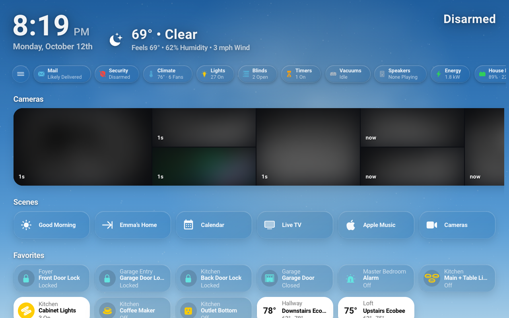

## The Background

**HK Settings → All Screens → Sky / Background** starts with one choice, the
**Background**: what Home, the room pages, Weather, Calendar and every page
without a color of its own show behind the cards.

| Background | What it shows |
|---|---|
| **Live Sky** | The default. The real sun, moon and weather behind the cards, dressed for the seasons. Its settings are below it: [Choose its look](#choose-its-look). |
| **Color** | A still color, a little different by day and by night: **Dusk**, **Midnight** (the default), **Fjord**, **Dune**, **Graphite**, **Plum**, **Ember**, **Mist**, **Black** or **Custom** (four Day colors and four Night colors, top to bottom). No sun, moon, stars, weather or decorations. |
| **Photo** | A photo of your own, sharp and still, edge to edge. No sun, moon, stars, weather or decorations. A bright photo is dimmed a little so the cards stay readable. |
| **Landscapes** | Fifty landscape photos that come with HK Frontend, the same ones the screensaver’s clock can show: a new one each time the screen wakes, on a schedule, or the same one. Still, like a Photo. [Landscapes](#landscapes), below. |

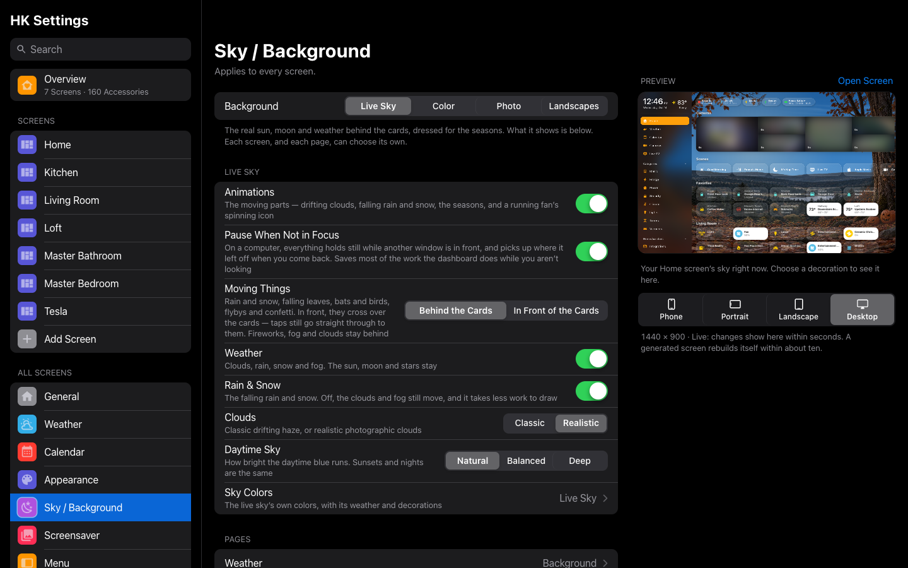
*All Screens → Sky / Background starts with the Background.*

Before, the closest thing to a plain color was a Backdrop, which only
recolored the live sky, so the stars still showed through. Color and Photo
draw no sky at all.

**Choose Photo…** uploads a photo to Home Assistant’s own image store, the
way a person’s picture is. It is made no bigger than 2560 pixels and saved as
a JPEG first, so a wall tablet isn’t drawing a phone’s full-size original, and
the photo’s location and camera data aren’t kept. **Choose Another Photo…**
replaces it and **Remove Photo** takes it away. With no photo chosen, Photo
shows Black. A photo no longer used anywhere (All Screens, a screen or a
page) is removed from the image store.

Home Assistant serves the images in its image store to anyone who has the
photo’s address, without signing in, as it does a person’s picture. The
address is long and random, so it can’t be guessed, but anyone it reaches can
open it: choose a photo you wouldn’t mind a visitor seeing.

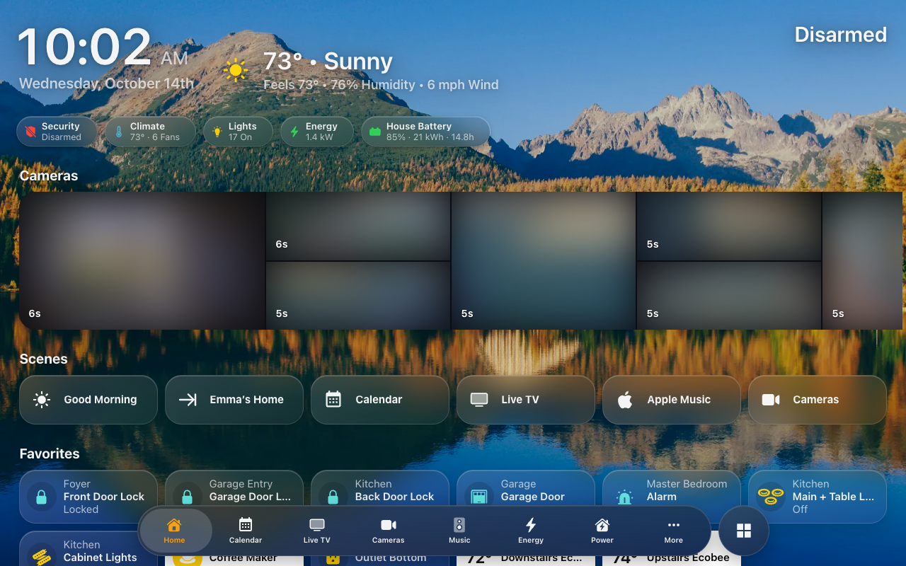

Under the photo, **Look** softens or colors it: **Blur** (0–100%), **Dim**
(0–80%), **Saturation** (100% as taken, 0% black and white, up to 200%) and
**Color Tint**, one of the Colors washed over the photo at **Tint Strength**
(its day colors while the sun is up, its night ones after). A screen can have
its own Look, with **Reset to All Screens** to follow again, and **Reset to
Default** puts any Look back to the photo as taken. A page set to Photo has a
Look of its own too; until you change it, it is the screen’s (a room’s page:
Room Pages’), and **Reset to the Screen’s Look** (or **Room Pages’ Look**)
follows it again.

### Landscapes

**Landscapes** shows one of the fifty photos that come with HK Frontend
(mountains, lakes, coasts, canyons, forests, the northern lights; every one
public domain or CC0, from Wikimedia Commons). There is nothing to upload, and
nothing of your home on the screen. Under **Landscape**, the one showing now,
and when it changes:

| Landscape | What it does |
|---|---|
| **Each Time the Screen Wakes** | A new one each time the screen goes to sleep (the screensaver or the black starts, or the tablet’s screen turns off), so it is already there when the screen wakes, never swapped in front of you. |
| **On a Schedule** | A new one **Every 15 Minutes**, **30 Minutes**, **Hour**, **3**, **6** or **12 Hours**, or **Every Day** (the default; at midnight). |
| **Stay the Same** | The one showing now stays. **Choose a Landscape** shows all fifty, small, to pick another; the one you pick stays. |

Each change goes far along the list, so the next one is never the one next
to it, and all fifty come round. Landscapes has its own **Look** (Blur, Dim,
Saturation and a Color Tint, as a Photo has), kept apart from your Photo’s.
A screen can choose its own landscape and Look, and a page can be set to
**Landscapes** too (with a Look of its own).

#### Image Look

Under a Photo or the Landscapes, **Image Look** gives the picture Flat's
treatment in these looks too. It is **Off** to begin with: the picture as it is,
with its Look above. **Original** keeps the photograph's colors. **Soft**,
**Balanced**, **Rich** and **Washed** tint it to one color, keeping its own light
and dark: the page's accent (**Match Accent**) or **Your Own Color**. **Adjust**
sets its **Strength**, **Depth**, **Brightness** and **Fade** toward the dark,
with a preview. It is kept apart from Flat's own Image Look. A screen can have
its own; **Use Inherited Image Settings** follows All Screens again. The Look
above still applies on top: a blur or a dim works with either. A set of your own: put an
`index.json` and your pictures in a `landscapes` folder of
[your files](Your-Files.md), as for the
[screensaver’s clock](Screensaver-and-Idle.md#landscapes).

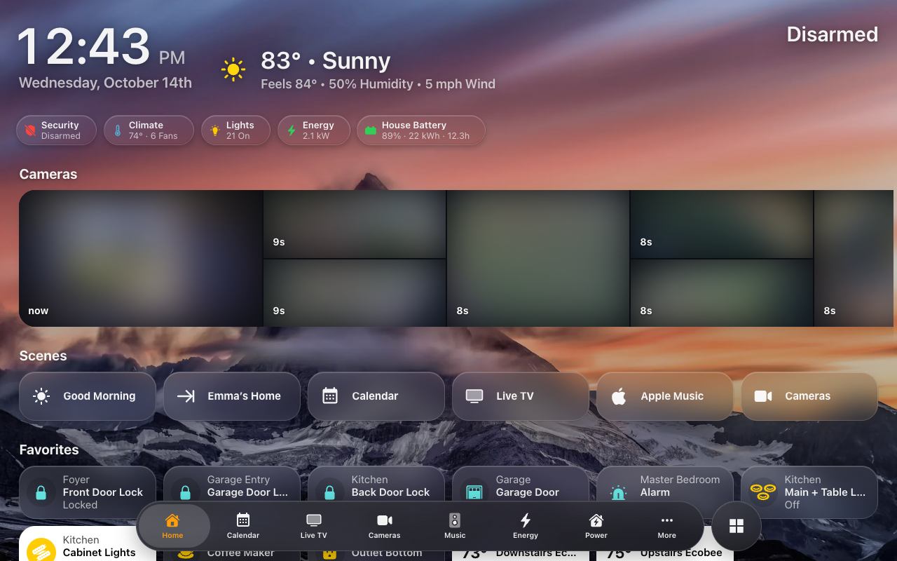

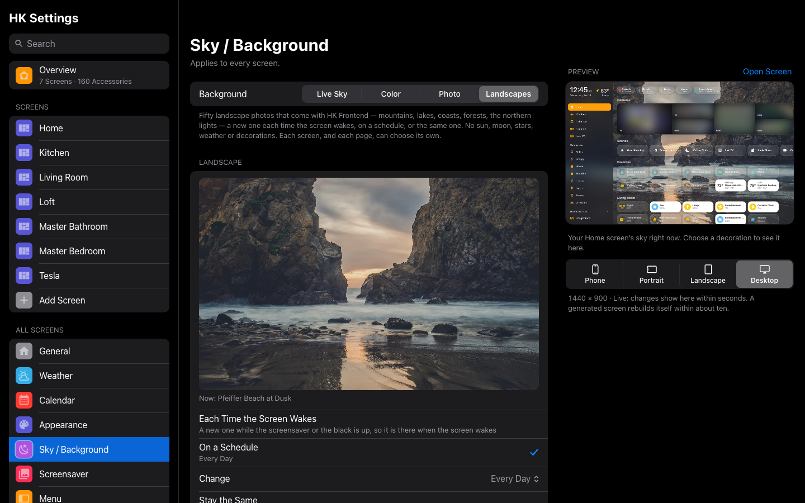

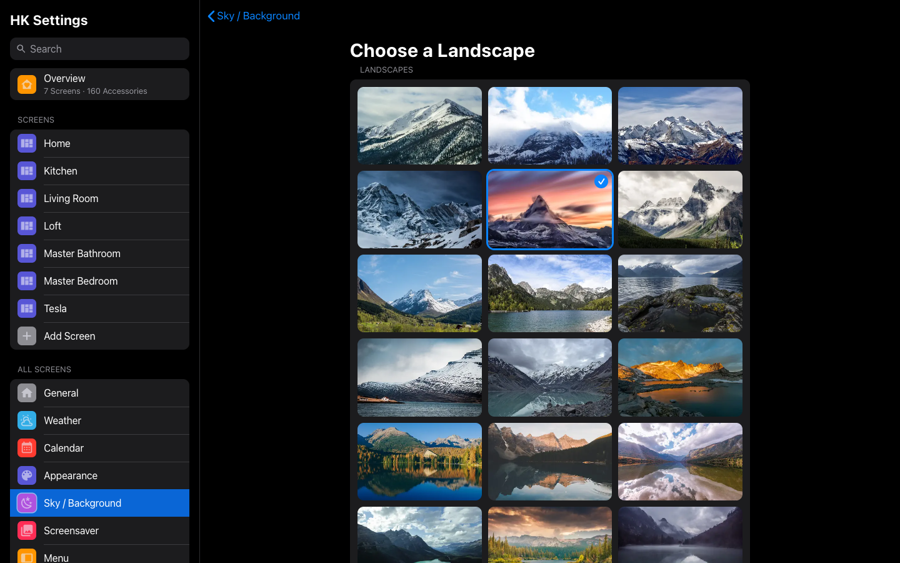

### Reset to Defaults

At the foot of **Sky / Background**, **Reset to Defaults…** puts every setting
on the page back: on All Screens, to HK Frontend’s defaults (the Live Sky, with
its weather, decorations and liveliness); on a screen, to **Same as All
Screens**. The **Pages** keep their own backgrounds (each page’s choice, its
photo and its Look), a photo or custom colors you made are kept for next
time, and Advanced (hemisphere, dates, sources) is left as it is.

**Each room** can have its own background: **Sky / Background → Room Pages →
Each Room**, or the **Background** row in the room’s own settings (**Rooms →
the room**). A room left alone is the same as Room Pages; one set to Photo can
have a photo of the room itself, with its own Look.

**Each screen** chooses its own under **HK Settings → the screen →
Appearance → Sky / Background**. Its **Background** reads **Same as All
Screens** until you change it, then **Just This Screen**, and **Reset to All
Screens** follows All Screens again. Its Color can be **Same as All Screens**
or one of its own. With Photo, a screen without a photo of its own shows All
Screens’ photo; one with its own can go back with **Use All Screens’ photo**.
A YAML screen shows the Background wherever its YAML puts the sky.

A screen whose **Live Sky** switch was turned off (there is no such switch
now) reads as **Color: Black**, which is what it showed, and its Sky /
Background row says **Black**. Choosing anything there turns its background
back on.

**Each page** can have its own background, too: a Color, a Photo, the Live Sky
or its own color ([Page backgrounds](#page-backgrounds)).

## What it shows

| | What the sky does |
|---|---|
| **Time of day** | The colors follow the sun’s elevation, from a bright midday blue through sunset to night. The sun’s glow sits where the sun is. **Daytime Sky** below sets how bright the midday blue runs. |
| **Night** | Stars, and the moon drawn at its real phase. |
| **Clouds** | As many as the weather says (its cloud coverage, or a guess from the condition when there is none). At sunset they are lit warm from below. **Clouds** below chooses their look: Classic or Realistic. |
| **Rain and snow** | Falling while the weather is rainy, pouring, hailing or snowy; lightning in a thunderstorm; a haze in fog. |

Glass tiles and white text on top of the sky stay readable, even at noon:
when the sky gets bright, a soft shade comes in behind the cards.

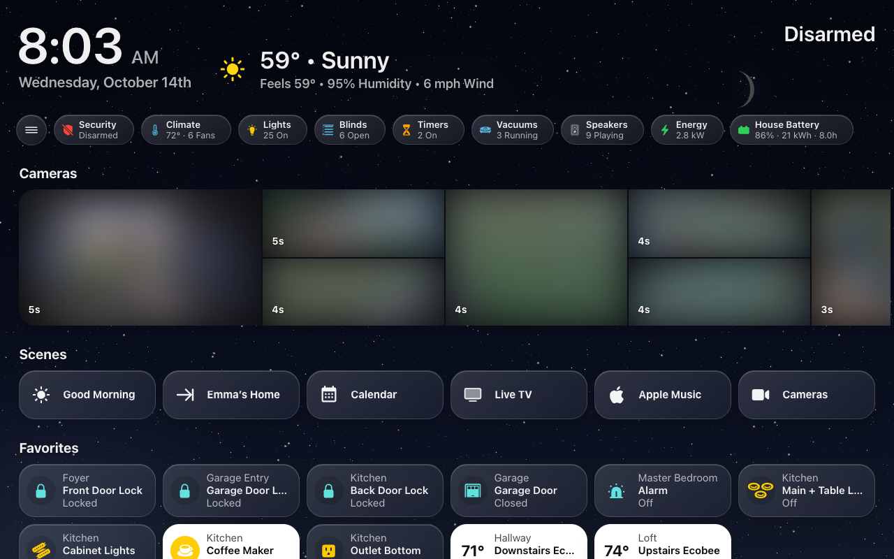

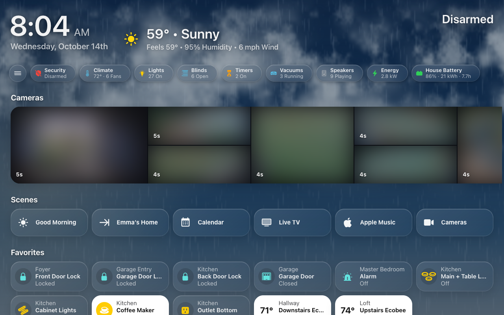

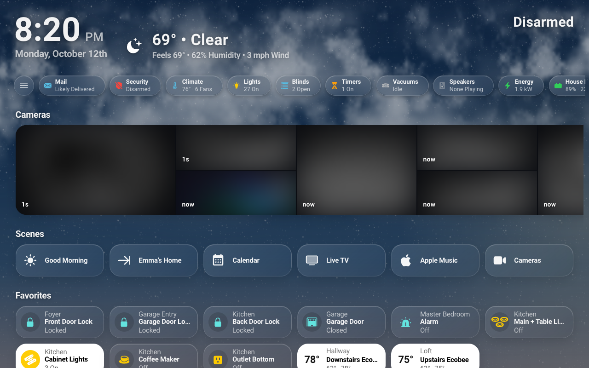

It reads:

- `sun.sun`, for where the sun is;
- the weather entity chosen under **HK Settings → All Screens → Weather**
  (without one, the first weather entity it finds);
- the moon’s phase, worked out from the date (or a sensor you choose; see
  [Advanced](Seasonal-Decorations.md#advanced)).

### Where it appears

On a generated screen, the live sky (or the Color or Photo chosen as the
[Background](#the-background)) is behind **Home**, **Weather**,
**Calendar** and the room pages. The category pages (Lights, Climate, Doors &
Windows, Security, Timers, Vacuums, Water, Cameras, Live TV, Music, and Energy) each have a still wash of their own color instead,
matching the chip that opens them. A custom page shows the live sky when its
YAML says `sky: true`. Decorations appear only on the live sky.

Any page can change this under [Page Backgrounds](#page-backgrounds).

When the tablet is behind a screensaver, or its browser tab is hidden, the sky
stops moving.

The [forecast screensaver](Screensaver-and-Idle.md#no-photos-the-forecast)
draws this same sky over a landscape, and livelier: its clouds drift faster,
the brighter stars twinkle, a clear night has the odd shooting star, a summer
night has fireflies, and on the holidays the landscape itself is decorated
([Seasonal Decorations](Seasonal-Decorations.md#on-the-forecast-screensaver)).

## Turn it on or off

**Every generated screen at once:** pick an input boolean or switch as the
**Sky Switch**, in its own group near the end of **HK Settings → All Screens →
Sky / Background**. While it is off, no generated screen shows the live sky.
With none chosen, the sky is always on.

**One screen:** HK Settings → the screen → **Appearance → Sky / Background**,
and choose a **Color** (**Black**, say) or a **Photo** as its **Background**
([The Background](#the-background)). A generated screen’s live sky also follows
the Sky Switch; a YAML screen’s sky comes from its YAML.

**A dashboard you write in YAML:** the dashboard opts in with a `sky:` block,
and each view that wants the sky says `sky: true`:

```yaml
sky:
  enable: input_boolean.live_sky                          # optional: off hides the sky
  sleep: input_boolean.kitchen_photos                     # optional: on pauses it
views:
  - title: Home
    path: home
    type: custom:hk-grid-view
    sky: true
    cards: []
```

`sky: {}` on its own is enough to opt in. A view can instead take one of the
still washes with `sky_variant:` (`lights`, `climate`, `doors`, `timers`,
`vacuums`, `water`, `cameras`, `playmusic`, `energy` or `ecoflow`).

## On phones and narrow screens

The decorations are drawn for a landscape screen. On a screen taller than it
is wide, each one is drawn as its left and right edges, blended through the
middle, so the branches and garlands still reach in from both sides.

## If the sky stands still

A browser that asks pages for **reduced motion** gets a still sky. On an
Android tablet, Android’s **Remove animations**, some power-saving modes and
the developer animation settings all turn that on, and the browser can keep
reporting it until the tablet restarts. If the sky is frozen on one tablet and
moving everywhere else, check those settings and restart the tablet. More in
[Troubleshooting](Troubleshooting.md).


## Choose its look

While the [Background](#the-background) is **Live Sky**, its settings are
below it. **HK Settings → All Screens → Sky / Background** sets the defaults.
Each screen can choose its own under **Appearance → Sky / Background**:

| Setting | What it changes |
|---|---|
| **Animations** | Off stops the sky's animated layers, including clouds, lightning, decorations and forecast landscape effects, and a running fan's spinning icon on its tile and chip. Falling rain and snow are hidden rather than shown frozen. The sky still follows the sun and updates its appearance. |
| **Moving Things** | Shown while Animations are on. **Behind the Cards** (the default) or **In Front of the Cards**: the rain and snow, falling leaves and petals, bats and birds, flybys (the witch, the sleigh, the geese), confetti and fireflies cross over the cards instead of behind them, and still go under the menu, the tab bar, the Now Playing bar and pop-ups. Taps always go straight through to the cards. Fireworks, fog and mist, clouds and the scenery stay behind. A screen can choose its own. |
| **Pause When Not in Focus** | Shown while Animations are on. On a computer (a device with a mouse), everything holds still while another window is in front and picks up where it left off, on the next frame, when you come back — in one test, Home went from about 31% of a core to about 8%. While you're looking at it, nothing changes. Wall tablets and phones never pause this way. On by default; a screen can choose its own. |
| **Weather** | Off removes clouds, rain, snow, lightning and fog, including decorative snow and Halloween fog. The sun, moon and stars remain. |
| **Rain & Snow** | Shown while Weather is on. Off removes only the falling rain and snow; the clouds and fog still move, and a wet sky keeps its gray. Less for the device to draw. Never shown while Animations are off. A screen can choose its own. |
| **Seasonal Decorations** | Off removes seasonal and surprise scenes. On uses the shared dates, themes and optional extra gate. |
| **Clouds** | **Classic** is the drifting haze the sky has always had. **Realistic** draws photographic clouds instead — fair-weather cumulus, broken sheets, high wisps, a storm tower on the horizon, an overcast lid with darker masses drifting under it — chosen from the weather's cloud cover and condition, lit by the sun (gold at sunset, pink at dusk, moonlit at night), across the whole sky down to the horizon, behind New Decorations' trees. They sit in perspective: near clouds big and high, far ones small, many and softer toward the horizon, with long cirrus streaks above and, as it clouds over, the overcast's ceiling receding behind them. Each cloud crosses once and comes back as another, so nothing repeats. They are there from the first moment a page loads (they no longer fade in over a few seconds); a change of sky still cross-fades. A fair or partly cloudy day keeps the sky as bright and blue as Classic's; the overcast's faint ceiling only comes in as the sky clouds over. A screen can choose its own. |
| **Daytime Sky** | How bright the midday blue runs. **Natural** (the default) is a real midday sky. **Deep** is the darker, dusky blue the sky had before; **Balanced** is in between. The shade behind the cards rises with it, so all three stay readable. Sunrise, sunset, dusk and night look the same in all three. A screen can choose its own. |
| **Sky Colors** | The live sky’s own colors, with its weather and decorations over them (it was called Backdrop). Live Sky follows the sun's colors. Dusk, Midnight, Fjord, Dune, Graphite, Plum, Ember and Mist use curated day/night gradients, and Black is plain black. Custom provides two sets of four colors, top to horizon. Day applies above the horizon, Night at or below it. |

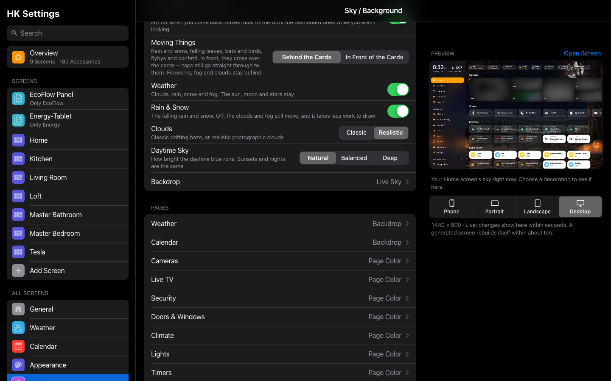
*All Screens → Sky / Background: Moving Things, Behind the Cards or In Front of the Cards.*

After these come **Seasonal Decorations** and **Liveliness**
([Seasonal Decorations](Seasonal-Decorations.md#liveliness)), the **Sky
Switch** in a group of its own ([Turn it on or off](#turn-it-on-or-off)), and
**Advanced**.

**To try a look before choosing it,** open **Sky Lab** (`/hk/pages/skylab.html`):
set the time of day, the weather, the clouds and the daytime brightness by hand,
over the sky alone or over one of your own dashboards (preview only — nothing
in your home switches). See [Tools → Sky Lab](Tools.md#sky-lab).

Sky Colors only changes the live sky’s gradient: the sun’s glow, the moon,
the stars, the weather and the decorations still show over it. For a plain,
still background, choose **Color** as the [Background](#the-background)
instead. The usual luminance scrim keeps glass and text readable over custom
colors.

Per-screen flags follow All Screens until you change them: each reads **Same
as All Screens**, then **Just This Screen**, and **Reset to All Screens (On)**
follows All Screens again. A screen’s Decoration Style, Moving Things, Clouds and Daytime Sky
are the same tabs as All Screens’, showing All Screens’ choice, until changed. **Same as All Screens** in the Sky Colors picker follows the
global palette and its custom colors; an explicit **Live Sky** overrides All
Screens’ Sky Colors. Selecting Custom starts with Dusk (or, for a screen,
the global custom colors if available). An own Custom palette keeps its colors
when you change the global palette.

These settings apply wherever the live sky is shown, including the forecast
screensaver and any page set to Live Sky (below). A page with a still
background (its own color, a Color or a Photo) shows none of them.

### Realistic clouds in every weather

What **Clouds → Realistic** draws for each weather, the sky alone (on a
screen, your cards sit over it). The mix comes from the weather entity's
condition and cloud cover; the lighting from the sun.

| | |
|---|---|
| 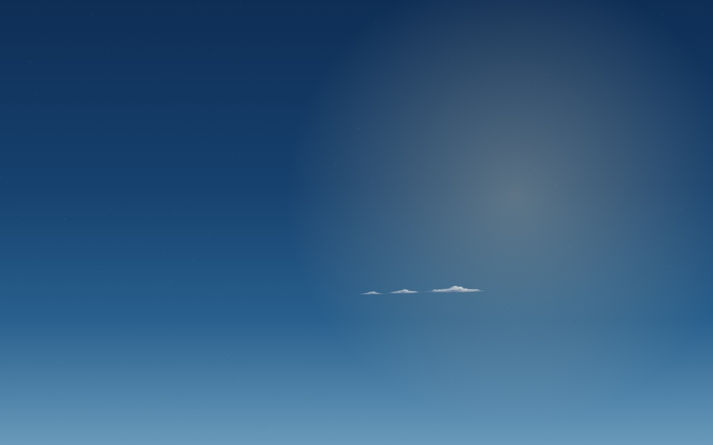 |  |
| **Sunny** — a few far cumulus, low on the horizon | **Partly cloudy** — cumulus near and far, now and then a high wisp |
|  | 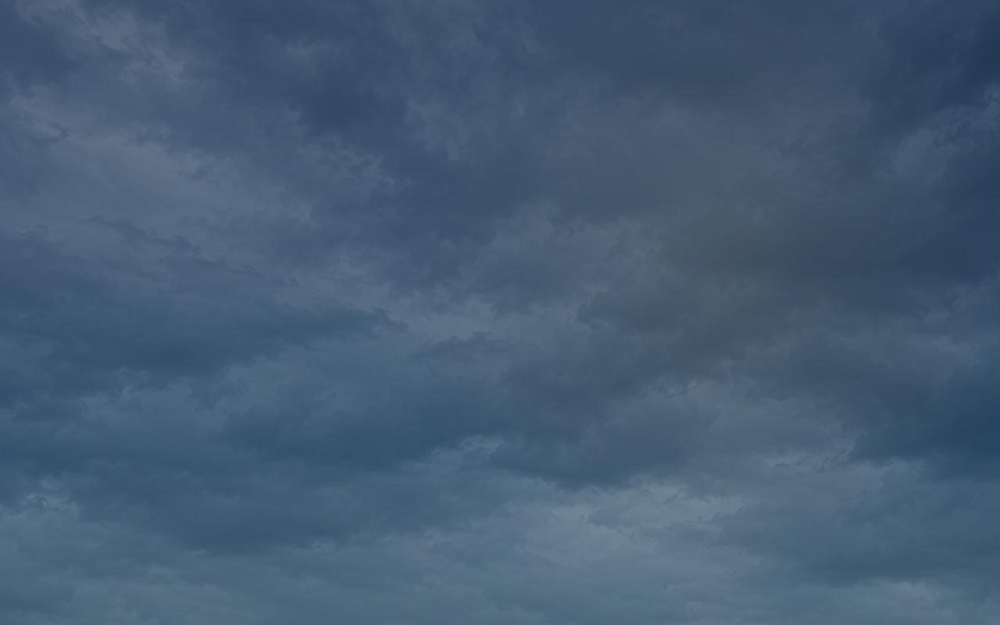 |
| **Mostly cloudy** — big cumulus, broken sheets and a haze along the horizon | **Overcast** (85% cover or more) — one photographic deck, drifting to and fro |
| 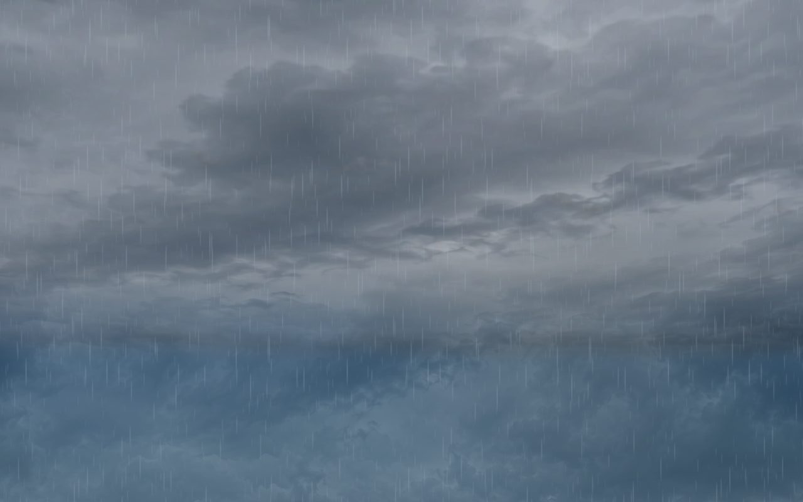 | 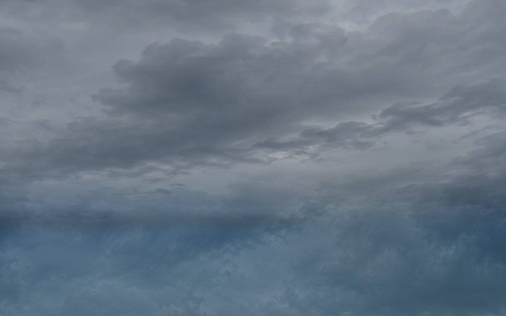 |
| **Rain** — the gray deck, with the rain falling in front | **Thunderstorm** — the gray storm deck, whatever cover is reported, lightning flashing in it |
| 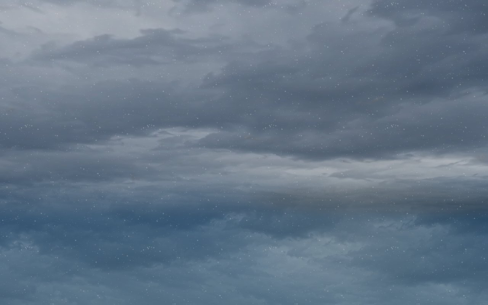 |  |
| **Snow** — the gray deck, with the snow falling | **Classic**, the same partly cloudy sky, for comparison |

The same partly cloudy sky through the day's lightings:

| | | |
|---|---|---|
|  | 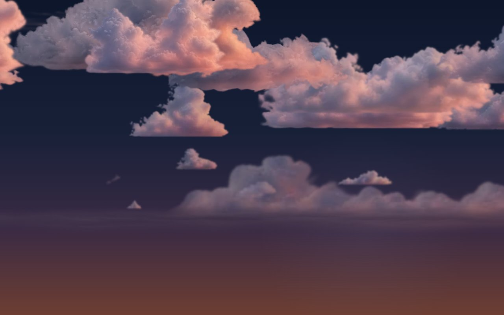 | 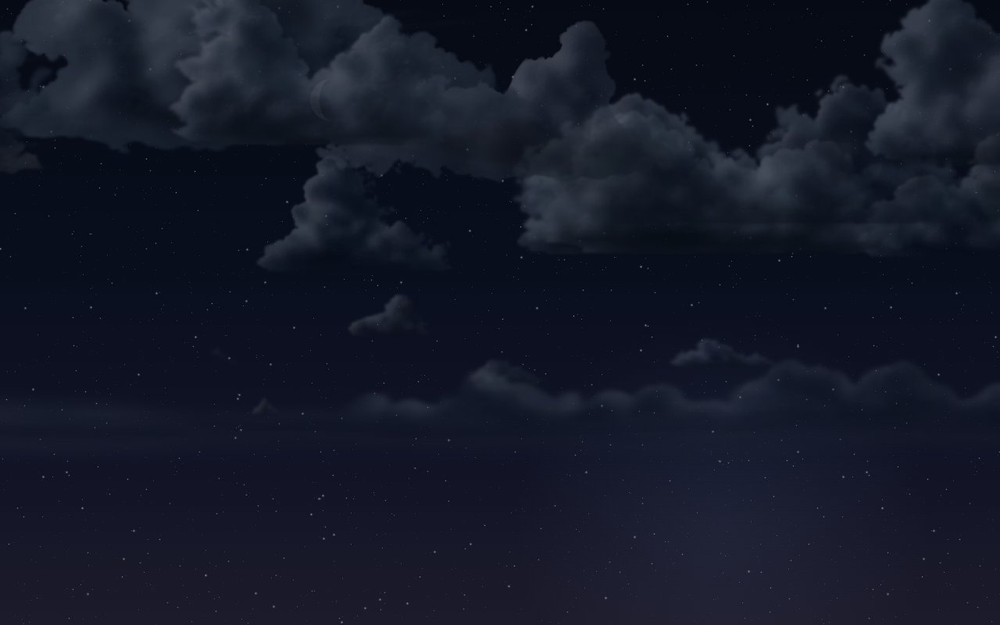 |
| **Golden hour** (the sun under 10°) | **Dusk** (just below the horizon) | **Night** |

On a dashboard:

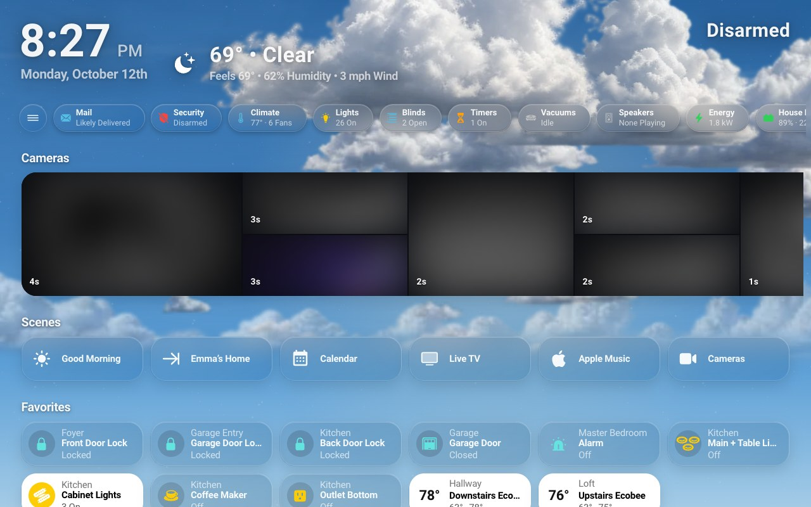

### Page backgrounds

**Sky / Background → Pages** lists every page with its background ("Energy:
Page Color", "Weather: Background"). Tap a page to choose its background. It
is set under All Screens, and each screen's Sky / Background can choose its
own for any page; a page a screen leaves alone follows All Screens.

On a [page screen](Pages.md#whole-screens-and-page-screens) the list is its
own pages, at the top of its Sky / Background (for example **Energy
Background**). A page screen has no Home or room page, so it has no
Background of its own: each page’s background is chosen there. With a single
page, that page’s background is the screen’s.

| Choice | The page shows |
|---|---|
| **Automatic** | A page with a color of its own (Energy, Climate, Lights, Security …) keeps it. Weather, Calendar and the room pages show the [Background](#the-background). A custom page is as its YAML says. On a screen, this is **Same as All Screens** when All Screens has chosen one. |
| **Page Color** | The page's own still wash. Music's is the album art. |
| **Live Sky** | The live sky, following the sun, with the screen's weather, clouds and decorations. |
| **Color** | A still color (Dusk, Midnight … Black, Custom), like Page Color: no clouds, weather, sun or moon glow, stars or decorations. Its day colors show while the sun is up, its night colors after. It starts with the screen’s Background color. |
| **Photo** | A photo, still: the page’s own (**Choose Photo…** under **Its Photo**), else the screen’s Background photo. With neither, Black. Under it, the page’s own **Look**. |
| **Landscapes** | The screen’s landscape (which one, and when it changes, is the Background’s choice), still. Under it, the page’s own **Look**; until you change it, the screen’s Landscapes Look. |

A color picked for a page is only that color. **Sky Colors** is different: it
recolors the live sky, and the weather and decorations still show over it.

All Screens' **Pages** set the defaults, and each screen can choose its own. A
change shows on the screens within a few seconds, with no reload.

On a page screen, **Sky / Background** starts with **This Screen's Pages**,
with each page's background. When none of them uses the live sky, it says so,
because then the animations, weather and decorations settings below it don't
show anywhere. The screen's **Appearance → Sky / Background**
row shows what its pages use, for example **Page Color**.
