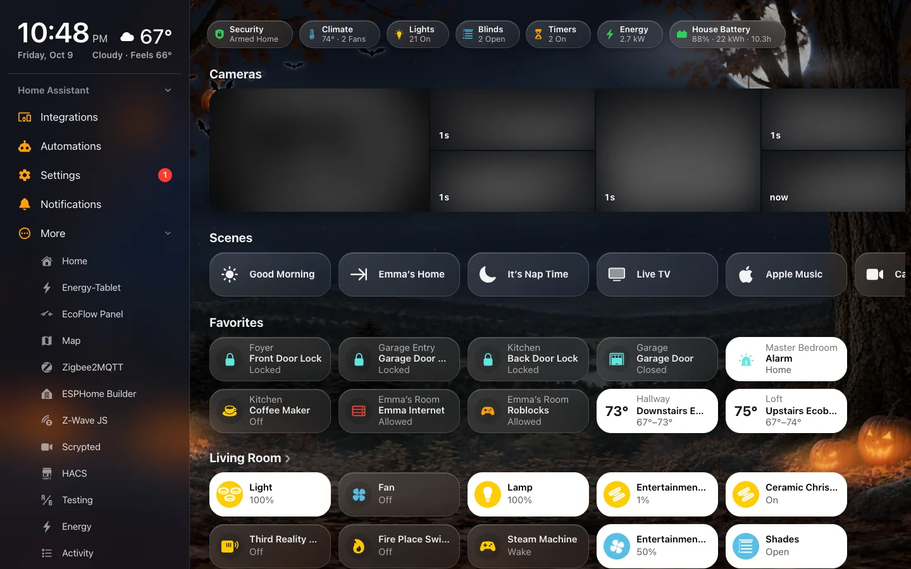
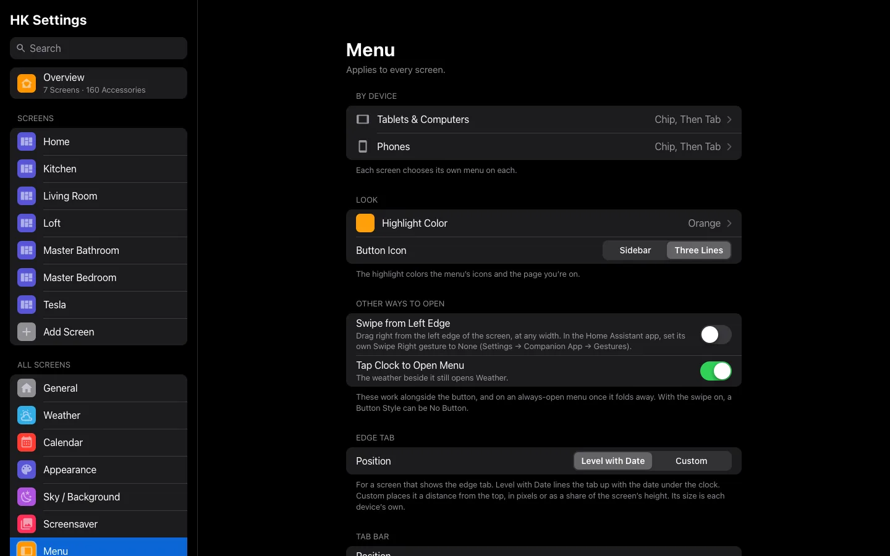
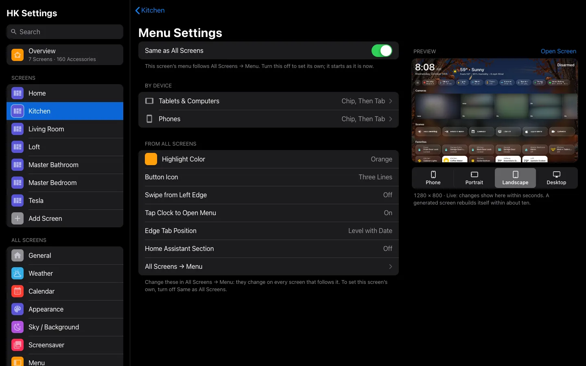
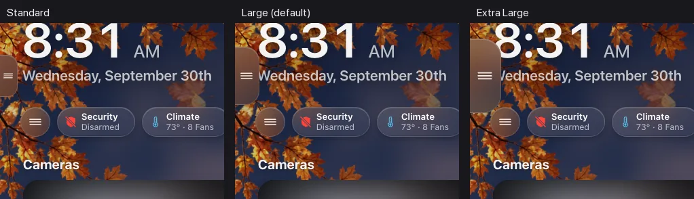

# Menu

The menu lists a screen’s pages and rooms, like the sidebar of Apple’s Home
app. For a row of tabs at the bottom of the screen instead (or as well), see
[The tab bar](Tab-Bar.md).

The menu lists the screen’s pages and rooms, like the sidebar of Apple’s Home
app: **Home** first, then the pages at the top, then **Categories** and
**Rooms**. The page you are on is highlighted; choosing another slides the
highlight over to it, as the tab bar’s does.

Each screen chooses its menu **for each kind of device**, under **Screens →
(the screen) → Menu**: one for **Tablets & Computers** and one for
**Phones** (see [Phones and tablets](#phones-and-tablets)). Everything else
about the menu (its look, its button, the edge tab, what’s in it) is set once
for every screen in [All Screens → Menu](#menu-settings-for-all-screens), and
a screen can [set its own](#a-screens-menu-settings). On tablets and
computers the menu can be:

- **Off**: no menu. Pages are reached from the chips and pills.
- **Tab Bar**: no side menu; [the tab bar](Tab-Bar.md) along the bottom of
  the screen instead.
- **Button**: the menu is hidden until opened. **Button Style** picks how:
  - **Automatic**: the round chip when Home has a menu button, otherwise the
    edge tab.
  - **Chip**: a round button at the start of the status chips (and beside the
    back button on other pages).
  - **Chip, Then Tab**: the chip, and a slim tab slides in from the left edge
    when the chip is scrolled out of sight.
  - **Chip on Home, Tab Elsewhere**.
  - **Edge Tab**: a slim tab on the left edge, level with the date. Its
    **Position** can move it.
  - **No Button**: nothing on the page; swipe from the left edge to open the
    menu. Offered only while **Swipe from Left Edge** is on.

  The button’s style is All Screens’ unless the screen sets its own.
- **Always Open**: the menu stays beside the page, with no button. It needs
  room: narrower than **Keep Open Down To** (1,000 px unless you change it),
  it folds away. With **Time & Weather in Menu**, the time, date and weather
  sit at the top of the menu and the Home page gains the header’s space.

**Where the tablet menu doesn’t fit, the screen shows its Phones menu.** An
always-open menu narrower than Keep Open Down To, and a button below 1,024 px
(where the edge tab has no margin to sit in) — an iPad held upright, Split
View, a narrow window — show the screen’s **Phones** menu instead, with all
of Phones’ settings. If Phones is Off, they show the chip, so a tablet is
never left with no way in. The tab bar fits at every width, so a tablet set
to Tab Bar keeps it.

## Phones and tablets

A **phone** is an iPhone or an Android phone, held either way up, or any
browser window narrower than 640 px. Everything else is a **tablet or
computer**: an iPad (even an iPad mini held upright), a wall tablet, a
computer, the car. HK Frontend tells a phone held sideways by the size of its
screen (its shorter side is under 500 px), so turning a phone never swaps it
onto the tablet’s menu.

On phones the menu can be **Off**, a **Button** or the **Tab Bar**. A phone
never keeps the menu always open: there is no room beside the page. So one
screen can be always open on a wall tablet and a computer, and show the tab
bar on a phone — and on an iPad held upright, where the open menu has no
room.

The menu on each device is set in one place: the screen’s page, under
**Menu**. Everything else is on the page of the kind of menu it belongs to,
**Side Menu**, **Edge Tab** or **Tab Bar**, split by device only where each
device has its own value (a Button Style for Tablets & Computers and one for
Phones, an edge tab size for each, While Scrolling, Tabs in Bar and More for
each). Every Phones setting is its own value; none copies the tablets’.

**Other ways to open it.** These work alongside the button, each switched on
or off by itself:

- **Swipe from Left Edge**: drag right from the screen's left edge and the
  menu follows your finger, the way the Home app's sidebar does. Let go past
  a third of the way, or flick it, and it opens; otherwise it slides back. It
  works at
  every width and with every Button Style, and an always-open menu gets it
  once it folds away. Dragging up or down at the edge still scrolls the page.
  In Safari the browser's own back swipe can get there first at the very edge.
  **In the Home Assistant Companion app**, set the app's own Swipe Right
  gesture to **None** (Settings → Companion App → Gestures). By default it
  opens Home Assistant's sidebar on the same swipe. If it does, HK Frontend
  closes that sidebar again at once (the screen keeps it hidden) and says once
  what to change in the app. The same happens on any screen that hides Home
  Assistant's sidebar, with or without the swipe, so the app's gesture can
  never leave the page frozen under a sidebar you can't see.
- **Tap Clock to Open Menu**: tapping the clock opens the menu, and the
  weather beside it opens the Weather page.

The chip and the edge tab aren't separate switches, because they depend on
each other: "Chip, Then Tab" shows the tab only once the chip has scrolled out
of sight. That's why they stay one **Button Style**. With the swipe on, Button
Style can be No Button. If the swipe is turned off, a No Button screen goes
back to Automatic (and Phones’ to the chip), so it always keeps a way in.

**The highlight** (the menu’s icons and the page you’re on) is Apple’s orange
unless you choose another **Accent Color**, under **Appearance**: one of
Apple’s system colors or a color of your own. Over a pale one the page’s
name turns dark. In Flat the same color also shades the background.

**Top of Menu and Categories.** On a generated screen, Weather, Cameras and
Live TV sit at the top of the menu, right under Home, and every other page is
under **Categories**. To move one, open **Pages** and use the menu beside its
row: **Top of Menu**, **Categories** or **Not in Menu** (still one tap away on
its chip or pill). **Use the Automatic Menu** puts them back. Room pages are
always under **Rooms**.

**Rooms in the menu** are A to Z, or in the screen’s room order (**Rooms in
Menu**).

**Arranging it on the page.** In Edit mode ([Arrange a page](Accessories.md#the-menu-the-tab-bar-and-the-room-order))
the menu's pages and rooms have handles: drag a page within the top of the
menu or Categories, or between them, and use its switch to take it out of the
menu or bring it back. **Rooms** in the Edit bar opens the room order. The
tab bar and More follow, and **Done** saves it all.

**The Home Assistant section.** **Home Assistant Section** adds Home
Assistant’s own pages to the menu, above Categories: Integrations,
Automations and Settings, Notifications, **More** (which folds out the rest
of your Home Assistant sidebar, in your order, without what you hid),
**Show Menu** (Home Assistant’s own sidebar, over the page, even where kiosk
mode hides it) and Profile. Settings shows how many updates and repairs are
waiting and Notifications how many notifications, as Home Assistant’s
sidebar does. Everything is read live from Home Assistant, and each person
sees only what they may open -- a wall tablet’s user gets Notifications,
More, Show Menu and Profile. On Home Assistant’s own pages its sidebar (or
its ☰) is the way back. Leave it off on a wall tablet everyone uses.

**Placement** puts the section right under Home (**Top**), **Above
Categories**, **Above Rooms** (the default) or last (**Bottom**). It applies
in the menu and in the tab bar's More alike.



The menu closes itself when you choose a row, tap outside it, press Escape,
leave it untouched for a minute, or when the page changes any other way.

## The menu on your own dashboard

A dashboard of your own gets the menu once it is added to HK Frontend: **HK
Settings → Screens → Add Screen → Existing Dashboards**, then turn the menu on
in its settings. A dashboard that isn't added has no menu (nor a tab bar).

Its list is read from the dashboard itself, in any view type:

- The first view is **Home**.
- A view with `area:` is a **room**, named by its title (else the area’s name)
  and pictured by the area’s icon (**Settings → Areas**).
- **Categories** are the pages Home’s status chips open, in chip order. With no
  chips, every other view with a title.

View keys adjust it:

| Key | Effect |
|---|---|
| `area: kitchen` or `area: [backyard, deck]` | The view is a room. |
| `menu: top` | Listed at the top, right under Home. |
| `menu: false` | Not listed. Hidden views, views with no title and views this user can’t see are never listed. |
| `menu_title:` | The name in the menu, when it should differ from the view’s title. |
| `menu_icon:` | The icon in the menu, when it should differ from the view’s `icon:`. |

The screen’s **Pages in Menu** overrides `menu: top` and `menu: false`, page
by page.

A room page for a YAML dashboard is built from its area every time it opens:

```yaml
- title: Kitchen
  path: room-kitchen
  subview: true
  strategy:
    type: custom:hk-room
    area: kitchen          # or a list: [backyard, deck]
```

To make a room heading on Home open it, give the heading the same area:

```yaml
- type: custom:hk-heading-card
  name: Kitchen
  area: kitchen
```

A page you lay out yourself is a room too, as long as the view has `area:`.
Give it a status row with `custom:hk-room-status-card`:

```yaml
- type: custom:hk-room-status-card
  area: kitchen
```

| Option | What it does |
|---|---|
| `area` | Required. One area or a list. |
| `items` | Which kinds show, in this order. Default: [Rooms → Status Row](Status-Rows.md#settings). |
| `temperature`, `humidity` | A sensor to use instead of the area’s own. |
| `entities` | The accessories on this page. Outlets, blinds, fans, locks and garage doors are then counted from this list rather than the whole area. |
| `exclude` | Entities to leave out of the counts. |
| `include` | Entities from outside the area to count too. |

Every card’s options: [Card Library](Card-Library.md).

## Menu settings

**Screens → (the screen) → Menu.**

| Setting | Default | What it does |
|---|---|---|
| Tablets & Computers | Button (a YAML screen added as *Something Else*: Off) | **Off**: no menu. **Button**: the menu is hidden until you open it. **Always Open**: the menu stays beside the page, like the sidebar of the Home app on a Mac. **Tab Bar**: [the tab bar](Tab-Bar.md). The screen’s [preset](Screens.md#add-screen) sets this first. Always the screen’s own. |
| Phones | As the screen showed on phones before | **Off**, **Button** or **Tab Bar**, on a [phone](#phones-and-tablets). Always the screen’s own, and separate from Tablets & Computers: changing one never changes the other. |
| Menu Settings | Same as All Screens | The navigation this screen uses (Side Menu, Edge Tab, Tab Bar), each [All Screens’ settings](#menu-settings-for-all-screens) one at a time, or [this screen’s own](#a-screens-menu-settings). Says how many are its own. |
| Pages in Menu | Automatic | *YAML screens.* For each page: **Top of Menu** (right under Home), **Categories**, or **Not in Menu**. A generated screen sets this on its [Pages](Pages.md) instead. **Use the Automatic Menu** clears your choices. |

## Menu settings for all screens

**All Screens → Menu.** How people get around, for every screen that doesn’t
set its own:

- **Menu on Each Screen**: every screen and its menu on each device, such as
  **Tab Bar · Button** (tablets and computers, then phones). Each opens that
  screen’s page, where the choice is made.
- **Navigation**: **Side Menu**, **Edge Tab** and **Tab Bar**, each saying
  which screens use it, or **Not used on any screen**. Each is a page of
  everything about it.
- **Rooms in the Menu**: which rooms the side menu and the tab bar’s More
  list show, and in what order, in [Rooms](Rooms.md).
- **Back Button & Title** (Page Header before): the header on every page
  but Home. A screen sets its own under its **Header**.

<a id="menu--rooms-settings"></a>

| Page | Setting | Default | What it does |
|---|---|---|---|
| Side Menu | Button Style: Tablets & Computers | Automatic | **Automatic**: a round chip at the start of the status chips when the Home page has a menu button, otherwise the edge tab. **Chip**: the round chip. **Chip, Then Tab**: the chip, and a slim tab slides in from the left edge while the chip is scrolled out of sight. **Chip on Home, Tab Elsewhere**: the chip on Home, the edge tab on every other page. **Edge Tab**: a slim tab on the left edge, level with the date. **No Button**: nothing on the page; the swipe opens it (only with Swipe from Left Edge on). |
| Side Menu | Button Style: Phones | Chip | On a phone, and on a tablet whose own menu doesn’t fit: **Chip**, **Chip, Then Tab**, **Edge Tab** or **No Button** (only with Swipe from Left Edge on). |
| Side Menu | Button Icon | Sidebar | The menu button’s picture: **Sidebar** or **Three Lines**. |
| Side Menu | Keep Open Down To | 1,000 px | *Always open.* Narrower than this (700 to 3,000 px), the menu folds away and the screen shows its Phones menu. 1,000 keeps it open on a computer and an iPad held sideways and folds it on an iPad held upright. |
| Side Menu | Time & Weather in Menu | Off | *Always open.* The time, date and weather sit at the top of the menu instead of in the Home page’s header, and the status chips move up into the space. When the menu folds away, the header comes back. A Wall Tablet screen turns it on for itself when All Screens has it off. |
| Side Menu | Swipe from Left Edge | Off | Drag right from the screen’s left edge to pull the menu out, at any width, alongside the button. Lets Button Style be **No Button**. In the Home Assistant Companion app, set the app’s own Swipe Right gesture to None. |
| Side Menu | Tap Clock to Open Menu | On | Tapping the header’s clock opens the menu. The weather beside it still opens the Weather page. |
| Side Menu | Home Assistant Section | Off | Adds a **Home Assistant** section to the menu and to the tab bar’s More: Integrations, Automations, Settings (with its updates-and-repairs count), Notifications (with its count), **More** (the rest of that person’s Home Assistant sidebar, in their order), **Show Menu** (Home Assistant’s own sidebar, even where it is hidden) and Profile. **Placement**: Top, Above Categories, Above Rooms or Bottom. Each person sees only what they may open. Leave it off on a shared wall tablet. |
| Edge Tab | Position | Level with Date | **Level with Date**: the tab’s middle lines up with the date under the clock. **Custom**: a **Distance from Top**, **Measured In** **Pixels** or **% of Screen Height**. |
| Edge Tab | Size: Tablets & Computers | Large | **Standard** (the slim tab that fits the margin), **Large** or **Extra Large**. A bigger tab lies over the page’s edge and stays on top of it, and its touch area reaches a little past it. |
| Edge Tab | Size: Phones | Standard | The same three sizes for a phone. On a phone even the standard tab lies over the first column of tiles. |
| Tab Bar | Everything else | | Position, Size, Labels, Use the Side Strip (an iPhone Duo's strip of system controls), While Scrolling, Tabs and More: see [the tab bar](Tab-Bar.md). Its glass is under **Appearance → Tab Bar Look**. |



### A screen’s menu settings

**Screens → (the screen) → Menu → Menu Settings** lists only the kinds of
menu the screen uses, each the same page as All Screens’. Every setting there
says **Same as All Screens** until you change it; then it says **Just This
Screen**, with **Reset to All Screens** under it. One setting of its own
leaves the rest following All Screens. **Reset All to All Screens** takes
every one of them back. Whether the screen has a menu, and which, is its own
either way, set on the screen’s page.






## Coming from 1.14

Before, a screen’s menu followed All Screens all or nothing: **Same as All
Screens** on, or every menu setting its own. Now each setting follows on its
own. On the first start after updating, a screen with its own menu keeps as
its own only the settings that differ from All Screens’; the rest follow All
Screens again. The **Highlight Color** and Flat’s **Accent Color** are one
**Accent Color**, under Appearance. Nothing any screen shows changes.

## Coming from 1.5

Before, a phone used a screen’s narrow choice (**On Narrow Screens** /
**When Folded**), and some phone settings copied the tablets’ (**Same as
Tablets**). On the first start after updating:

- each screen’s menu on phones is written down as a phone showed it: the tab
  bar where the screen’s menu or its narrow choice was the tab bar, no menu
  where it had none, otherwise a button in the narrow choice’s style;
- every phone setting that copied the tablets’ gets that value as its own;
- the narrow choice goes. An upright iPad or a narrow window whose tablet menu
  doesn’t fit now shows the Phones menu. For most screens that is the same
  button as before; a screen that is always open on tablets with the tab bar
  on phones now shows the tab bar there too.

Nothing a phone, or a tablet with room, shows moves.

## Coming from 1.4

Before, each screen held its own copy of every menu setting. On the first
start after updating, each one became All Screens’ as most screens with a
menu had it (the button’s style among the screens with a button, Keep Open
Down To among the always-open ones). A screen with exactly those follows All
Screens; one that differed keeps its own (its Same as All Screens is off).
Nothing on any screen moves.
