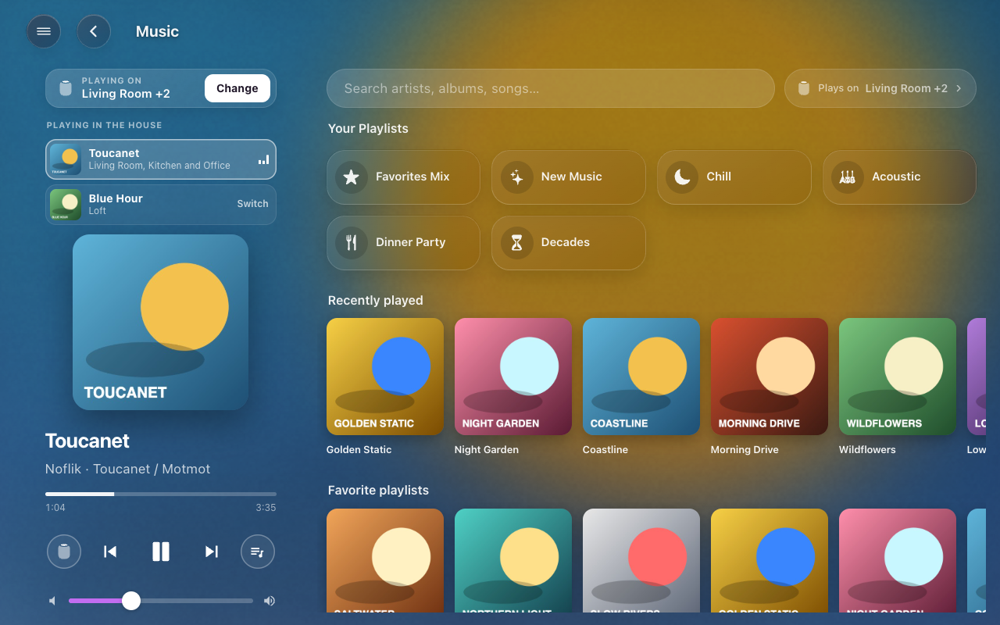
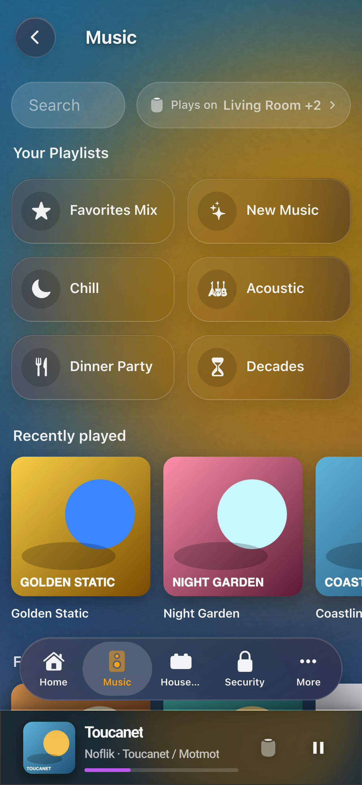
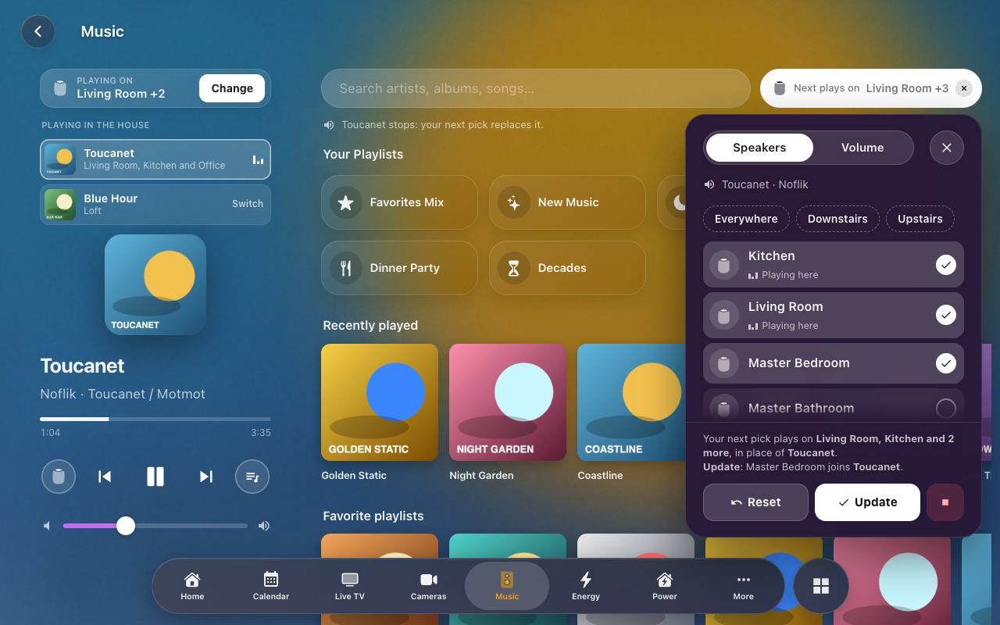
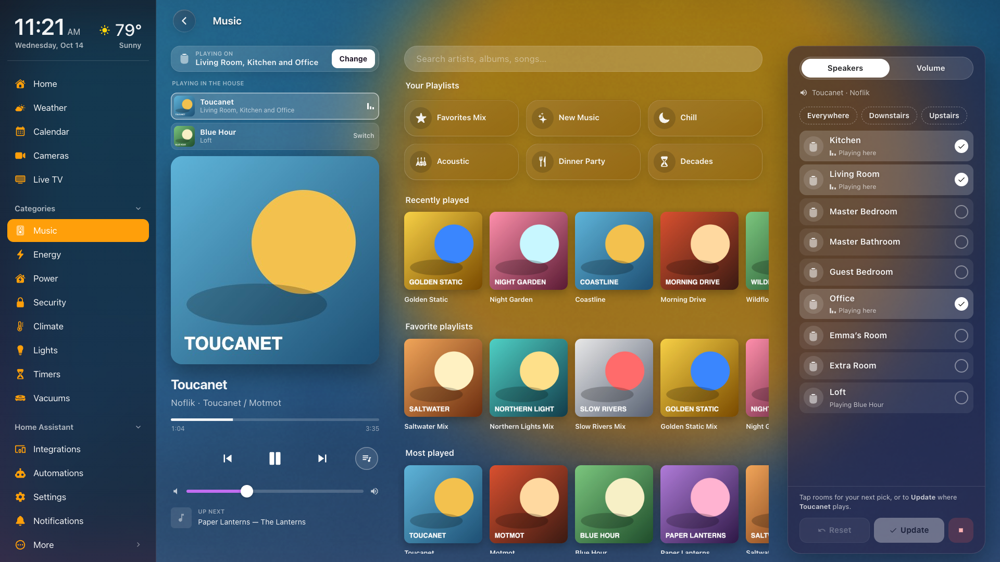
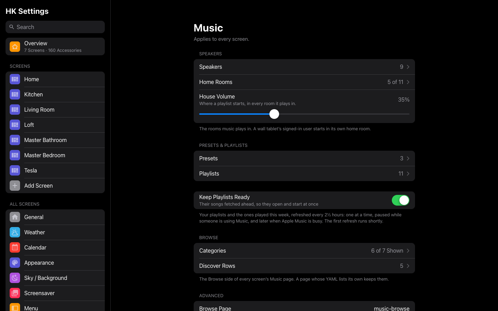
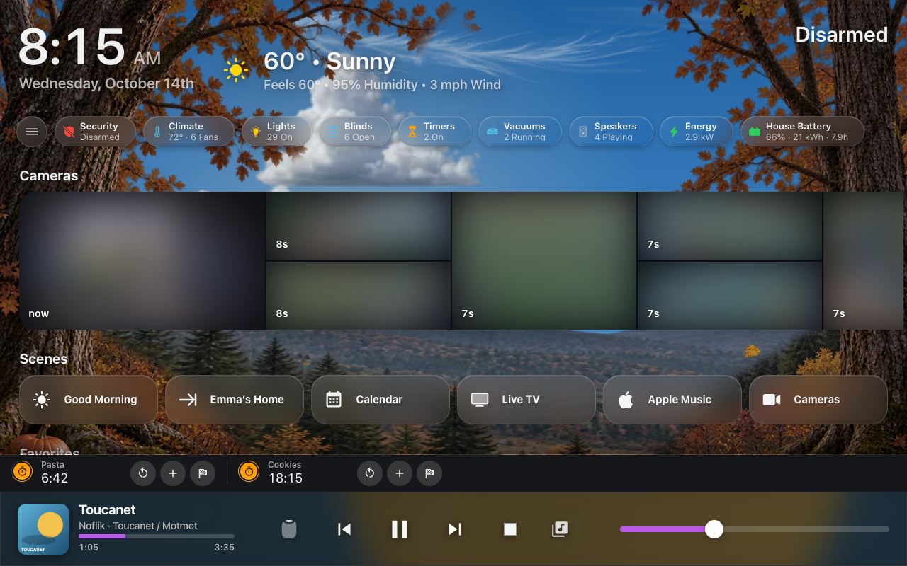
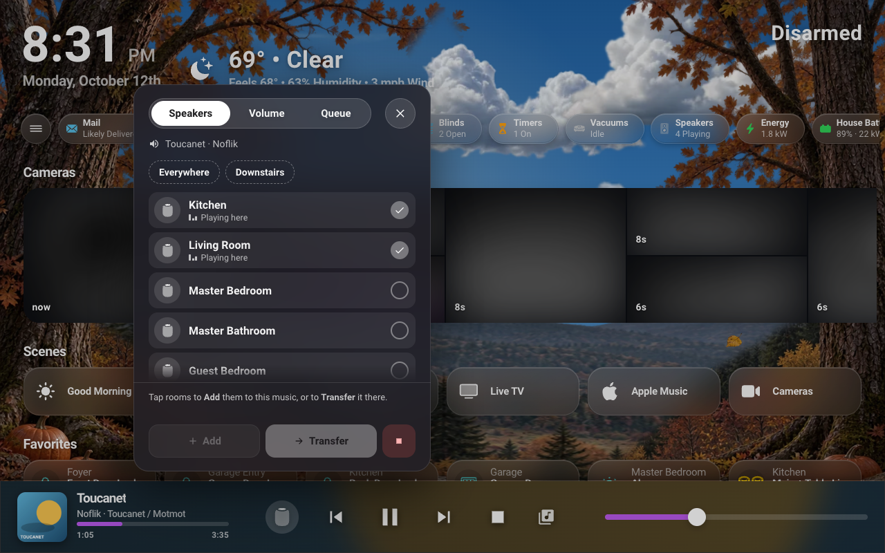

# Music

Whole-home music through Music Assistant. Choose one or more rooms on a
screen, tap a playlist, and it plays there, grouped and in step. Music can be
moved to other rooms, added to more rooms, or stopped everywhere.


*The Music page on a wall tablet: what plays and where on the left, Browse on the right.*

## What you need

- The **Music Assistant** integration, with its players in Home Assistant.
- Each speaker in an **area**. The area names its pill on the screens
  (“Kitchen,” not “Kitchen HomePod”), and the area’s **floor** groups the
  pills. Rename an area and every screen follows.
- Optional: **sync groups** made in Music Assistant, for rooms that should
  always play together (say, the whole downstairs).

## Set it up

1. Add the feature: **HK Frontend → Add feature → Music**. It asks nothing.
2. Select the gear on the new **Music** item:
   - **Speakers (rooms)**: the Music Assistant players, one per room. Leave
     sync groups out here; they are presets (next step).
   - **House playlist volume**: the volume every room is set to when a
     playlist starts (default 35%).
   - Then **Each tablet’s room**: one dropdown per person who signs in. A wall
     tablet signs in as its own user, so this is how a tablet knows the room
     it hangs in. Its Music page starts on that room.
3. Optional: select **Add music preset** at the top of HK Frontend’s page for
   each sync group.
   Give it a name, pick the Music Assistant sync group player, and tick the
   rooms it plays in. Home Assistant cannot read a sync group’s rooms from
   Music Assistant, so you pick them here.
4. Select **Add music playlist** for each pill you want under Your Playlists on the Music page:
   - **Name** and **Icon** (default `mdi:playlist-music`).
   - **Playlists**: one or more playlists from your Music Assistant library.
     They play as one shuffled queue.
   - **Chooser** (optional): playlists with the same chooser name become one
     pill that asks which, for example a “Decades” pill for six decade
     playlists.
   - **Order**: lower comes first.

Every change reaches open screens right away, with no reload.

## What you see

On generated screens (see [Screens](Screens.md)), once Music has at least one
speaker:

- **Music**: one page for playing and browsing. (Play Music and Browse
  Music, two pages before 1.7, are this one page now.)
  - **Left: what is playing.** At the top, while something plays, **Playing
    on** names the rooms (as many as fit, then “and 2 more”), with
    **Change**. Under it, when more
    than one thing is playing in the house, **Playing in the House** lists
    each one; the one this page controls is lit, and **Switch** on another
    hands the page to it. Rooms playing the same song on their own (an
    iPhone AirPlaying to several HomePods at once) are one card, “Kitchen,
    Living Room and 7 more”; the page’s buttons still act on the one room
    **Playing on** names. A long list scrolls within itself, so the player
    under it always stays on screen. Then the artwork, the song, progress, and the
    controls: **Speakers** (the HomePod), previous, play or pause, next,
    **Queue**, the volume and Up Next.
  - **Speakers** (or **Change**) turns what is playing over to the speakers
    panel, the same one the screensaver has. **What’s ticked is where it
    plays**: the ticks start on the rooms playing, and a tap ticks or
    unticks a room (**Everywhere** and your other presets tick theirs).
    Then either:
    - **pick something in Browse**: it plays on the ticked rooms, and rooms
      you didn’t tick keep what they play, so ticking only the Guest Room
      starts new music there while the rest of the house plays on; or
    - **Update**: what is playing moves to exactly the ticked rooms (rooms
      join, rooms stop, or it moves altogether).

    **Reset** puts the ticks back on where it plays, and **Stop** stops it.
    The line above the buttons says what each will do, including a room
    that has to stop something else first. The exact rooms of a preset play
    through its sync group. **Volume** has a slider for each room, and
    **Queue** shows what is up next in Music Assistant (tap one to jump to
    it).
  - **With nothing playing**, Speakers picks where the next music plays: your
    room to start with (the signed-in user’s **Home Room**, below, or the
    room their music last played in); tick rooms, then pick a playlist, an
    album or a song and it starts there. If other rooms are playing
    something else, it asks whether to stop them.
  - **Right: Browse.** Search at the top. Under it **Your Playlists** (the
    playlist pills; a Chooser pill like Decades opens its choices in place),
    then your Discover rows, then the **Library** categories.
  - **Where the next pick plays: “Plays on …”** beside the search box,
    pinned at the top on every level (search results and albums too). It
    starts on the rooms playing now. Tap it and the Speakers panel drops
    down under it (Speakers and Volume, as tall as the screen allows; on a
    phone, the Speakers sheet): tick rooms (or a preset), then pick a
    playlist, album or song and it starts there, or **Update** to move what
    is playing. What is playing keeps playing on the rooms you didn’t tick;
    the line under the search says where. While it differs from what is
    playing the button is white (“Next plays on Kitchen + Office”); its ✕
    puts it back. It, Change and Speakers are all the same panel and the
    same ticks.
  - On a wide desk screen the speakers have a column of their own on the
    right, always up, with **Speakers** and **Volume** tabs, and it does
    Plays on’s job: there is no Plays on button, and the search box has the
    row. **Queue** (under the artwork) turns the left side over to the queue
    alone.
  - **On a phone** the page is Browse. What is playing is the mini player
    at the foot: the screen’s now-playing bar, which comes onto the Music
    page on a phone even when it isn’t on every page. There it has no
    Browse, and its Speakers button opens the page’s own Speakers.
    On a screen without the bar, or with it swiped away, a Now Playing row
    at the top of the page takes its place.
    Tap it for **Now Playing**, a sheet with everything the tablet shows on
    the left; tap or drag its handle down to go back. Tapping the bar on any
    other page does the same: it opens the Music page with Now Playing up,
    and closing it leaves you on Browse. While you search,
    “Plays on” folds to the HomePod and the number of rooms, so the search
    box has the row; it opens out again when the search is empty.
  - **Its address** is `playmusic`, as Play Music’s was, so a menu place,
    a page pill or a link to it still opens it. The old **Browse Music**
    address (`music-browse`) opens the same page with the search box ready,
    so existing links and buttons still work; it is never in the menu or a
    screen’s **Pages** list (Music is, once).
- The **Speakers** status chip, and the optional **Now Playing bar** docked
  along the bottom of a screen ([below](#the-now-playing-bar)).


*On a phone the Music page is Browse; what is playing is the bar at the foot, and a tap on it opens Now Playing.*


*Plays on: what's ticked is where the next pick plays, and Update moves what is playing there. The line above the buttons says what each will do.*


*On a wide desk screen the Speakers column is always up, so there is no Plays on button.*

## Settings

| Setting | Default | What it does |
|---|---|---|
| Speakers | None | The rooms music plays in: Music Assistant players, one per room. Each is named by its area and grouped by floor; within a floor, in the order you drag them. A preset’s sync group can’t also be a room. |
| Home Rooms | None | For each Home Assistant user, the room they start in when they play music. A wall tablet signs in as its own user, so this is where each tablet hangs. |
| House Volume | 35% | The volume every room is set to when a playlist starts. |
| Presets & Playlists → Presets | None | A Music Assistant sync group and the rooms it plays in (**Name**, **Sync Group**, **Rooms**). Choosing exactly those rooms on a screen plays through the group, in step. |
| Presets & Playlists → Playlists | None | The pills under Your Playlists on the Music page, in order (**Name**, **Icon**, **Chooser**, and the library playlists it **Plays**, as one queue). Pills with the same Chooser become one pill that asks which. |
| Keep Playlists Ready | Off | Refreshes Music Assistant’s copy of your playlists’ songs in the background, so they open and start at once: the playlists your pills play, plus the ones played in the last week (not Music Assistant’s own). Every 2½ hours, one playlist at a time, never while someone is using Music, and later when the streaming service is refusing requests. Under the switch: when it last ran and how many are ready. |
| Browse → Categories | All shown | Music Assistant’s categories under **Library** on the Music page’s Browse side: Artists, Albums, Songs, Playlists, Radio, Podcasts, Audiobooks. Untick the ones nobody opens. |
| Browse → Discover Rows | Recently played, Favorite playlists, Most played, Recently added, Favorite radio | The rows under the categories, in order. None: no Discover section. A row with nothing in it yet isn’t shown. |
| Advanced → Browse Page | `music-browse` | The page a speaker’s sheet opens with **Browse**, on screens written in YAML (a path on the same dashboard). Generated screens always use their own Music page. Empty: no Browse button. |

A Browse card (`hk-library-card`) whose YAML sets its own `hide:` or `discover:` keeps them.

The Discover rows you can pick: Recently played, Recently played albums,
Recently played playlists, Recently played artists, Recently played podcasts,
Favorite playlists, Favorite songs, Favorite albums, Favorite artists, Favorite
radio, Favorite podcasts, Most played, Most played songs, Most played playlists,
Most played artists, Recently added, Recently added playlists, Recently added
songs, Newest albums, Albums at random.

**HK Settings → Features → Music** holds these; the gear on the Music item
under **Settings → Devices & services → HK Frontend** has the first three, and
**Add music preset** and **Add music playlist** at the top of that page add
the others. Deleting a preset leaves the group in Music Assistant; deleting a
playlist pill leaves the playlists in your library.



## The Now Playing bar

A generated screen can dock a bar along the bottom of the screen: what is
playing on its room, and the quick timers that are running. It runs the
screen’s whole width, square and opaque, with a hairline on top; a docked
menu and a tab bar rail end above it, and a tab bar along the bottom rides
over it. The page gets room below so its last row scrolls clear of it.


*Home on a wall tablet: the Timer Bar’s row over the docked Now Playing bar.*

Three switches under the screen’s **Behavior** ([Screens](Screens.md#behavior))
shape it:

| Setting | Default | What it does |
|---|---|---|
| Now Playing Bar | Off | The player: artwork, the song, progress, play and skip, the volume, and **Speakers** and **Browse**. Needs Music. |
| Timer Bar | Off | Running quick timers in a slim row on the bar’s plate, over the player when music plays, soonest to finish first: a ring round each glyph for the time left, and **Restart**, **+1 min** and **Finish**. A tablet shows up to four across; a phone shows one at a time, swiped, with dots for how many. With no music, the bar is the timers alone. Needs HK Frontend’s quick timers, not Music. A screen that had the Now Playing Bar before 1.7 has it on. |
| On Every Page | Off | Shown with either of the above. The bar on every page of the screen, not Home alone. It stays in place as you change pages, without sliding away and back. The Music page on a tablet is its own player, so the bar leaves it out there. |

**The player.**

- **Speakers** (the HomePod) and **Browse** sit either side of play and skip,
  as on the screensaver. Speakers opens the screensaver’s panel above the
  button: **Speakers** to tick the rooms it plays on and **Update**, or **Stop**,
  **Volume** for each room, and the **Queue**. It closes itself once a
  request has gone through. On a phone it opens as a sheet from the bottom.
  Browse opens the Music page with the search box ready. In a narrow window
  (860 px wide or less) the bar leaves Browse out.
- **A tap on the song or the artwork opens the player**: the Music page,
  whose left side is the player on a tablet; on a phone the Music page opens
  with Now Playing up, and closing it leaves you on Browse.
- **It comes and goes by itself.** It rises when music starts on the room
  the screen is showing, and stays for 20 seconds after it stops. Pausing
  music the screen is following keeps it there.


*The bar’s Speakers panel: tick rooms, then Update or Stop.*

**Putting it away.** The bar has no close button: **swipe it down**. Only a
swipe that starts on the bar (not on its sliders) and goes down far enough,
or a quick flick, counts; a short one springs back, and scrolling the page
never touches it. On an iPhone the strip along the very bottom (the home
indicator) is left to iOS, whose own swipes start there. Put away, it leaves
a small **speaker button** in the bottom-right corner (above a tab bar along
the bottom; when the tab bar folds to its small button, the speaker sits in
the same row at the other end): tap it to bring the bar back. It also comes
back by itself when the music stops and starts again, moves to other
speakers, or a quick timer starts or finishes (on a wall tablet, also when
its screensaver comes on). The dashboard keeps working under it.

**On a phone** the bar is slimmer: smaller artwork, the progress a plain line
under the song, and no extra band above the home indicator. On the
phone’s Music page the bar is the page’s mini player, even on a screen
without On Every Page: it has no Browse, and its Speakers opens the page’s
own panel.

Quick timers need HK Frontend’s optional timer helpers; see
[Your First Screen](Your-First-Screen.md#what-next).

## Actions

The Music page uses these actions, and your automations and scripts can
too. Every one **answers**: call it with a response variable and read
`ok: true` (with `leader`, the player now leading the group) or `ok: false`
with a `message` written for a person. Called without a response variable, a
failure raises an error with that same message, so an automation never fails
silently.

A request for rooms that another request is still working on waits its turn.
When a newer request replaces it, it answers `superseded: true` and does
nothing. `hk_frontend.music_stop` cancels whatever is still running for its
rooms.

### `hk_frontend.music_play`

Plays one of your playlist pills on a set of rooms: each room is set to the
house volume, shuffle is turned on, and the rooms are grouped. If the rooms
are exactly a preset’s rooms, it plays through the preset’s sync group.

| Field | Required | Description |
|---|---|---|
| `rooms` | yes | Room players: the speakers chosen under Speakers (not a preset’s group). |
| `playlist` | yes | The playlist’s id (below). |

```yaml
action: hk_frontend.music_play
data:
  rooms:
    - media_player.kitchen
    - media_player.living_room
  playlist: 01JC3Z7Q4M8V2R6N0D5K9T1XWB
response_variable: result
```

**Finding a playlist’s id.** Each playlist pill is an item of HK Frontend’s
entry. On HK Frontend’s integration page, open the entry’s ⋮ menu →
**Download diagnostics**; under `features` → Music → `subentries` the file
lists every preset and playlist, each with its `subentry_id` and `title`. That
`subentry_id` is the playlist’s id.

A playlist whose library playlist has since been removed is refused rather
than played (Music Assistant would otherwise play a search result).

### `hk_frontend.music_transfer`

Moves what is playing to a set of rooms, or adds rooms to it, keeping the
queue and the position in the track. Rooms left out of `rooms` stop: with
`rooms` the source alone, the rest of its group lets go and the source plays
on (refused only when the source already plays alone).

| Field | Required | Description |
|---|---|---|
| `rooms` | yes | Where the music should be. |
| `source` | yes | The player the music is on now: a room or a preset’s sync group. |

```yaml
action: hk_frontend.music_transfer
data:
  source: media_player.kitchen
  rooms:
    - media_player.kitchen
    - media_player.patio
```

### `hk_frontend.music_stop`

Stops and ungroups rooms. With no rooms, it stops the whole house, including
every preset’s sync group.

| Field | Required | Description |
|---|---|---|
| `rooms` | no | The rooms to stop. Leave it out for the whole house. |

```yaml
action: hk_frontend.music_stop
data: {}
```

### `hk_frontend.music_transport`

Play/pause, skip, stop or change the volume on one player.

| Field | Required | Description |
|---|---|---|
| `player` | yes | A room, or a preset’s sync group. |
| `command` | yes | `play_pause`, `next`, `previous`, `stop`, `volume_up`, `volume_down` or `volume_set`. |
| `level` | for `volume_set` | 0 to 1. |

```yaml
action: hk_frontend.music_transport
data:
  player: media_player.living_room
  command: volume_set
  level: 0.3
```

### `hk_frontend.music_play_media`

Plays one item from the Music Assistant library on a player, the way Browse
on the Music page does. It does not group rooms or set the house volume. It answers once
the item is actually playing.

| Field | Required | Description |
|---|---|---|
| `player` | yes | A room, or a preset’s sync group. |
| `media_content_id` | yes | A library URI, for example `library://album/42`. |
| `media_content_type` | yes | The media type, for example `album`, `playlist`, `track` or `radio`. |

```yaml
action: hk_frontend.music_play_media
data:
  player: media_player.office
  media_content_id: library://playlist/12
  media_content_type: playlist
```

## Notes

- **Failures people should know about** (a group that would not form, a
  playlist that did not start or is no longer in the library, a move that did
  not arrive, a Stop All that left something playing) also appear as a
  notification in Home Assistant, so a screen that did not make the request
  still hears about it.
- **A streaming playlist can take a while to open the first time.** Music
  Assistant does not keep a streaming playlist’s songs in its library; it
  asks the service each time and keeps the answer for a few hours (3 for
  Apple Music), so the first open waits on the service, and longer when the service
  is rate-limiting Music Assistant. The playlist’s cover and name appear at
  once with **Loading songs…** under them, and the songs fill in when they
  arrive. Opening it again within those hours is instant. Starting one waits
  the same way before the music begins; **Keep Playlists Ready** (Settings)
  keeps your playlists fetched ahead so neither waits.
- **Presets are not checked against Music Assistant.** If you change a sync
  group’s rooms in Music Assistant, edit the preset too.
- **Every request is logged** in one line: who, what, where and how long. To
  see them all, turn on debug logging:

  ```yaml
  logger:
    logs:
      custom_components.hk_frontend.features.music: debug
  ```

---
