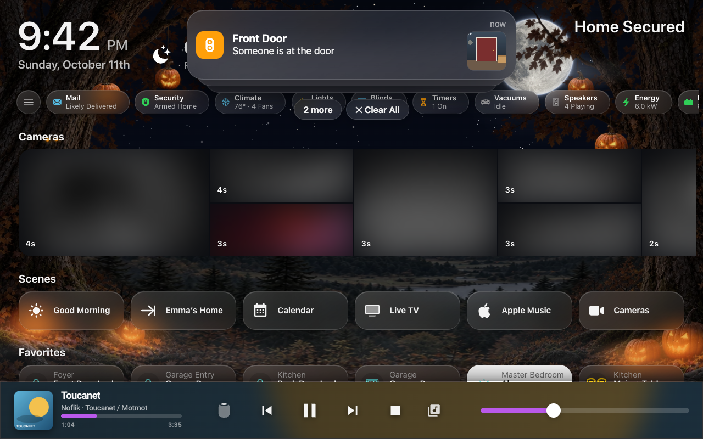
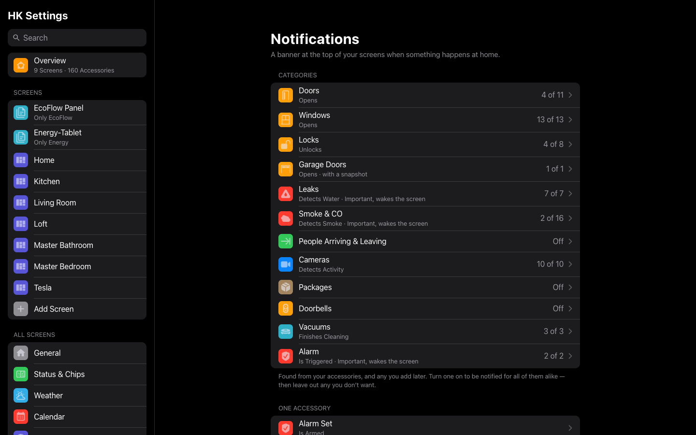
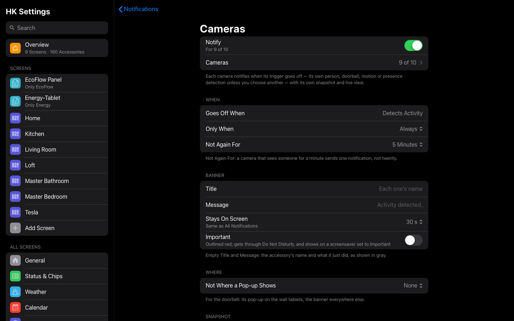
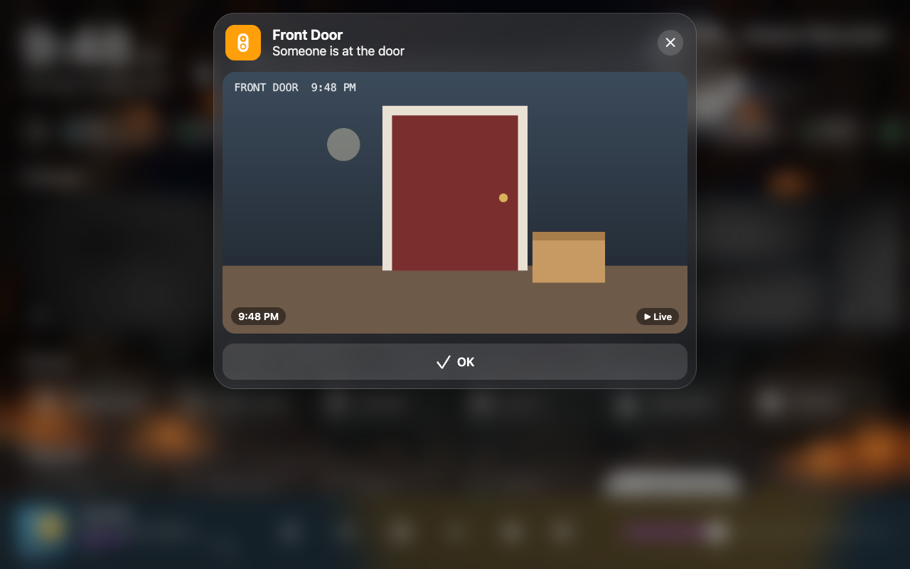

# Notifications

A banner at the top of your screens when something happens at home, like an
iPhone’s: a door opens, someone arrives, the doorbell rings, a camera sees a
person. A camera’s snapshot, taken the moment it happened, can come with it.


*A banner on a wall tablet: the accessory, what it did, and the camera’s snapshot.*

Add it with **Add feature → Notifications** ([Features](Features.md)). There
is nothing to answer; everything is on its HK Settings page,
**Features → Notifications**: **Categories** at the top, then **One
Accessory** (your own notifications and **Add Notification**), **Where They
Show** and **Banner**.


*Features → Notifications in HK Settings.*

## Categories

At the top of the page, **Categories** lists the kinds of accessory your home
has — Doors, Windows, Locks, Garage Doors, Leaks, Smoke & CO, People Arriving
& Leaving, Cameras, Packages, Doorbells, Vacuums, Alarm — found by
themselves from Home Assistant (accessories hidden in Home Assistant, and
HK Frontend’s own, are left out). A category your home has nothing for isn’t
listed. Each row says **Off**, or how many of its accessories notify
(“4 of 5”).

- **Turn one on** with its **Notify** switch, and every accessory of that kind
  notifies alike, with one set of settings (the same ones as
  [a notification](#a-notification) below); each banner names its own
  accessory. Turn it off and the category stops, its settings gone.
- **Accessories** lists them by room: untick any you don’t want (a closet
  door, an indoor sensor). One added to Home Assistant later is found and
  included unless you untick it.
- **Not Again For** is kept for each accessory: one door opening doesn’t
  silence the others.
- **Camera Snapshot** in a category takes each accessory’s own camera (the
  one on the same device) — **Each One’s Own Camera** — or one camera you
  pick for all of them.
- **Send Test** shows it for one of its accessories, as if it just went off.


*A category in HK Settings: one switch, its accessories, and one set of settings for all of them.*

They start sensibly:

| Category | Goes off when | Starts with |
|---|---|---|
| Doors, Windows | Opens | |
| Locks | Unlocks | |
| Garage Doors | Opens | |
| Leaks, Smoke & CO | Detects water, smoke or CO | Important, Wakes the Screen, Until Dismissed |
| People Arriving & Leaving | Arrives Home | |
| Cameras | Its trigger goes off (below) | A snapshot, Not Again For 5 minutes, a tap opens the camera live |
| Packages | A camera detects a package | A snapshot, Not Again For 15 minutes |
| Doorbells | Rings | A snapshot; not where the `#doorbell` pop-up shows |
| Vacuums | Finishes Cleaning (or Needs Help, Starts Cleaning) | |
| Alarm | Is Triggered | Important, Wakes the Screen, Until Dismissed |

Change any of them on the category’s page.

### Cameras

**Cameras** lists every camera once: a camera’s high, medium and low channels
are one camera, and its best channel is the one shown live. Each camera has
its own page:

| Setting | What it does |
|---|---|
| **Notify** | Whether this camera notifies. |
| **Goes Off When** | Its **trigger**: the sensor that sets it off. **Suggested** is the camera’s own device’s person detection, else its doorbell, motion or presence sensor; or choose any binary sensor or event. |
| **Live View** | The camera its snapshot and live view come from: **This Camera**, or another (a doorbell’s sensor with the driveway camera, say). |

The banner is the camera’s name and what the trigger saw (“Front Door
Camera” · “Person detected.”), with the snapshot; a tap opens it live. A
camera with nothing on its device to suggest says **No trigger — choose
one** in the list and stays quiet until you do. A suggestion follows the
house: a camera you haven’t changed picks up a new sensor by itself.

## A notification

For one accessory of its own (**One Accessory → Add Notification**), or
anything a category doesn’t cover — a washer finishing, the alarm being set,
a timer ending.

**Add Notification** asks for an accessory. What it can go off for, its words
and its camera are suggested from what the accessory is; change any of them.

| Setting | What it does |
|---|---|
| **Accessory** | What it watches: a door or window sensor, a lock, a garage door, a person, a camera’s motion or person detection, the doorbell, a leak or smoke sensor, a switch, a timer… |
| **Goes Off When** | What it does that sets it off; its kind decides the choices. A door or window: Opens, Closes or Either. A person: Arrives Home, Leaves Home. A lock: Unlocks, Locks, Jams. A garage door: Opens, Closes. An alarm: Is Triggered, Is Armed, Is Disarmed. A vacuum: Finishes Cleaning, Needs Help, Starts Cleaning. A timer: Ends, Starts. A leak sensor: Detects Water, Dries. A switch: Turns On, Turns Off. |
| **Only When** | Always, Someone Is Home, Nobody Is Home, or At Night. |
| **Not Again For** | Once it has gone off, not again for this long: Every Time, 1 minute, 5 minutes, 15 minutes or 1 hour. A camera that sees someone for a minute sends one notification, not twenty. |
| **Title**, **Message** | Empty: the accessory’s name and what it just did (“Garage Door” · “Opened.”, “Emma arrived” · “Emma is home.”), shown in gray. |
| **Stays On Screen** | How long its banner stays. **Default** follows Banner → Stays On Screen (30 seconds unless changed); or 10 seconds up to 5 minutes, or **Until Dismissed**. |
| **Important** | Outlined red. Gets through Do Not Disturb, and shows on a screensaver set to show only the Important ones. |
| **Wakes the Screen** | (Shown for an Important one.) Wakes every screen that allows notifications: from its photo screensaver, or from the [Sleep Screen](Sleep-Screen.md)’s dark, quiet hours too. The banner shows once the screen is up. |
| **Not Where a Pop-up Shows** | A screen that opens this pop-up for it shows the pop-up alone. The doorbell’s is `#doorbell`, so the wall tablets show the doorbell pop-up and phones and computers show the banner. |
| **Camera Snapshot**, **Camera** | A picture taken the moment it goes off. A camera’s own sensor suggests the camera on the same device; any notification can have one (someone arriving can show the driveway). For an accessory with no camera of its own (a washer), turning it on asks which camera first. |
| **Tap Opens** | What a tap on the picture does: **Live Camera** (with a snapshot), **Accessory Sheet**, or **Nothing**. |

**Send Test** shows it now on every screen that allows notifications, as if
it went off, marked *Test*. **Delete Notification…** removes it.

## On a screen

- The banner slides down at the top, centered, and slides away by itself
  after Stays On Screen. A finger on it holds it. On a phone it sits just
  under the Dynamic Island (or the camera cutout), in the Home Assistant app
  too.
- It shows over the dashboard, and over the photo screensaver as **On the
  Screensaver** says ([Where they show](#where-they-show)).
- **Swipe it up or sideways** to dismiss it.
- **Tap it** (or pull it down) to open it: the snapshot big, and buttons for
  what the accessory can do now — **Close** a garage door, **Lock** a lock,
  **Open Camera**.


*A banner tapped open: the snapshot big, Live for the camera, and OK.*

- **Several at once** stack, the newest on top, with **N more** and
  **Clear All** under them. N more fans them out into a list; each one can be
  swiped away.
- A wall tablet or a computer plays a soft chime (twice for an Important one)
  when **Chime** is on.
- A screen that is hidden (another app in front, the page in the background)
  shows what came in meanwhile when it comes back, if it hasn’t timed out.

There is no history: a banner that’s gone is gone. Phones have their own
notifications from the Home Assistant app; HK Frontend’s show while its
dashboard is open.

## Where they show

On **Features → Notifications → Where They Show**:

| Setting | Default | What it does |
|---|---|---|
| **Screens** | Every screen | Each screen’s **Allow Notifications**, all on one page. Every notification goes to every screen that allows them. |
| **On the Screensaver** | Important | **All**, **Important** (only the Important ones over the photos), or **Off**. A notification set to Wakes the Screen wakes it whatever this says. |
| **Do Not Disturb** | Off | No banner while it is on, except an Important one. **Scheduled**: every day, from–to (it starts at 10 PM–7 AM, and may run past midnight). **While This Is On** (Add…): any entity listed being on — an input_boolean, a switch, a timer while it runs. |

And under **Banner**:

| Setting | Default | What it does |
|---|---|---|
| **Stays On Screen** | 30 Seconds | How long a banner stays: 10 seconds up to 5 minutes. Each notification can choose its own, Until Dismissed included. |
| **Chime** | On | Wall tablets and computers play a soft chime; an Important one plays it twice. |

Each screen can have its own, in its **Notifications** group, after
Behavior ([Screens](Screens.md#notifications)): **Allow Notifications**, **On the
Screensaver** (Same as All Screens, All, Important Only or Off) and **Do Not
Disturb** (Same as All Screens, **Off on This Screen**, or **Its Own Hours**
with its own While list). **Copy Settings From…** copies them with
Behavior.

A screen that is asleep (the Sleep Screen’s dark) shows nothing, except a
notification that wakes it.

## From an automation

The action **HK Frontend: Show notification** (`hk_frontend.notify`) puts a
banner of your own on the screens, for anything the notifications above
don’t cover: the washer finishing, a reminder, a door left open too long.

| Field | What it does |
|---|---|
| **Title** | Required, up to 40 characters. |
| **Message** | Up to 120 characters. |
| **Important** | Gets through Do Not Disturb, and shows on a screensaver set to Important. |
| **Wakes the Screen** | Turns a sleeping screen on to show it (and makes it Important). |
| **Stays On Screen** | Seconds; 0 keeps it until dismissed. Empty: All Screens’ Stays On Screen. |
| **Icon** | Any `hk:` or `mdi:` icon. |
| **Accessory** | Its icon and buttons (Close a garage door, Lock a lock); a tap opens its sheet. |
| **Camera** | A snapshot taken the moment it is sent; a tap opens the live view. |
| **Tap Opens** | **Camera**, **Sheet** or **None**. |
| **Dashboards** | Only these screens (their addresses, `dashboard-kitchen`). Empty: every screen. |
| **Users** | Only screens signed in as these users (user ids). Empty: everyone. |

Each screen then decides as it does for any notification: its Allow
Notifications, Do Not Disturb and screensaver settings apply. Notifications
must be added first (**Add feature → Notifications**).

```yaml
- alias: Laundry - Basement - Washer Done Banner
  triggers:
    - trigger: state
      entity_id: sensor.washer_status
      to: complete
  actions:
    - action: hk_frontend.notify
      data:
        title: Laundry
        message: The washer is done.
        icon: mdi:washing-machine
        stay: 120
        dashboards: [dashboard-kitchen]
```

## How it works

The house watches the accessories, not the browsers: a notification goes off
once, however many screens are open, and Not Again For is kept by the house.
The snapshot is taken by Home Assistant at that moment and kept ten minutes,
so every screen shows the same picture. Each screen then decides whether to
show it (its settings, Do Not Disturb, its screensaver, asleep, a pop-up).

Wakes the Screen asks the [Sleep Screen](Sleep-Screen.md) of every screen it
decides for to show the dashboard for a while (the banner’s time, at least a
minute and at most five; five for Until Dismissed). A screen whose Sleep
Screen is *Decided By: An Automation* is not woken by the house; its
screensaver still closes for it if the page is up.

New screen code reaches a wall tablet when its kiosk’s cache is cleared (see
[Wall tablets](Wall-Tablets.md)).
