# Screensaver and Idle

The last two steps of setting up a [wall tablet](Wall-Tablets.md), and what
keeps a tablet awake.

## 5. Add the photo screensaver

The screensaver shows your photos with the time, the weather, what is playing,
any running timers and the home’s status over them. It is part of HK Frontend
(nothing to install), and it runs only on a wall tablet: a computer or a phone
opening the same screen never gets it.

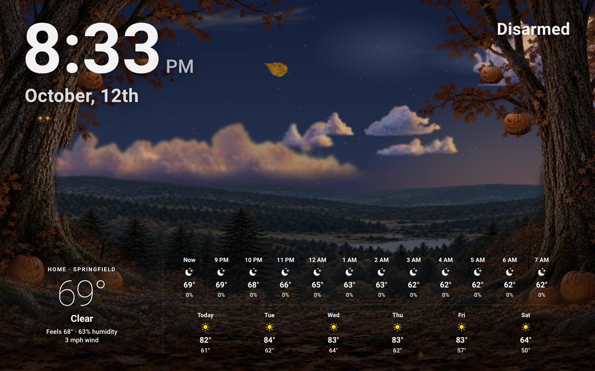

*(The photo is one of HK Frontend’s own [Landscapes](#landscapes), standing
in for one of yours.)*

1. Put some photos in a folder of Home Assistant’s media, and tell HK
   Frontend where: **HK Settings → All Screens → Screensaver → Screensaver
   Photos**. The
   default, `media-source://media_source/local/photos`, is a `photos` folder in
   your local media. Folders inside it are shown too.
2. Open the screen in HK Settings. Under **When Idle**, turn on **Photo
   Screensaver**. Under **Wall Tablets**, the tablets that run it are listed;
   add one with **Add a Tablet to This Screen…** if there is none yet
   ([Wall Tablets](Wall-Tablets.md#3-add-the-tablet)).
3. Optional: **Screensaver Options** (see [the settings](Screens.md#screensaver-options)). A
   screen uses the settings for All Screens (**All Screens → Screensaver**)
   unless you turn off **Same as All Screens** and give it its
   own; the row then reads **Just This Screen**.

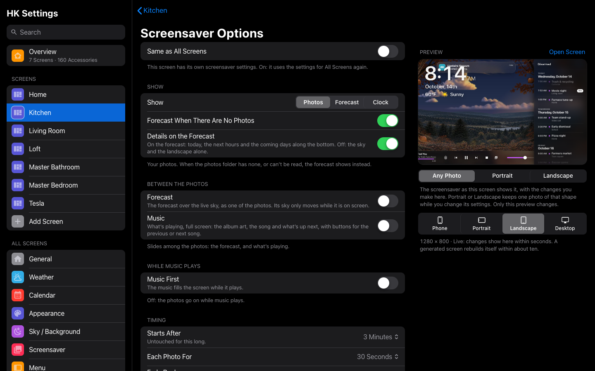

On this page the preview beside the settings shows the screensaver itself, as
that screen shows it, and changes as you change the options. Only the preview
changes: the tablet, its switch and its photos are left alone.

**Setup Check** counts the photos it finds, and says so when the folder is
empty or can’t be read, or when a screen has the Photo Screensaver on but no
tablet runs it.

### How it behaves

- It starts once the screen has been left alone for **Starts After** (3
  minutes). It never starts over an open detail sheet or while Live TV is
  playing.
- The photos cross-fade every **Each Photo For** (30 seconds). In **Random**
  order every photo is shown once before any is repeated.
- **Portrait Photos** and **Landscape Photos** each have their own settings.
  By default a portrait photo is shown whole, over a blurred copy of itself,
  and a landscape photo fills the screen. For each:
  - **Show As**: **Whole** (over a blurred copy, with its **Background Blur**
    and **Background Dim**) or **Fill the Screen** (cropped to the screen).
  - **Zoom** (100–200%) closes in on the focus.
  - **Focus** (**Top / Center / Bottom** and **Left / Center / Right**): the
    part that stays when the photo is cropped. **Top** keeps the faces in most
    portraits. For a whole photo it is its **Position**, where it sits when
    there is room around it.
  - **Reset to Default** puts them back.

- **Layout: Mosaic** shows 2 to 5 photos at once (**Photos per Mosaic**), in a
  layout picked at random each time, never the same twice running: a big one
  beside two, three columns, a grid of four and more. Portraits go in the tall
  cells and landscapes in the wide ones, and each is cropped by its shape's
  **Focus** and **Zoom** below. **Spacing**: **None**, **Thin** or **Rounded**
  (gaps and rounded corners, like the Home Screen's widgets), with the lines
  between the photos as you like them: **Line Thickness** (1–24 px; Spacing’s
  own to begin with, 3 for Thin and 12 for Rounded) and **Line Color**
  (**Black**, **White**, **Gray**, **Charcoal**, **Cream** or **Navy**).
  **Changes**:
  **One Photo at a Time** swaps one cell every Each Photo For and, after a
  while, the whole mosaic; **All at Once** brings a new mosaic each time. A
  tap on an edge always brings a new one. Each photo is drawn at its cell's
  own size, so five photos cost a tablet about what one full-screen photo
  does. Every photo fills its cell, so with Mosaic on, Portrait Photos and
  Landscape Photos show only **Zoom** and **Focus**.

  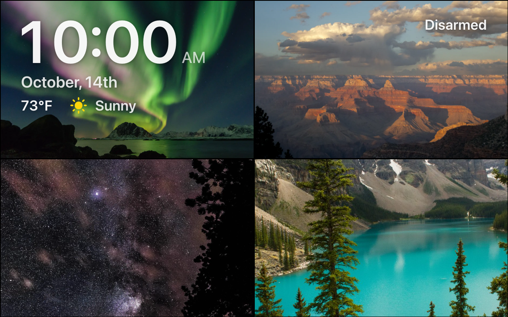

  **Up To** brings a different number of photos now and then: from one (a
  single photo, full screen) up to Photos per Mosaic, a new number every
  **A New Number Every** (1, 5, 10, 15, 30 or 60 minutes; 10 to begin with).

  Above the preview, **Portrait** or **Landscape** shows a photo of that shape
  and keeps it while you change its settings, laid out again in place (**Any
  Photo** lets the photos change again). The
  layout is the browser's, once per photo: it adds nothing to what the tablet
  draws between photos.
- Over the photos: the clock and date, the weather, what is playing, running
  timers, and **Home Status** top right (“Home Secured” when the alarm is set
  and everything is shut and locked; otherwise what is open or unlocked;
  nothing when there is nothing to say). Each can be turned off under **Over
  the Photos**.
- **Tap the left or right edge** for the previous or next photo (on
  **Show: Clock** there is no stepping, even with photos or the Landscapes
  behind the clock: a tap anywhere closes it). **A tap
  anywhere else closes it**, and that tap never presses anything on the
  screen behind; taps are ignored for 3 seconds after, so a second tap cannot
  either.
- **Tap the forecast details** (today, the hours and the days along the
  bottom) to close it onto the dashboard’s **Weather** page, when it has one.
- **Back to the dashboard**: whether a tap closes it or the switch is turned
  off, the dashboard is first drawn underneath, then the screensaver fades
  away over **Fade Back** (half a second; **Instant**, 1 or 2 seconds).
- Behind the photos the live sky, every animation and the live camera tile
  hold still, so the tablet does very little while it shows.

### A clock

**Show: Clock** (beside Photos and Forecast) makes a clock the screensaver,
full screen. Over the photos or the forecast, the **Clock** row is
**Corner** (the small clock and date, top left), **Large** (the same clock
as Show: Clock, centered, in place of the small one) or **Off**.

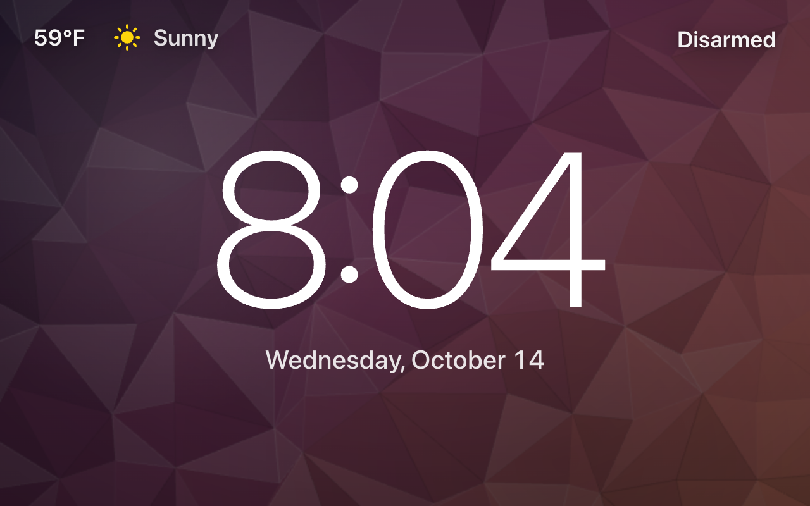

One **Clock Style** serves Show: Clock and a Large clock; its page lists the
fifteen, with the preview showing the one you pick:

| Style | Look |
|---|---|
| Today | The date, the time, the weather and what's playing, set as one block; its color follows the day (dawn orange, day blue, evening pink, night indigo) unless you pick one |
| Classic | Huge thin digits, like the lock screen |
| Big Serif | An editorial italic, like a magazine cover |
| Neon | Glowing tubes; the colon hums now and then |
| Retro LCD | Seven segments on a backlit panel |
| Flip | Split-flap cards that flip as the minute turns |
| Analog | A watch face with a sweeping second hand |
| Words | “It is quarter past seven”, lit in a grid of letters |
| Minimal Arc | The hour, big; the minutes a ring filling round it |
| Nixie Tubes | Orange glow in glass tubes |
| Poster | Swiss-poster bold, hours over minutes |
| Dot Matrix | An amber LED departure board |
| Day Ring | Today as a ring: daylight, night, where the sun is, and the next sunrise or sunset |
| Glass | The time on a frosted pane |
| Typewriter | A sentence, typed out, the cursor blinking |

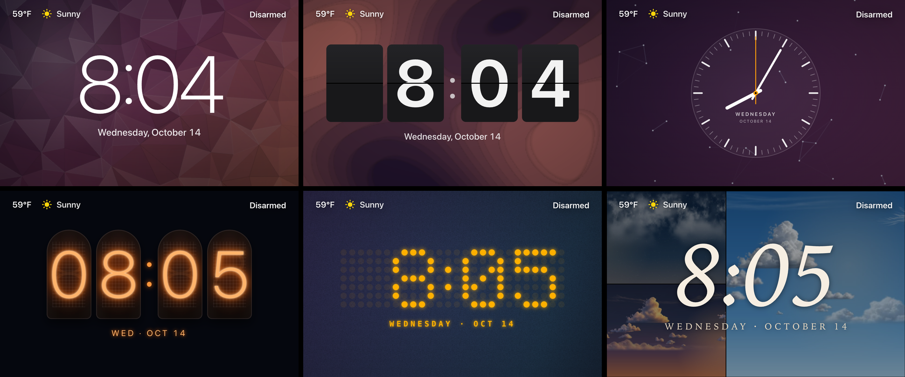

**Color**, under the style and at the top of its page, offers that
style's own colors (Classic: White, Warm, Ice Blue, Mint or Rose; Today: By
Time of Day, or one color). Each style keeps its own, so trying another
style loses none.

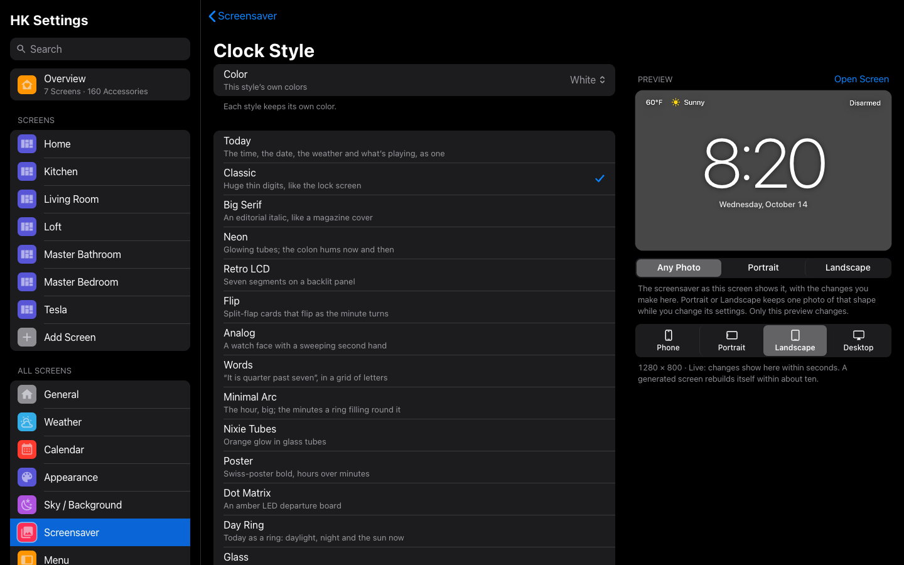

Every style shows the date, and **24-Hour Time** switches them all. On a
screen left on all night the clock drifts a few percent every five minutes,
so nothing burns in. The digits are set the way Apple sets a big clock:
proportional, so a “1” doesn’t leave a gap, with the colon raised to the
middle of the digits.

Today carries its own weather and music, so it stands in for the **Weather**
and **Now Playing** corners while it shows (Home Status and Timers stay).

A screen's page offers a **Recommended for** its room when its clock isn't
already the one suggested there, one tap to take it: a bedroom Minimal Arc on
Black with Night Mode, a bathroom Classic on Black with Night Mode, a kitchen
Today on Sky Only, a living room Classic on Sky Only, an office Flip on a
Drifting Gradient, an entry or garage Today on Black, and anywhere else Today
on Sky Only.

**Night Mode** (with Show: Clock, or a Large clock): **Off**, **At Night**
(**From** and **Until**, 22:00 to 07:00 to begin with, across midnight) or
**Always**. Like StandBy on an iPhone, the clock and everything over it turn a
dim red on black and nothing behind the clock is drawn, so a bedroom stays
dark. It comes and goes on its own, checked every half minute.

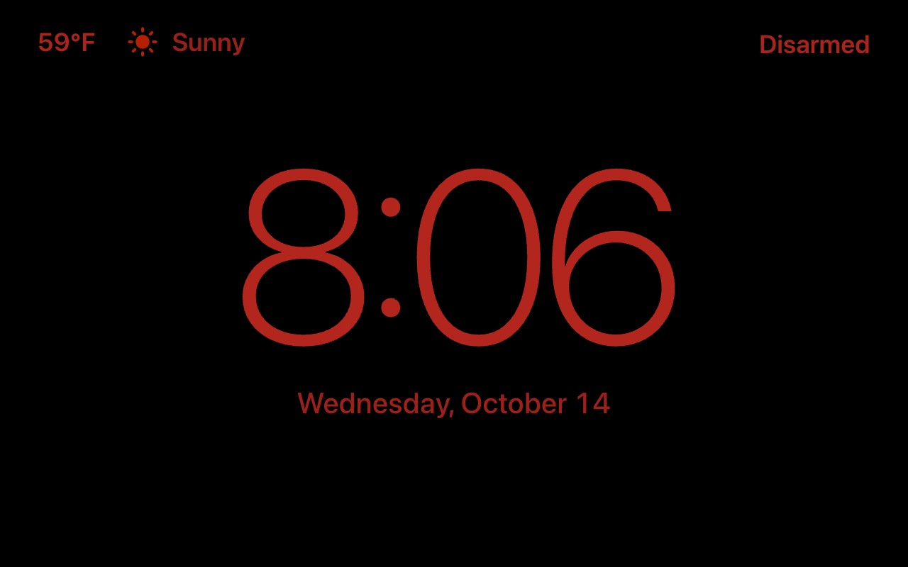

With Show: Clock:

- **Behind the Clock → Background**: **Black**; **Grain Wash** (two
  colors drifting under fine grain), **Drifting Gradient**, **Aurora**, **Ink
  Swirl** or **Follow the Sky** (the live sky's colors as they are now, a
  soft light drifting across, no stars or weather); **Low Poly** (a light
  sweeping across facets in the part of the day's colors), **Topography**
  (contour bands flowing slowly) or **Constellation** (drifting points joined
  by fine lines); **Forecast** (the forecast's sky and the season's land);
  **Sky Only** (the same live sky -- its clouds, stars, sun, moon, rain and
  snow -- with no land, trees or decorations under it); **Photos** (your
  photos, below); or **Landscapes** (HK Frontend's own photos, below).
  Every one but Black moves. Forecast and Sky Only move as the live sky
  does, and Photos and Landscapes as the photos change. The rest (Grain Wash
  through Constellation) have **Speed**, how fast (0 holds it still,
  changing once a minute, for a tablet that runs warm), and **Depth**, how
  strong (the colors, the glow, the relief, how many contours or points).
  They're drawn on the tablet itself and moved smoothly by the browser: a
  new frame about once a second, blended continuously into the last (Low
  Poly's facets are drawn once and its light slides across them;
  Constellation draws up to 30 frames a second), so they cost little.
- **Over the Clock**: **Weather** (top left), **Now Playing** (bottom left),
  **Timers** (bottom right), **Home Status** (top right) and the forecast
  along the bottom, each its own switch: turn them all off for the clock
  alone. **Music First** and the **Side Pane** work as they do over the
  photos; the clock moves over beside the pane. While the music fills the
  screen, the small clock and date tell the time above it, top left (with a
  Large clock over the photos too).
- Glass draws its frosted pane from the background itself, the way
  Pre-rendered glass does, never as a live blur.

**Photos behind the clock** are the photos themselves, laid out by the same
**Photos** settings as the Photo Screensaver: **Layout** (**One at a Time** or
**Mosaic**, with all of the mosaic’s settings), **Order**, **Each Photo For**,
**Slow Zoom**, and **Portrait Photos** and **Landscape Photos**. **Darken**
(0–80%, 35% to begin with) dims them so the clock reads. **Photos: Sharp**
shows them as they are; **Soft** is the older look, blurred, dimmed copies
one at a time.

### Landscapes

**Behind the Clock → Landscapes** shows fifty photos that come with HK
Frontend in place of your own: mountains, lakes, coasts, deserts, canyons,
forests, waterfalls, snow, the Milky Way and the northern lights. Nothing to
set up, and nothing of your home on the screen. They change and lay out the
way your photos do (**Each Photo For**, **Order**, **Layout**, **Darken**,
**Sharp** or **Soft**).

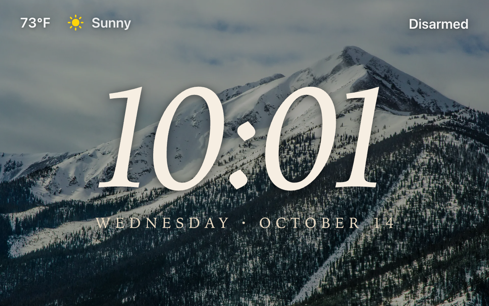

They are 1920 pixels wide, about 300 KB each, and every one is public domain
or CC0, from Wikimedia Commons; `frontend/landscapes/index.json` lists each
photo's source. To show a set of your own instead, put an `index.json` and
your pictures in a `landscapes` folder of [your files](Your-Files.md): it is
read in place of the bundled one.

**Clock Text**, over photos, sets how much the clock stands out from them:
**Shadow** (a soft shadow under it, 40% to begin with) and **Outline** (a dark
outline around it, 0 to begin with). The same two sliders are there for a
**Large** clock over the photos.

In HK Settings' preview, choosing a style redraws the clock where it is, so
you can compare them one after another.

### No photos? The forecast

Without photos (none in the folder yet, or a folder that can’t be read), the
screensaver shows the **forecast** instead, and you can choose it outright:
**Screensaver Options → Show → Forecast**. Rather have a dark screen when
there are no photos? Turn off **Forecast When There Are No Photos**. Or have
both: **Between the Photos → Forecast** brings the forecast round as one of
the photos every few photos (**A Slide**: every 3, 5, 10 or 20), for as long
as a photo shows; its sky only moves while it is on screen.

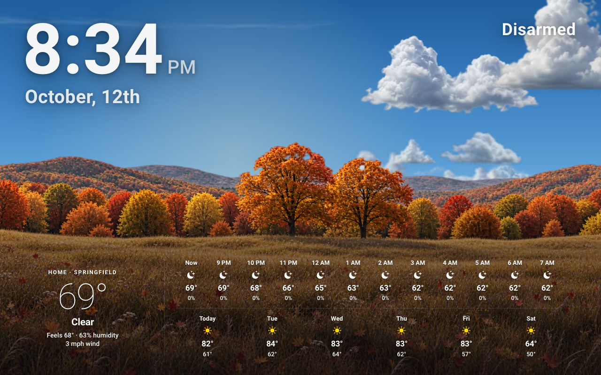

- The live sky fills the screen, the same one the pages draw, following the
  real sun, clouds, rain and snow, over a landscape of the season: spring,
  summer, fall or winter, by day, at dusk and by night. It is one valley
  through the year, so the light changes around you rather than the place. Falling rain and
  snow pass in front of the hills. South of the equator the seasons are
  flipped, and snow falling makes it winter.
- It moves a little more than the pages’ sky: the clouds drift twice as
  fast, the brighter stars twinkle, a clear night brings a shooting star now
  and then (one every minute or two), and on a summer night fireflies
  blink over the meadow. The moon keeps to the right, clear of the clock.
- On the holidays the landscape dresses up, on the same days as the
  [seasonal decorations](Seasonal-Decorations.md#on-the-forecast-screensaver):
  carved lanterns in the trees and jack-o’-lanterns at their feet at
  Halloween (by day as well as at dusk and night), strings of bulbs through
  the trees with a snowman and presents at Christmas, bunting, the flag,
  café lights and hydrangeas on the Fourth of July, and on a birthday café
  lights, presents and balloons over whichever season is showing.
- Along the bottom, the forecast details: today’s conditions, the next 12
  hours and the next 6 days, from the weather set in **HK Settings →
  Weather**. **Details on the Forecast** turns them off, for the sky and the
  landscape alone; **Over the Photos → Forecast Along the Bottom** puts them
  over your photos too.
- The clock and date, Home Status, now playing and timers stay, the last two
  above the forecast.
- While the screen is dark (the kiosk app’s own screensaver, or the screen
  off) the sky holds still. Fully Kiosk is asked through its JavaScript
  interface (**Advanced Web Settings → Enable JavaScript Interface**); Kiosk
  Satellite announces its screensaver and screen to the page itself. Without
  either, the sky holds still only when the browser reports the page as hidden.
- When the photos have covered the page, the dashboard goes back to its top,
  unseen, so the next wake starts there.
- A tap anywhere closes it. There are no photos to page through.

### The music

**Between the Photos → Music** brings what’s playing round as a slide of its
own, full screen: the album art, large, over a blurred copy of itself, with
the song, the artist, the album, the room (and how many more are grouped with
it), how far into the song, and what’s up next. With **Forecast** on too, the
two take turns. It only comes while music plays anywhere in the house.

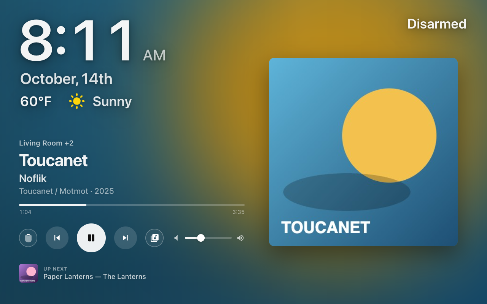
*The Music slide: its buttons and volume work without closing the screensaver.*

- **Its buttons work without closing the screensaver:** previous, play or
  pause, next, and a volume slider you drag. A slide touched stays its full
  time again. **A tap on the album art opens Music** on that music. A
  touch anywhere else closes the screensaver, as always.
- The clock, the date and the weather stay at the top left; the song sits
  below them, the art on the right.
- **While Music Plays → Music First** makes the music the screensaver while
  it plays: it fills the screen in place of the photos (or the forecast) and
  stays, and the photos (or the forecast) come back 20 seconds after it
  stops (a pause from its own button keeps it there meanwhile). The
  screensaver starts straight into the music when something is already
  playing. With **Show: Clock** or a **Large** clock, the music covers the
  big clock, so the small clock and date show above the music while it
  plays.
- The music is the one this screen follows, as the dashboard’s music pages
  do: the one you chose there, or what started playing (this tablet’s room
  first). Up Next and the album’s year come from Music Assistant; other
  speakers show the rest.

#### Speakers, Volume and Browse

Either side of the music’s buttons are two more: **Speakers** (a HomePod) on
the left and **Browse** on the right, in the slide and in the side pane. A tap
turns the album art over (in the side pane, the whole pane) and the panel is
on its back, with three tabs:

- **Speakers**: every room; what’s ticked is where it plays. The rooms in
  the music start ticked and say *Playing here*; a room playing something
  else says what. Tap rooms to tick or untick them, then **Update**: the
  music plays on exactly the ticked rooms (rooms join, rooms stop, or it
  moves to them). **Reset** puts the ticks back. The line above the buttons
  says what Update will do before you press it. **Everywhere**,
  **Downstairs** (your presets) tick their rooms, and play on Music
  Assistant’s own sync group, as on the Music page.
- **Volume**: a slider for each room in the music (the slider on the front
  sets them all).
- **Browse**: your playlists, then the Music page’s Browse itself (search,
  your Discover rows, Artists, Albums and the rest), all playing on the rooms
  ticked under Speakers: the music’s own speakers, unless you ticked others
  (then the line at its top says **Plays on** them, and the rooms you
  didn’t tick keep playing what they play). Search uses the
  tablet’s keyboard; the screensaver stays up while you type.

It closes by itself a moment after Update or a play has gone through,
after 30 seconds untouched, and when the music stops; or tap ✕, the same
button again, or anywhere outside it (that tap never wakes the dashboard).
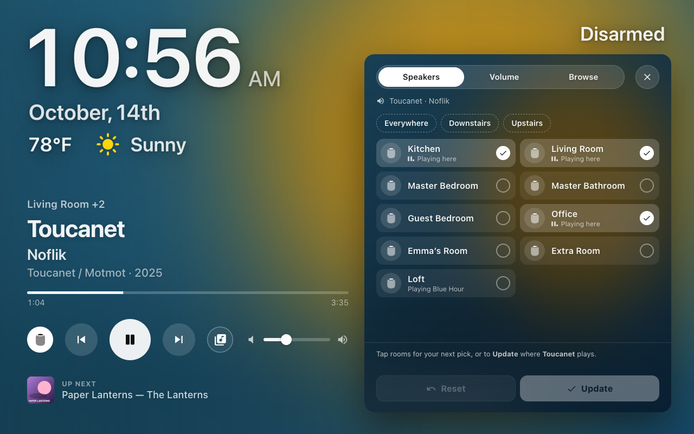
*The Speakers panel on the back of the album art.*

While it’s open the slide stays put and the music’s other buttons still work.
On a tablet whose Sleep Screen is HK Frontend’s, using it keeps the photos
up ([Sleep Screen](Sleep-Screen.md)).

### Home Energy and additional screens

**Home Energy** is today so far against a usual day, in the Energy page’s own
rings: energy, cost and water (solar and gas too where Home Assistant’s
Energy settings have them), each ring today against a usual *whole* day, with
a white dot where a usual day would be by this time. Beside them, each figure
and what a usual day comes to, a leader line drawing out to it as the rings
sweep in. Along the bottom: **Right Now** (what the house draws, the house
battery, yesterday by now) and **the month so far**, with where its cost is
heading (what it has cost so far, plus a usual day for each day left: the
Energy page’s own estimate, firmer as the month goes on).

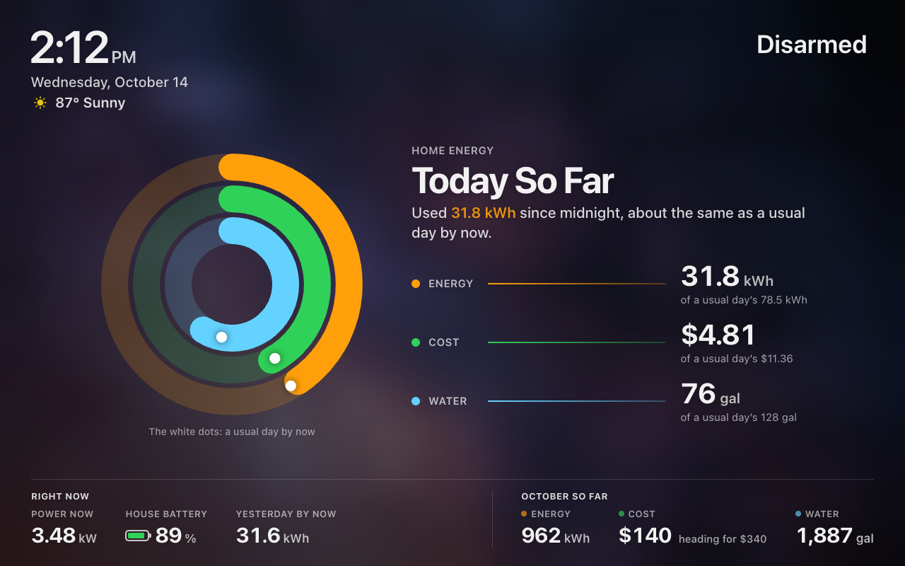

- **The numbers are the Energy page’s** Today and This Month, from the same
  meters and sums, so the two never disagree. Home Assistant closes an
  hour’s statistics only once it is over, so the five-minute statistics since
  the last closed hour are added on top: it is current to the last five
  minutes.
- **It tells the time itself**, top left: the time, the date and the
  weather, smaller than the screensaver’s corner clock, which fades while
  it shows. Home Status stays top right.
- **Behind it:** over the photos, a blurred, darkened copy of the photo;
  over the forecast, the sky held still and darkened; over a clock’s own
  background, a dark gradient of its own. It fades in over what’s there.
- **A tap on it opens the Energy page.**
- **Home Energy Options** (its row, once it’s on): which rings show (Energy
  always), Right Now’s three, the month and where its cost is heading. The
  preview holds Home Energy while you change them.
- It skips its turn until it has the day’s numbers (a missing number is a
  dash, never a zero).

**With Show: Photos** it is one of the slides **Between the Photos**: the
music, the forecast and Home Energy take turns, every **A Slide** photos.

**With Show: Forecast or Clock**, **Additional Screens** bring other screens
in now and then: **Forecast** (on Show: Clock, unless the forecast is already
behind the clock), **Music** (only while something plays; Music First covers
it, so it isn’t listed then) and **Home Energy**. **Every** few minutes one
fades in, for **Show For**, then the forecast or the clock comes back; with
more than one on, they take turns. None come while music plays first, in the
clock’s Night Mode, or while the screen is dark. More screens may join this
list later.

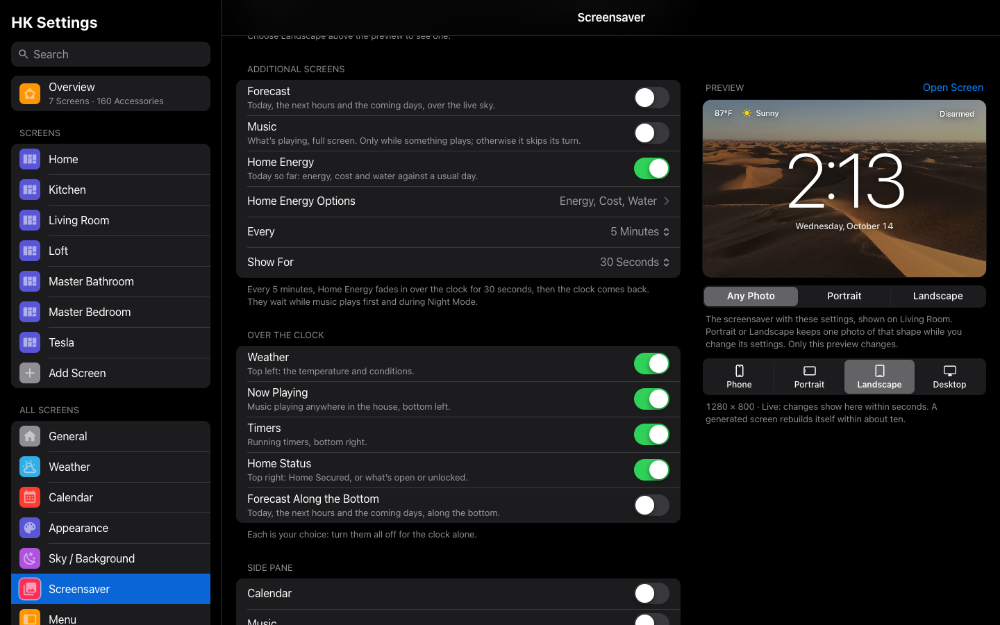

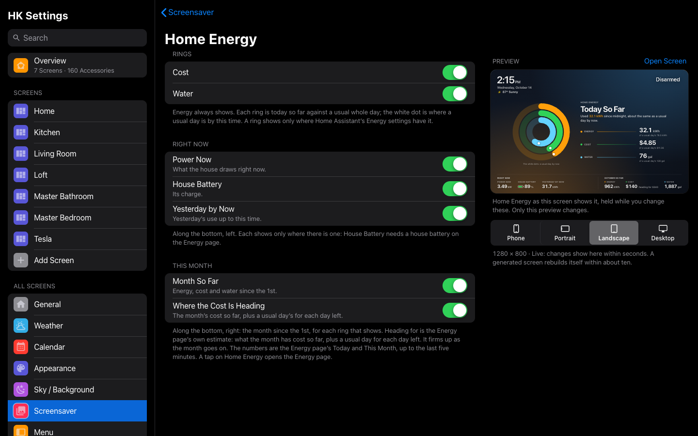

### The side pane: calendar and music

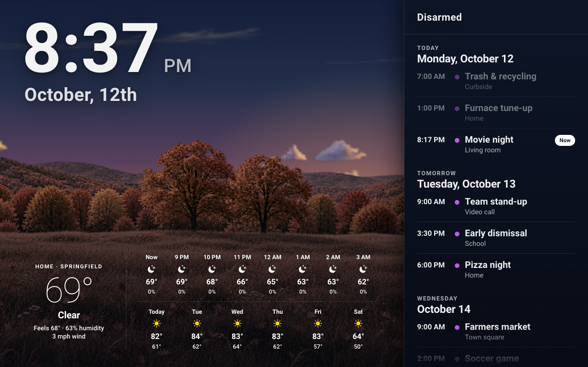

**Screensaver Options → Side Pane → Calendar** lists the coming events down the
right of the screen: today, tomorrow and as many days after as **Days** says
(up to 7), from the calendars in [All Screens → Calendar](Calendar.md), each in
its calendar’s color. All-day events come first; today’s past events are
dimmed, and the next one says how soon (“in 46 min”).

**Side Pane → Music** puts what’s playing in the same pane while music plays
(or is paused): the album art, the song, how far in, previous, play or
pause and next, the volume, and what’s up next, over a blurred copy of the
art. On its own it fills the pane, the art as large as fits; with
**Calendar** on too, the events are above it and the music below, the art
beside the song. Its buttons and slider work without closing the screensaver;
a tap on its album art opens Music. **Speakers** and **Browse** are here
too: the pane turns over, and its back keeps what plays at its foot (play or
pause, next).

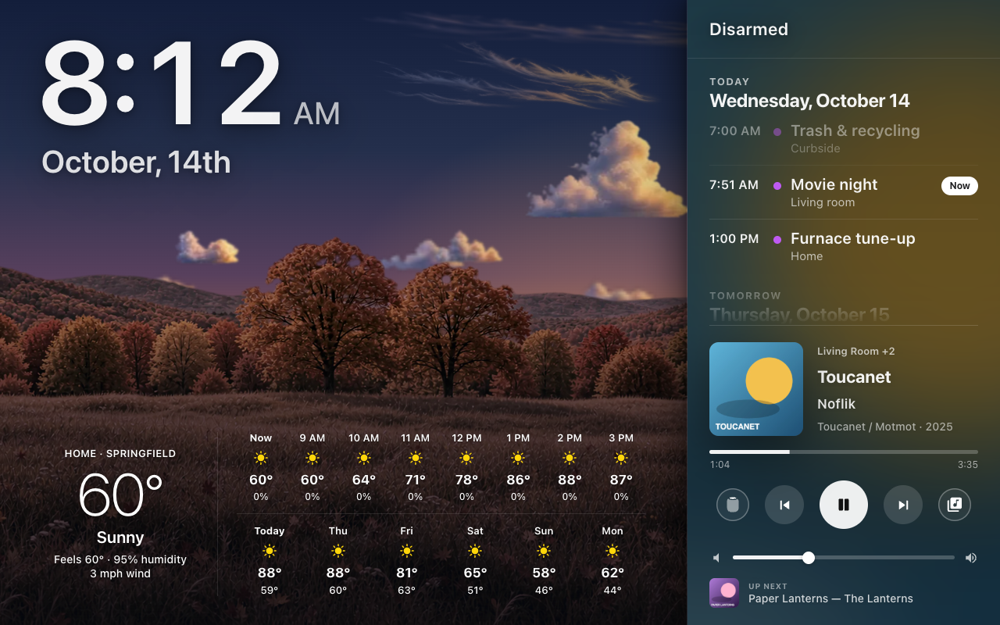
*Side Pane with Calendar and Music: the events above, what plays below.*

- **Only while music plays.** Twenty seconds after the music stops (a pause
  between songs doesn’t count), the music leaves: under the calendar, the
  events take the whole pane; on its own, the pane goes and the photos have
  the whole screen again.
- On its own, the pane comes and goes **with the next photo**, never moving
  the photo on screen; over the forecast, at once.

- The photos move over beside it, so the middle of each photo stays in view;
  behind the pane is a blurred copy of the photo. On the forecast the pane
  turns the night sky’s navy, and the forecast fits beside it: today on the
  left, the hours and the days beside it, as on the other screens.
- The pane is one column of what is going on: Home Status at its top (on as
  many lines as it needs, the list starting below it), the events, and at its
  foot what is playing (the music, with **Music** on) and the running timers. The clock, the date and the
  weather stay over the photos.
- **A swipe on the pane scrolls it** without closing the screensaver, the one
  place a finger doesn’t. A touch anywhere else closes it, as always. Left
  alone for 45 seconds, the pane scrolls back to today.

### Its switch and In Use sensor

You create nothing. Each [wall tablet](Wall-Tablets.md) gets these entities,
named after the tablet (a tablet called Kitchen gets these):

| Entity | What it is |
|---|---|
| `switch.kitchen_photo_screensaver` | **On while the photos show.** The screensaver turns it on when it starts and off when someone taps it. Turn it **on** to start the photos now (bedtime, say); turn it **off** to close them (a doorbell automation bringing the dashboard back). It keeps its state across restarts. |
| `binary_sensor.kitchen_screen_in_use` | **On while someone is using the tablet**: on at each touch, off once it has been left alone for its window (below). Only a real touch on the page counts. Nothing sent to the tablet from outside (a brightness change, a kiosk browser command) can turn it on. |
| `switch.kitchen_black_screen` | **On while the tablet is HK Frontend’s own black**, for a tablet whose **Sleep Screen** is drawn by *HK Frontend* ([Sleep Screen](Sleep-Screen.md)). Its `black_screen` attribute says which the screen uses (`kiosk` or `hk`), `brightness` the backlight to come back to, and `confirmed` that the page went black. |
| `sensor.kitchen_sleep_screen` | **What Sleep Screen decides** (`dark`, `photos`, `dashboard`, `hold`) and why, while HK Frontend decides; `automation` otherwise ([Sleep Screen](Sleep-Screen.md)). |

They carry the same attributes: `tablet` (its id), `dashboard` (the screen
it runs), `starts_after` and `in_use_window` (seconds), and `last_touch`
(when the tablet was last touched). Each tablet’s entities are a device of
their own, under the tablet’s item in **Settings → Devices & services → HK
Frontend**. Renaming the tablet renames the device and the entities’ names;
their entity ids stay as they are, so automations keep working. The screen’s
**Screensaver Options** page lists each of its tablets’ switch and In Use
sensor under **For Automations**. Tap one there to open it.

Only the tablet itself ever changes them: a computer opening the same
screen never gets a screensaver, never writes the switch, and never counts as
a touch.

### Sleep Screen

Dark when nobody needs the tablet, awake the moment somebody does: the
tablet’s **Sleep Screen** (**Wall Tablets → the tablet → Sleep Screen**) sets
how it goes dark (Kiosk Satellite’s black, or HK
Frontend’s own with the backlight at its lowest or the display off) and who
decides when: **your automations**, with the `hk_frontend.set_black_screen`
action, or **HK Frontend itself**, from presence sensors, quiet hours, the
doorbell, smoke, away mode and more, with the brightness for day and night.

**[Sleep Screen](Sleep-Screen.md) has all of it:** every setting, the order
its rules win, ready-made recipes for a kitchen, a bathroom and a bedroom,
and how automations work alongside it.

### One timer: Starts After

**Starts After** is the only number to set. It decides when the photos come
up, and the In Use window follows it: a **minute less** (never under 15
seconds). With the default 3 minutes:

- a touch keeps the screen **In Use for 2 minutes**;
- the photos come up after **3 minutes** untouched.

So the screen has always stopped counting as In Use a minute before the
photos can start. An automation that waits for In Use to go off before doing
something (dimming the screen, say) can never race the screensaver. Change
Starts After and the window moves with it; there is no second timer to keep
in step.

### Automations

Two examples, for a tablet called Kitchen.

Photos at bedtime, whether or not anyone touched the tablet:

```yaml
triggers:
  - trigger: time
    at: "22:30:00"
actions:
  - action: switch.turn_on
    target:
      entity_id: switch.kitchen_photo_screensaver
```

The dashboard back when the doorbell rings (with an
[answer pop-up](Detail-Sheets-and-Popups.md), the pop-up then shows over it):

```yaml
triggers:
  - trigger: state
    entity_id: binary_sensor.front_door_doorbell
    to: "on"
actions:
  - action: switch.turn_off
    target:
      entity_id: switch.kitchen_photo_screensaver
```

The screen off once the photos have shown for an hour, but never while
someone is using it (this example uses [Fully Kiosk Browser](https://www.home-assistant.io/integrations/fully_kiosk/)’s
screen switch; use whatever turns your tablet’s screen off):

```yaml
triggers:
  - trigger: state
    entity_id: switch.kitchen_photo_screensaver
    to: "on"
    for: "01:00:00"
conditions:
  - condition: state
    entity_id: binary_sensor.kitchen_screen_in_use
    state: "off"
actions:
  - action: switch.turn_off
    target:
      entity_id: switch.kitchen_tablet_screen
```

### Coming from 1.2 (the old helper)

Before 1.3 the switch was a Toggle helper you created,
`input_boolean.wallpanel_screensaver_<room>`, named by the screen’s Tablet
Room (now the tablet’s **Room**). If you have one, nothing breaks: while it
exists HK Frontend keeps it and the new switch in step both ways, so your
automations keep working. Move them to `switch.<tablet>_photo_screensaver`
when it suits you, then delete the helper.

### HK Frontend’s screensaver or WallPanel?

[WallPanel](https://github.com/j-a-n/lovelace-wallpanel) is a popular,
long-standing screensaver for any Home Assistant dashboard, with a great many
options. HK Frontend’s own is narrower on purpose: it is built for HK Frontend’s
screens on a wall tablet, and set up in HK Settings rather than in YAML. Both
work, and you can choose per screen.

| | HK Frontend’s screensaver | WallPanel |
|---|---|---|
| Install | Part of HK Frontend | From HACS, then YAML in each dashboard |
| Set up | HK Settings: Photo Screensaver, Screensaver Options, and the wall tablet that runs the screen | `wallpanel:` in the dashboard’s raw configuration |
| Who gets it | Only the screen’s wall tablets | Everyone who opens the dashboard, unless a profile turns it off (per user, or per browser with Browser Mod) |
| Its switch | `switch.<tablet>_photo_screensaver`, made for you | An `input_boolean` you create (`screensaver_entity`) |
| “Someone is using it” | `binary_sensor.<tablet>_screen_in_use`, made for you, with its window set by Starts After | No sensor for touches (a camera motion sensor, below) |
| Photos | Images from a Home Assistant media folder | Images and videos from a media folder, Immich, Unsplash, entity pictures, or whole websites |
| Without photos | The forecast, over the live sky and a landscape of the season (or a dark screen, if you prefer) | Nothing to show until a media source has images |
| The forecast among the photos | Between the Photos → Forecast: the full forecast every few photos | A weather card over the photos, or a weather web page among them |
| Over the photos | Clock and date, weather, now playing, timers, Home Status, drawn to match the screens | Any cards, badges or dashboard views; the box can move around; EXIF photo details, a progress bar |
| Effects | Cross-fade; Slow Zoom | Cross-fade; Ken Burns (pan and zoom), with more controls |
| While it shows | The live sky, card animations and the live camera tile hold still | Its own slideshow |
| Won’t start over | An open detail sheet, Live TV | An Assist dialog; optionally a Browser Mod pop-up |
| Beyond the screensaver | Home Assistant Header & Sidebar, in the screen’s Header group | Hides the header and sidebar, full screen, keeps the screen on, wakes on motion seen by the tablet’s camera |
| Checked by | Setup Check (photos found, the screen’s wall tablets) | — |

**Choose HK Frontend’s screensaver** for a screen on a wall tablet
when you want it working with two settings, a switch and an In Use sensor that
exist without creating anything, the forecast when you have no photos, and the
least work for the tablet behind the photos.

**Choose WallPanel** if you want videos, Immich or Unsplash, a website as the
screensaver, your own cards over the photos, the tablet’s camera to wake it,
or a screensaver that isn’t tied to a wall tablet.

### WallPanel instead

If you prefer [WallPanel](https://github.com/j-a-n/lovelace-wallpanel) (HACS)
and have it installed, on a generated screen **Screensaver Options → Use
WallPanel Instead** hands this screen’s
screensaver to it, with WallPanel’s own options. A screen using WallPanel gets
no switch or In Use sensor from HK Frontend: WallPanel reports through
`input_boolean.wallpanel_screensaver_<room>`, which you create, named by the
**Room** of the tablet that runs the screen (its area’s id).

### On a dashboard of your own

An existing dashboard gets the photo screensaver like any screen: give it HK
settings (**Screens → Add Screen → Existing Dashboards**), turn on **Photo
Screensaver**, and add the wall tablet that runs it. Its options, the
forecast, and its switch and In Use sensor are all as above, with nothing
written in its YAML.

Or write an `hk_screensaver:` block in the dashboard’s configuration; it then
wins over those settings. There is no switch made for you this way: `entity`
is optional, and can be any `input_boolean` or `switch` of yours, which the
screensaver then keeps in step the same way.

```yaml
hk_screensaver:
  user: Kitchen Tablet   # the tablet’s Home Assistant user
  tablet: kitchen        # optional, instead of user: the wall tablet’s id
  entity: input_boolean.kitchen_photos   # optional: yours, kept in step
  photos: media-source://media_source/local/photos
  starts_after: 180
  each_photo: 30
  order: random        # or sorted
  zoom: false          # Slow Zoom
  photo_layout: single # or mosaic (mosaic_count: 2 to 5)
  fill: true           # landscape photos fill the screen
  portrait_fill: false # portrait photos whole, over a blurred copy
  portrait_y: top      # the part kept when cropped: top, center, bottom (and portrait_x)
  show: photos         # photos, both (the forecast slide on), forecast or clock
  clock_over: corner   # over the photos: corner or large (clock: false for none)
  clock_style: classic # for show: clock and a large clock
  clock_bg: gradient   # behind show: clock
  clock_night: "off"   # "night" (clock_night_from to clock_night_to) or "always"
  forecast_every: 5    # a slide (the forecast, the music) after this many photos
  music_slide: false   # what plays, full screen: a slide among the photos
  music_first: false   # ...or the music fills the screen while it plays
  fallback: true       # no photos: the forecast (false: a dark screen)
  band: true           # the forecast’s details on the forecast
  band_photos: false   # ...and over the photos
  calendar: false      # the calendar pane, down the right
  calendar_days: 2     # ...today and tomorrow (1 to 7 days)
  music_pane: false    # what plays, in the pane (under the calendar)
  fade_back: 500       # ms back to the dashboard (0: at once)
  cards:
    - type: custom:hk-clock-card
    - type: custom:hk-weather-strip-card
      variant: inline
    - type: custom:hk-screensaver-now-card
      music: true
    - type: custom:hk-timer-strip-card
      entity: sensor.running_quick_timers
      fixed: true
    - type: custom:hk-screensaver-status-card
```

The block takes the other options too, with the same names the settings
keep:

- **Photos**: `portrait_fill`, `portrait_blur` (0–100) and `portrait_dim`
  (0–80) for the blurred copy, `portrait_zoom` (100–200), `portrait_x`
  (`left`, `center`, `right`) and `portrait_y` (`top`, `center`, `bottom`);
  the same with `landscape_`, except that a landscape photo’s Fill the Screen
  is `fill`.
- **Mosaic**: `photo_layout: mosaic`, `mosaic_count` (2–5), `mosaic_gap`
  (`none`, `thin`, `rounded`), `mosaic_line` (1–24 px; 0 is Spacing’s own),
  `mosaic_color` (`black`, `white`, `gray`, `charcoal`, `cream`, `navy`),
  `mosaic_change` (`one`, `all`), `mosaic_random` (Up To) and `mosaic_every`
  (minutes).
- **Clock**: `clock_style` (`today`, `classic`, `serif`, `neon`, `lcd`,
  `flip`, `analog`, `words`, `arc`, `nixie`, `poster`, `dots`, `ring`,
  `glass`, `type`), `clock_colors` (each style’s color, by style:
  `{classic: warm}`), `clock_24`, `clock_bg` (`black`, `grain`, `gradient`,
  `aurora`, `ink`, `sky`, `lowpoly`, `topo`, `constellation`, `forecast`,
  `skyonly`, `photos`), `clock_speed` and `clock_depth` (0–100), and
  `clock_night_from` and `clock_night_to` in quotes (`"22:00"`). For photos
  behind a clock, `clock_photo_soft`, `clock_photo_dim` (Darken, 0–80),
  `clock_text_shadow` and `clock_text_outline` (0–100).

With `show: clock` or `clock_over: large` the big clock tells the time, so
in `cards` leave out `hk-clock-card`, or give it `music_only: true`: it then
shows only while the music covers the big clock, as on a screen set up in
HK Settings.

Everything a dashboard of your own can use is on
[Your Own Dashboard](Your-Own-Dashboard.md).

`?hk_saver=off` on a screen’s address turns the screensaver off for that one
page (a tablet you are working on, say).

## 6. Return to Home when idle

With **Return to Home When Idle** on, a page that nobody has touched goes back
to the screen’s first view: open Lights, walk away, and the tablet is back on
Home 50 seconds later. Scrolling or tapping starts the count again.

It is a wall tablet’s, and on for every tablet to begin with: **HK Settings →
All Screens → Wall Tablets → All Tablets** sets **Return to Home When Idle**
and **Idle Time** (**30 Seconds**, **50 Seconds**, **1 Minute**, **2
Minutes**, **5 Minutes** or **Never**; 50 seconds to begin with) for every
tablet, and each tablet’s own page can set its own (each reads **Same as All
Tablets** until you do). A desk, a phone or a car never returns to Home: only
a page HK Frontend knows is a wall tablet does ([Which tablet a browser
is](Wall-Tablets.md#which-tablet-a-browser-is)).

It waits while:

- a detail sheet is open;
- a Live TV channel is playing.

Keep the Idle Time shorter than the screen’s **Starts After**, so the tablet
is Home before the screensaver comes up. The tablet’s page shows the order
under **When It’s Left Alone**, and says when Home would come after the
screensaver.

**Coming from screens that were tablets.** The per-room helpers
(`input_select.<room>_tablet_idle_return`,
`input_number.<room>_tablet_room_idle`, `binary_sensor.<room>_tablet_in_use`)
and the Default Idle Time entity are no longer read: nothing to create. See
[Wall Tablets → Screens that were tablets](Wall-Tablets.md#screens-that-were-tablets).

## What keeps a tablet awake

HK Frontend never turns a screen off, so nothing in it has to be kept from
doing so. What it does is give the automations that sleep and wake your
tablets something to read:

| Entity | Use it to |
|---|---|
| `sensor.tv_viewers` (Live TV) | Keep a tablet on while it is showing a channel. The state is how many screens are watching; `users` names their signed-in users. |
| `switch.<tablet>_photo_screensaver` | Know when the photo screensaver is showing, and start or stop it (made for you; see step 5). |
| `binary_sensor.<tablet>_screen_in_use` | Know someone is using the tablet: a real touch within its window (made for you; see step 5). |
| `sensor.<tablet>_sleep_screen` | What the tablet’s [Sleep Screen](Sleep-Screen.md) decided, and why. |

For example, in the automation that turns the kitchen tablet’s screen off, a
condition that holds off while that tablet plays TV:

```yaml
conditions:
  - "{{ 'Kitchen Tablet' not in (state_attr('sensor.tv_viewers', 'users') or []) }}"
```

## When you change something

Everything HK Frontend serves is sent with `no-cache`, so a tablet picks up a
new version on its next load. The first load after an update can still come
from the browser’s own copy, so **reload twice** before deciding something
did not change. A tablet’s page in **Wall Tablets** has **Clear Cache &
Reload** (and Wall Tablets has **Clear Cache & Reload All**): after updating HK
Frontend, use it, since a plain reload keeps the old HK files. Settings you
change in HK Settings reach open screens by themselves, with no reload.

More help: [Troubleshooting](Troubleshooting.md).

## Screensaver settings

**All Screens → Screensaver** (right after Sky / Background). What every
screen’s screensaver shows, unless the screen has its own. When a tablet goes
dark is its own [Sleep Screen](Sleep-Screen.md)’s, and when it returns to Home
its own (both in [Wall Tablets](Wall-Tablets.md#wall-tablets-settings)).

| Setting | Default | What it does |
|---|---|---|
| Photos → Screensaver Photos | `media-source://media_source/local/photos` | The media folder every screen’s photo screensaver shows. |
| The options | Photos · 3 Minutes | The same options as a screen’s [Screensaver Options](Screens.md#screensaver-options), for every screen whose **Same as All Screens** is on, with a live preview: a screen that uses them, else any screen with the screensaver, shown with All Screens' settings either way (the line under it names the screen). Clock Style's preview is the same. |
| Screens | — | Each screen with the Photo Screensaver on, with **Same as All Screens** or **Just This Screen**. |

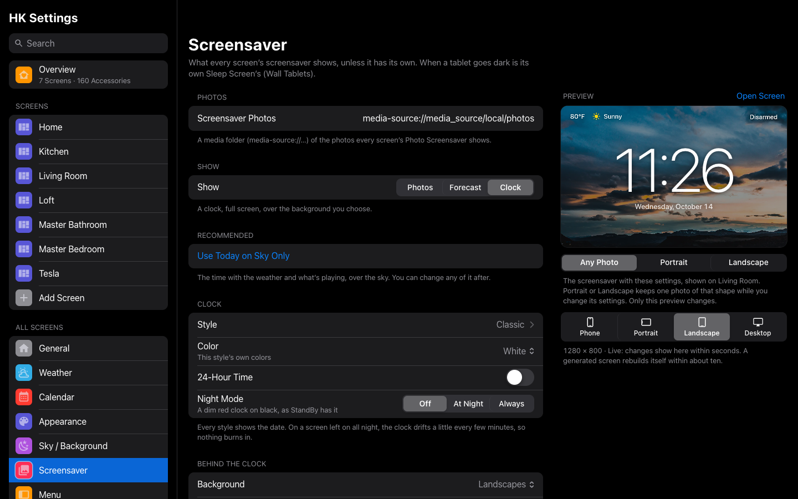

Its address is `#/house/screensaver` in HK Settings; the old
`#/house/tablets/screensaver` (Wall Tablets → Screensaver, before Screensaver
had its own entry) still opens it.
