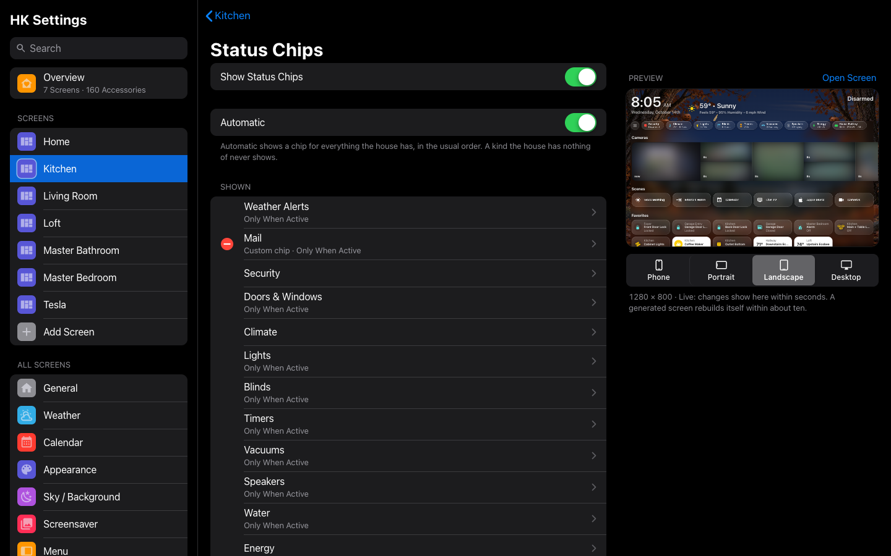
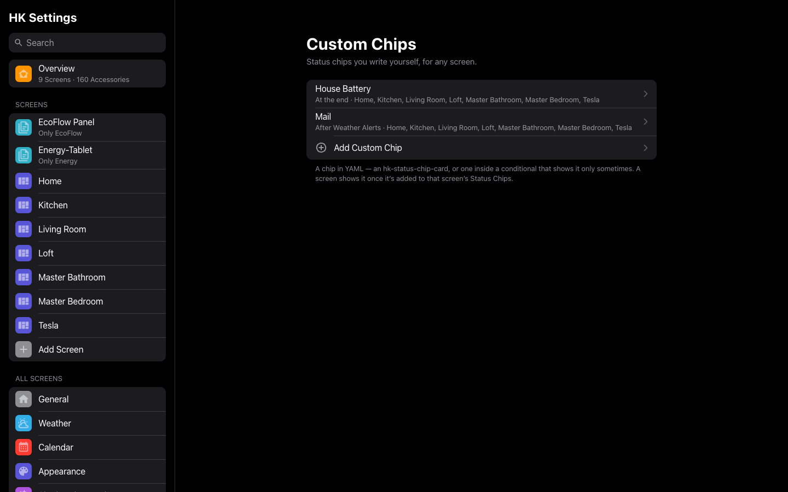
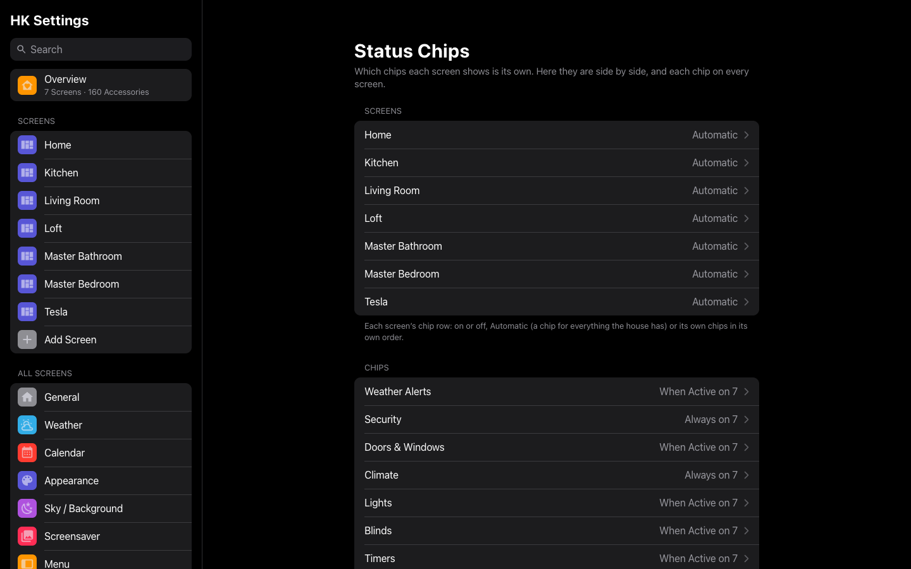

# Status Chips

The row of small summaries under the header: Lights, Security, Climate and the
rest. Each opens its own page.

Each chip summarizes one kind of thing and opens its page:

| Chip | Shows | Opens |
|---|---|---|
| Smoke & CO | *Smoke Detected* or *CO Detected*, in red, while an alarm is going off | Nothing |
| Weather Alerts | The current alert, while there is one | Weather |
| Security | The alarm’s state, or how many locks are unlocked | Security |
| Doors & Windows | How many doors, windows and garage doors are open | Doors & Windows |
| Climate | The indoor temperature and how many fans are on; its glyph shows heating or cooling | Climate |
| Lights | How many lights are on | Lights |
| Blinds | How many blinds are open | Climate |
| Timers | How many timers are running | Timers |
| Vacuums | How many vacuums are running | Vacuums |
| Speakers | How many speakers are playing | Music |
| Water | Whether a leak sensor is wet | Water |
| Energy | Power use, in kW | The [Energy](Energy.md) page, or a [custom page](Pages.md#custom-pages) with the address `energy` |

What each chip counts is the same on every screen. Each kind finds its own
accessories, and you change that on the accessory: hide it from a chip in
[Hidden Accessories](Accessories.md#hidden-accessories), or count it where it
isn’t found with its [Also Count As](Accessories.md#also-count-as).
Each type’s page in [Accessories](Accessories.md#types) shows the result. The alarm is in
[Pages → Security](HK-Settings.md#pages), the indoor temperature and power sensor
on the Climate and Energy chips’ own pages
([below](#status-chips-settings)); the alerts sensor is in
[Weather](Weather.md). A kind your home has nothing of never shows a
chip.

**Smoke & CO is on every screen.** In a home with a smoke or carbon monoxide
alarm, the Smoke & CO chip leads every screen’s chip row, before the chips the
screen chooses, and appears only while an alarm is going off. A screen can’t
remove or move it; turn the whole row off (**Show Status Chips**) and it goes
with it. **Accessories → Smoke & CO** ([Types](Accessories.md#types)) lists
the alarms that set it off: hide a camera that only hears the alarm from
**Smoke & CO**, or count a gas detector with its **Also Count As**.



**Only when there’s something to report.** Some chips are *quiet*: they appear
only while something is on, open, running or wet, so the row carries news
rather than a permanent “All Closed”. Weather Alerts, Doors & Windows, Blinds
and Water start quiet. To change one on every screen at once:

1. Open **HK Settings → All Screens → Status Chips**.
2. Tap the chip under **Chips** (or your own under **Custom Chips**).
3. Set each screen to **When Active** (quiet) or **Always**.

One screen alone: **Screens → (the screen) → Status Chips**, tap the chip’s
row, and set **Show**.

**Choose and order the chips.** On the same page, turn **Automatic** off. Drag
the chips into order, remove the ones you don’t want, and add others back from
**More**.

**An accessory as a chip.** Any entity can be a chip of its own: select **Add
Accessory Chip…** and pick it. The chip shows its name and state. In its
[accessory settings](Accessories.md) you can give it a color, show it
only in one state (a mail sensor only when its state is “Delivered”), show one
of its attributes instead of its state, or give it a label.

**Custom chips.** For a chip you design yourself (several values, its own tap
action, a chip that appears only sometimes), write it once in the Library and
add it to any screen:

1. Open **HK Settings → Library → Custom Chips → Add Custom Chip**.
2. Give it a **Name**, and choose where it **Sits**: at the start, after a kind
   of chip, or at the end.
3. Write the chip in YAML: an `hk-status-chip-card`, or one inside a
   `conditional` card. There is an example on the page.
4. Select **Add Chip**.
5. On each screen that should show it, open **Status Chips** and add it from
   **More**. **All Screens → Status Chips** then sets it Always or When Active,
   screen by screen.



A custom chip’s minus on a screen takes it off that screen only. **Delete
Chip** in the Library removes it everywhere.

## Status Chips settings

Each screen's chip row is its own: **HK Settings → the screen → Home Page →
Status Chips**. To see them all side by side, use **All Screens → Status
Chips**:

- **Screens** lists every screen's chip row (Off, Automatic, or its own
  chips), each a tap from that screen's page.
- **Chips** lists each chip with where it shows ("Always on 6 · When Active
  on 1"). A chip's page sets **Always** or **When Active** for every screen
  at once, lists the screens that don't show it, and what it counts.


*All Screens → Status Chips: every screen’s chips side by side.*

**Custom Chips** are listed there too, set the same way for each screen.
A chip left alone shows as written: one inside a `conditional` card only when
its condition is met (When Active), any other always. **Always** takes a
conditional chip out of its condition. **When Active** shows a status chip
only while its entity is on, open or running, or as its own `active:` rules
say, so a reading that is never off (a battery's percent) needs `active:`
rules for When Active to mean anything. A custom chip written as another kind
of card shows as written. Each custom chip's own page (**Library → Custom
Chips**) links to its screens.

Each type's page under [Accessories](Accessories.md#types) also has a
**Chips** group: the chips that count that type, each opening that chip's
page.

**What the Chips Count** ends All Screens' and each screen's Status Chips
page: **Accessories**, to add to a chip or hide from it type by type, and
**Custom Chips**. A chip's page says the same under **What It Counts**: tap a
type, then **Add…** to count something more, or open an accessory to hide it
from the chip. A chip that reads one setting (Weather Alerts, Energy) says so.

| Setting | Default | What it does |
|---|---|---|
| Show Status Chips | On | Off: no chip row on this screen. |
| Automatic | On | A chip for every kind your home has, in the usual order: Weather Alerts, Security, Doors & Windows, Climate, Lights, Blinds, Timers, Vacuums, Speakers, Water, Energy. A kind your home has nothing of never shows. |
| Shown | — | The chips, in order. A kind’s row opens its own page (below). |
| More | — | Kinds you took off, and your [custom chips](#custom-chips). |
| Add Accessory Chip… | — | Any entity as a chip of its own: its name and state. Its look is set in its [accessory settings](Accessories.md). |

Each kind’s page:

| Setting | Default | What it does |
|---|---|---|
| Show | When Active for Weather Alerts, Doors & Windows, Blinds and Water; Always for the rest | **When Active**: the chip appears only while something is on, open, running or wet. **Always**: it is always there. |
| What It Counts | — | The kinds the chip counts, each with how many and opening its type’s page in [Accessories](Accessories.md#types), and a link to the single setting it reads elsewhere (Alarm Panel, Weather Alerts). The same on every screen. |
| Indoor Temperature | First Thermostat’s | *Climate chip, on a screen’s page for it.* A temperature sensor for the chip’s reading (an average, say). The house’s: the same on every screen. |
| Power Use | None | *Energy chip, on a screen’s page for it.* A power sensor for the chip, which needs it. W or kW; shown in kW. The same on every screen. |

## The pages’ status rows

The [Climate](Climate.md), Lights, Doors & Windows, Water and Security pages
have a room-style status row under their titles: *3 Lights · 2 On*, *Motion ·
Emma’s Room*, *Valve · Running*. Each counts what its type’s page in
[Accessories](Accessories.md#types) lists; tap
an item for its room-labeled accessory list. Choose what each row shows, its
order and the rooms it leaves out in **Pages → the page → Status Row** ([Status
rows](Status-Rows.md)).

## What Counts

What each status chip, the header’s security line and the generated pages
count, on every screen, is each type’s page under **Library → Accessories**
([Types](Accessories.md#types)): Lights, Locks, Doors, Temperature and the
rest. A screen’s chip page (**What It Counts**) and a status row’s **Sources**
open them. Every kind finds its own entities, and what you change, you change
on the accessory — hide it from a kind in
[Hidden Accessories](Accessories.md#hidden-accessories), or count it where it
isn’t found with its [Also Count As](Accessories.md#also-count-as) (or **Add…**
on the type’s page). The Lights chip and the Lights page count the same
lights, so they can’t disagree. (What Counts was a page of its own, and before
that Status & Chips; its old links open the type’s page.)

| Kind | Found automatically | The chip counts |
|---|---|---|
| Smoke & CO | Binary sensors of class smoke or carbon monoxide | Going off (the Smoke & CO chip appears). Count a gas detector with its **Also Count As**; hide a camera that only hears the alarm from **Smoke & CO**. |
| Temperature | An area’s designated temperature sensor, else its thermostat’s current temperature | Range on the Climate page |
| Humidity | An area’s designated humidity sensor, else its thermostat’s current humidity | Range on the Climate page |
| Lights | Every light | On (Lights chip) |
| Fans | Every fan | On (Climate chip) |
| Doors | Binary sensors of class door | Open (Doors & Windows chip) |
| Windows | Binary sensors of class window | Open (Doors & Windows chip) |
| Garage Doors | Covers of class garage or gate, binary sensors of class garage door | Open (Doors & Windows chip); the Security page lists the covers |
| Locks | Every lock | Unlocked (Security chip) |
| Blinds & Shades | Covers of class awning, blind, curtain, shade, shutter or window, or with no class | Open (Blinds chip) |
| Leak Sensors | Binary sensors of class moisture | Wet (the Water chip appears) |
| Thermostats | Every climate entity | Heating or cooling (the Climate chip’s glyph) |
| Timers | Every timer helper | Running (Timers chip) |
| Vacuums | Every vacuum | Cleaning, returning, paused or in error (Vacuums chip) |
| Speakers | Media players that aren’t TVs or receivers | Playing (Speakers chip). With the Music feature, its speakers are counted instead. |

Never found: hidden or disabled entities, configuration and diagnostic
entities, groups of other entities (a light group would count its lights
twice; add one with **Add…** on its type’s page if you want it), and anything
hidden everywhere in
[Hidden Accessories](Accessories.md#hidden-accessories). An accessory hidden
from a kind there isn’t counted in it. One shown as something else (a switch
**Shown as** a light) is counted as its [accessory settings](Accessories.md)
say.

In **Hide From** and on an accessory’s **Where it shows**, a kind goes by the
page it is on: thermostats are **Climate**, locks **Security**, leak sensors
**Water** and garage doors **Garage**; the rest keep their names.

A type’s page lists what it counts room by room. **Hidden** marks one hidden
from this kind in Hidden Accessories (a car’s windows, a second copy of a
blind); **Added** marks one counted because its **Also Count As** is on (an
outlet you think of as a light, a switch that runs a fan). **Show All on (the
page) Again…** opens the kind in Hidden Accessories, where **Show All Again**
shows everything it finds again; what was added stays. See
[Types](Accessories.md#types).

The chips’ two readings, **Indoor Temperature** and **Power Use**, are chosen
on the Climate and Energy chips’ pages under any screen’s Status Chips
([Status Chips settings](#status-chips-settings)); either one is the
house’s, the same on every screen.

A kind you never touch stays automatic, so a light you add tomorrow is counted
tomorrow. The category pages of a generated screen (Lights, Doors & Windows, …)
list what their kinds count.

## Custom Chips

**Library → Custom Chips.** Status chips you write yourself in YAML: an
`hk-status-chip-card`, or one inside a `conditional` card that shows it only
sometimes. A screen shows one once it is added to that screen’s
[Status Chips](Status-Chips.md).

| Setting | Default | What it does |
|---|---|---|
| Name | — | Its name in the lists. |
| Sits | At the End | **At the Start**, **After** a kind (After Weather Alerts, After Security, …), or **At the End**. A screen that orders its chips itself places it where you drag it. |
| The chip (YAML) | — | One card, with a `type`. **Add Chip** or **Save Chip** saves it. |
| Delete Chip | — | Removes it from every screen that shows it. |

For example:

```yaml
type: custom:hk-status-chip-card
entity: sensor.house_battery
name: House Battery
icon: hk:home-battery
icon_color: green
tap_action:
  action: navigate
  navigation_path: ./energy
```
