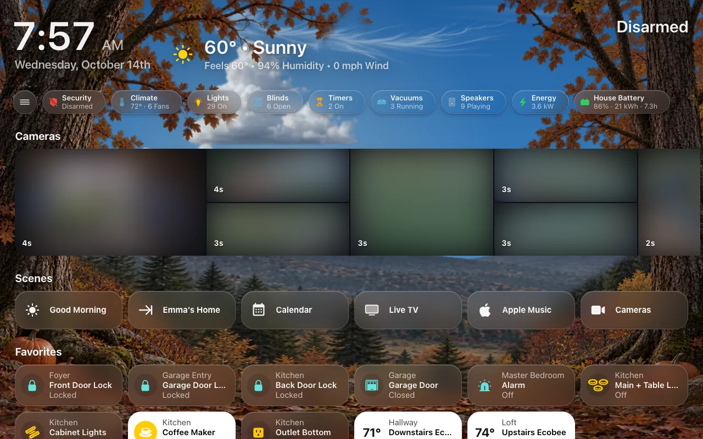
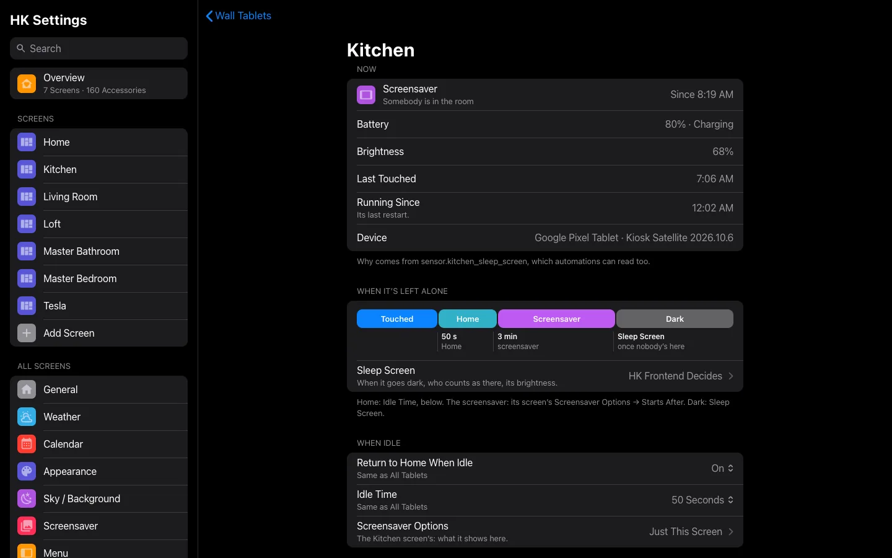
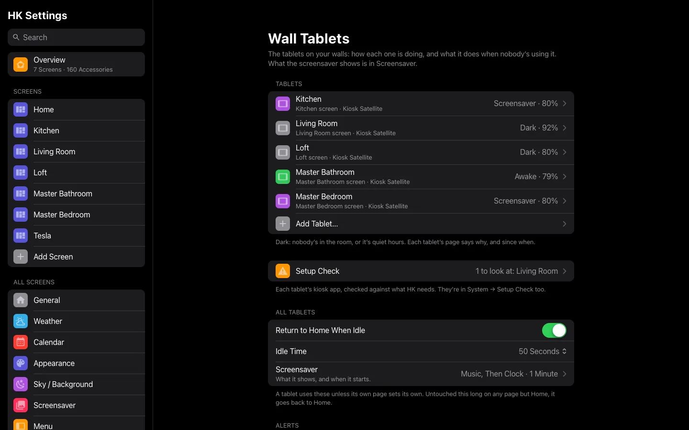

# Wall Tablets

HK Frontend was built for tablets mounted on a wall and left on all day. This
page and [Screensaver and Idle](Screensaver-and-Idle.md) set one up from start
to finish: its own user, its screen, the tablet itself, the kiosk app, a
photo screensaver, and returning to Home when nobody is using it. It works the
same for one tablet or ten, of any brand.



## Tablets and screens

A **wall tablet** and a **screen** are two different things. A screen is a
dashboard: what is drawn. A tablet is the hardware on the wall: it **runs** a
screen. One screen can run on several tablets (a kitchen and a hallway
showing the same thing), or on none (a screen for phones and computers).

So each has its own settings:

| A screen’s (Screens → the screen) | A tablet’s (All Screens → Wall Tablets → the tablet) |
|---|---|
| What it shows: the menu, Home, pages, appearance | Which screen it runs |
| Photo Screensaver and Screensaver Options: what the screensaver shows, and Starts After | Its room, its Home Assistant user and its kiosk app |
| Home Assistant Header & Sidebar | Return to Home When Idle and Idle Time |
| Car Browser | Sleep Screen: when it goes dark, and how |

Before tablets were their own items, a screen was its own tablet, with a
Tablet User and a Tablet Room. Updating moves those over by itself; see
[Screens that were tablets](#screens-that-were-tablets).

### Which tablet a browser is

HK Frontend works out which tablet is showing a page, in this order:

1. **The tablet’s start URL.** Its address ends in `?hk_tablet=<id>` (each
   tablet’s page has it, ready to copy). The browser remembers it once it has
   seen it, so a reload or another page still knows. `?hk_tablet=none`
   forgets it.
2. **Else, the signed-in user.** The tablet whose **Tablet User** is signed
   in; if two share one, the tablet on this screen first.
3. **Else, none.** A desk, a phone or a car: no screensaver and no return to
   Home, whatever screen it opens.

The start URL is what tells two tablets apart when they share a user or a
screen. With one user per tablet, the user alone is enough.

## What HK Frontend does, and what it leaves to you

**HK Frontend does:** the screen itself, a menu that stays open beside the
page, returning an untouched page to Home, a photo screensaver, a
now-playing bar, `sensor.tv_viewers` for knowing when a tablet is showing
Live TV, and keeping an eye on each tablet: whether it is awake, its battery,
its kiosk app’s settings, and alerts when one goes quiet.

**Going dark and waking is your choice.** Let HK Frontend decide, from
presence sensors, quiet hours and the doorbell, with each tablet’s
[Sleep Screen](Sleep-Screen.md), or leave it to your own automations (for
example with the Fully Kiosk Browser integration and a motion sensor). HK
Frontend gives those automations what they need to read; see
[What keeps a tablet awake](Screensaver-and-Idle.md#what-keeps-a-tablet-awake).

## What you need

- An Android tablet. Any size works; a 10–11 inch tablet that reports about
  1280 × 800 in its browser shows the full layout. Choose one with **6 GB of
  memory or more**: memory, not the processor, is what makes the difference.
- A kiosk app on it: **Kiosk Satellite**, which joins Home Assistant as an
  ESPHome device and can also be a voice satellite and a Bluetooth proxy, or
  **Fully Kiosk Browser** (its PLUS license adds remote administration, which
  the **Fully Kiosk Browser** integration in Home Assistant uses to reload
  the page and see the screen). With either one HK Frontend can show the
  tablet’s state and battery, check its settings, and reload or restart it.
  Set up one of them, step 4. Anything else (an old iPad, a car) still works
  as **Just a Browser**.
- Nothing else from HACS: hiding Home Assistant’s header and sidebar, and the
  photo screensaver, are part of HK Frontend.

**HK Settings → Setup Check → Wall Tablets** checks each tablet: that its
user and screen exist, that its kiosk device is chosen, and its kiosk app’s
settings ([below](#setup-check)). It also says when a screen has the Photo
Screensaver on but no tablet runs it.

## 1. Give the tablet its own user

In Home Assistant, add a person for the tablet with a login (**Settings →
People → Add Person**, then **Allow login**), for example “Kitchen Tablet.”
Do not make it an administrator.

A user per tablet is what lets each tablet be itself:

- HK Frontend knows which tablet a browser is by its user when the start URL
  doesn’t say, and nobody’s phone or computer ever counts as the tablet;
- Music knows which room the tablet hangs in (its **Home Room**);
- `sensor.tv_viewers` and `hk_frontend.show_popup` can name it.

To sign a tablet in without typing a password, add a `trusted_networks` auth
provider **before** the `homeassistant` one in `configuration.yaml`, with the
tablet’s fixed address and its user:

```yaml
homeassistant:
  auth_providers:
    - type: trusted_networks
      trusted_networks:
        - <the tablet's IP address>
      trusted_users:
        <the tablet's IP address>:
          - <the tablet user's id>
      allow_bypass_login: true
    - type: homeassistant
```

Any other device still gets the password form. Behind a reverse proxy, also
set `use_x_forwarded_for` and `trusted_proxies` under `http:`, so Home
Assistant sees the tablet’s own address.

## 2. Make the tablet’s screen

Skip this if the tablet will show a screen you already have.

1. Open **HK Settings** in the sidebar and select **Add Screen**.
2. Give it a **Name**, for example “Kitchen.”
3. Set **Shown On** to **Wall Tablet**.
4. Leave **Only Admins Can Open It** off (the tablet’s user is not an admin).
5. Select **Create Screen**.

A screen named “Kitchen” is the dashboard `/hk-kitchen`. It builds itself from
your areas and devices; see [Screens](Screens.md) for everything it can show.

The **Wall Tablet** preset starts the screen with:

| Setting | Wall Tablet starts with |
|---|---|
| Menu | Always open beside the page |
| Time and weather | In the menu, at its top (the Home page’s header steps aside) |
| Home Assistant Header & Sidebar | Both Hidden |

A preset is only a starting point. Every value can be changed afterwards on
the screen’s page in HK Settings. Returning to Home when idle is the
tablet’s, and on for every tablet unless you turn it off
([step 6](Screensaver-and-Idle.md#6-return-to-home-when-idle)).

An existing dashboard can be a wall tablet’s screen too: in **Add Screen**,
pick it under **Existing Dashboards** and choose **Wall Tablet**. It gets a
screen’s settings — hiding the header, the photo screensaver, notifications,
the menu — and a tablet running it returns to Home and sleeps like any other.
It doesn’t get what only a screen HK Frontend builds has: Favorites, its
generated pages, the Now Playing and Timer bars (you can add the Now Playing
bar yourself; see [Your Own Dashboard](Your-Own-Dashboard.md), which also
lists what its own YAML can add).

### Home Assistant’s header and sidebar

The Wall Tablet preset already hides them. To change it:

1. In **HK Settings**, open the screen. Under **Header**, open **Home
   Assistant Header & Sidebar** and turn on **Hide Header & Sidebar**.
2. Optional, on the same page: **Hide Header**, **Hide Sidebar**, and **For
   Admins Too** (off: an admin still sees them).

HK Frontend does this itself: nothing to install. Leaving the screen (for
Settings, say) always brings them back, and `?hk_kiosk=off` on the screen’s
address shows them until the page is reloaded, while you work on the tablet.

With the header hidden, you can still reach Home Assistant from the tablet if
you want to: the screen’s **Menu** settings can add a **Home Assistant
Section** -- Home Assistant’s own pages in the menu, and **Show Menu**, which
opens its sidebar over the page. A tablet’s own user sees only what it may
open. Leave it off on a tablet everyone uses.

A dashboard you write in YAML gets the same from its HK settings, or from an
`hk_kiosk:` block in its YAML ([Your Own Dashboard](Your-Own-Dashboard.md#hide-home-assistants-header-and-sidebar)):

```yaml
hk_kiosk: true
```

**Coming from the Kiosk Mode plugin.** Screens that hid Home Assistant’s
header through the Kiosk Mode plugin (HACS) do it themselves from 1.3, with
nothing to change. A screen with **Kiosk Mode Options** of its own moves over
too when **Home Assistant Header & Sidebar** can say the same (hide the header, the sidebar,
and admins seeing both); with any other option it keeps the plugin until you
turn off **Home Assistant Header & Sidebar → Use the Kiosk Mode Plugin
Instead**. A
dashboard with its own `kiosk_mode:` block keeps it too: HK Frontend leaves
that dashboard alone. Once nothing uses the plugin, you can remove it in HACS.

## 3. Add the tablet

**HK Settings → All Screens → Wall Tablets → Add Tablet…** (or, on the
screen’s page, **Wall Tablets → Add a Tablet to This Screen…**):

| Setting | What it is |
|---|---|
| Name | The tablet’s name, for example “Kitchen.” Its entities are named after it (`switch.kitchen_photo_screensaver`). |
| Screen | The screen it runs. |
| Room | The Home Assistant area it hangs in. **Calm When Nobody’s Around** ([Liveliness](Seasonal-Decorations.md#liveliness)) looks there. |
| Kiosk App | **Kiosk Satellite**, **Fully Kiosk**, **WallPanel** or **Just a Browser**, and for the first two its **Device**. |
| Tablet User | The user from step 1. |

Then select **Add Tablet**. Its page opens, with its **Start URL** to put in
the kiosk app (step 4).

Each tablet is also an item on HK Frontend’s integration page (**Settings →
Devices & services → HK Frontend**), with its entities as a device under it.
The page’s **Add wall tablet** button (and reconfiguring a tablet’s item)
gives a link to the same place in HK Settings, where tablets are set up.

**Just a Browser** is for anything HK Frontend can’t see a kiosk app on: an
old iPad, a car, a browser you say is a tablet. It gets HK Frontend’s
screensaver and Return to Home, with no state, battery or remote actions.

**This Looks Like a Wall Tablet.** Wall Tablets suggests what may be a tablet
that isn’t one yet: a Kiosk Satellite or Fully Kiosk device no tablet uses,
or a Fully Kiosk browser seen showing a screen. **Add Tablet…** starts Add
Tablet with what it knows filled in; **Not a Tablet** stops suggesting it.

## 4. Set up the kiosk app

### Fully Kiosk Browser

In Fully Kiosk Browser’s settings on the tablet:

- **Start URL**: the tablet’s start URL, from its page (**Setup → Copy Start
  URL**), for example
  `https://homeassistant.local:8123/hk-kitchen?hk_tablet=kitchen`.
- **Keep the screen on** while the app runs, unless your own automation turns
  it off.
- **Autoplay** audio and video, so camera and Live TV sound can start without
  a tap.
- **Microphone access**, if you want to talk on the doorbell pop-up. Browsers
  allow the microphone only on a secure page, so the tablet must load Home
  Assistant over **https** for talking. Everything else works over http.
- **Remote administration** on (PLUS), then add the tablet in Home Assistant
  with the **Fully Kiosk Browser** integration, and choose it as the tablet’s
  **Device**. Its **Load start URL** button reloads the tablet from Home
  Assistant; so does **Reload** on the tablet’s page.

Sign in once as the tablet’s user.

### Or Kiosk Satellite

In Kiosk Satellite’s setup on the tablet:

- **Connect** with a long-lived access token **created by the tablet’s user**
  (sign in as that user in a browser on the tablet, then Profile → Security).
  Kiosk Satellite signs the dashboard in with it, so HK Frontend knows the
  tablet by its user.
- **Dashboard**: the screen’s dashboard.
- **Screensaver: Black, after a day.** HK Frontend’s photo screensaver is the
  screensaver, so Kiosk Satellite’s own should never come up over it by
  itself. Its Black screensaver can still be put up from Home Assistant as
  the tablet’s “dark” (its **Screensaver** and **Screensaver active**
  switches); HK Frontend notices it and holds the sky still. Or let HK
  Frontend make the dark itself, and decide when: the tablet’s **Sleep
  Screen** ([Sleep Screen](Sleep-Screen.md)). The tablet’s **Setup Check**
  says when this is set otherwise, and **Fix** sets it.
- **Pause dashboard during screensaver: off** (Home Assistant Configuration →
  Optimizations). On, the tablet throws the drawn page away under the black
  and a wake can show it half drawn; HK Frontend holds the page still under
  any black itself.
- **Filter dashboard updates: off** (Home Assistant Configuration →
  Optimizations). It drops updates for entities it does not see on the page,
  and HK Frontend’s sky, status and screensaver read beyond the page.
- **Return to home dashboard view** and **dashboard view rotation: off** —
  HK Frontend already returns the tablet to its dashboard.
- Add it in Home Assistant with the **ESPHome** integration, and choose it as
  the tablet’s **Device**.
- For **Restart Tablet** (on the tablet’s page, and the scheduled restart),
  make Kiosk Satellite the tablet’s **device owner**. Without it, only the
  app restarts.

Two things to know:

- Its **Screen** is a `light` in the tablet’s area, so a “turn off the room’s
  lights” automation or voice command turns the tablet off too. Hide the
  kiosk’s entities (Settings → Entities → select → Hide) and area targeting
  passes them by.
- Its own **Camera** and **Screenshot** never join the Cameras page or a
  camera strip, the same as Fully Kiosk’s camera.

### On the tablet itself

- **Update Android System WebView** from the Play Store before judging how
  anything looks or scrolls. A factory WebView can be far behind.
- **Turn adaptive brightness off.** It fights the brightness Sleep Screen
  sets.
- **Protect Battery** (or your tablet’s battery care) on: a tablet charging
  all day at 100% wears its battery out.
- **Disable the vendor apps you do not use.** Background apps cost a tablet
  more smoothness than anything on the page. Never disable Wi-Fi, the
  keyboard, Google Play services or the Play Store.
- Leave Android’s **Remove animations** (and power-saving modes that turn
  animations off) off. With it on, the browser asks pages for reduced motion
  and the live sky stands still.

Next: [5. Add the photo screensaver](Screensaver-and-Idle.md#5-add-the-photo-screensaver).

## A tablet’s page

**All Screens → Wall Tablets → (a tablet).** Everything about one tablet.



### Now

How it is doing, from its kiosk app: **Dark**, **Screensaver**, **Awake** or
**Offline**, why (“nobody’s in the room,” “quiet hours”) and since when; its
**Battery** and whether it is charging; its **Brightness**; when it was
**Last Touched**; **Running Since** its last restart; and the **Device** and
app version. A tablet that is **Just a Browser** or WallPanel has no Now.

### When It’s Left Alone

A timeline of what happens after the last touch, in order: **Touched**, then
**Home** at its Idle Time, the **Screensaver** at its screen’s Starts After,
and **Dark** when Sleep Screen says. When Home would come after the
screensaver has started, it says so: the screensaver then comes up over
another page and the tablet goes Home behind it. An Idle Time shorter than
Starts After puts Home first.

**Sleep Screen** opens the tablet’s [Sleep Screen](Sleep-Screen.md), and says
who decides: an automation, or HK Frontend.

### When Idle

| Setting | Default | What it does |
|---|---|---|
| Return to Home When Idle | Same as All Tablets (On) | A page left untouched goes back to the screen’s Home. **On** or **Off** for this tablet alone. |
| Idle Time | Same as All Tablets (50 Seconds) | How long untouched first: **30 Seconds**, **50 Seconds**, **1 Minute**, **2 Minutes**, **5 Minutes** or **Never**. |
| Screensaver Options | — | Opens its screen’s Screensaver Options: what the screensaver shows here, and Starts After. **Photo Screensaver** (Off) when the screen has none. |

### Setup

**Name**, **Screen**, **Room**, **Tablet User**, **Kiosk App** and its
**Device**, as in [Add the tablet](#3-add-the-tablet). The Room row says when
the kiosk device is in another area in Home Assistant.

**Copy Start URL** copies the tablet’s address for its kiosk app: its screen
with `?hk_tablet=<id>`. It tells the page which tablet it is, even when two
tablets share a user or a screen.

### Setup Check

The kiosk app’s own settings, checked against what HK Frontend needs. **Fix**
sets the ones HK Frontend can set from here.

| Check | Right when | Fix |
|---|---|---|
| Kiosk App Not Heard From | (shown only when wrong) The app answers. It may be off the Wi-Fi, or behind the lock screen after a restart. | — |
| Adaptive Brightness Off | Android isn’t changing the brightness, so Sleep Screen’s holds | Yes |
| Kiosk Screensaver: Black, after 1 day | Kiosk Satellite’s own screensaver is Black and waits a day, so it never comes up over HK Frontend’s | Yes |
| Kiosk Mode On | Nobody can leave the dashboard by accident | Yes, where the app has a switch for it |
| App Up to Date | No update waiting | — |
| Battery Care | Not over 85% while charging. Over that, **Protect Battery** is off on the tablet: turn it on there. | — |

### Actions

What its kiosk app can do, from Home Assistant:

- **Wake Now** and **Sleep Now**, when HK Frontend decides its Sleep Screen.
  Sleep Screen decides again after: somebody in the room wakes it.
- **Reload**, and **Clear Cache & Reload**. After updating HK Frontend use
  Clear Cache & Reload: a plain reload keeps the old HK files.
- **Restart App**.
- **Restart Tablet…**, with Kiosk Satellite as the device owner. It comes back
  to its screen in about a minute.

**Copy Sleep Screen To…** (when HK Frontend decides and there is another
tablet) puts this tablet’s Sleep Screen rules and brightness onto other
tablets; each keeps its own kiosk.

**Remove Tablet…** removes the tablet, its idle, screensaver and Sleep Screen
settings and its own entities. Its screen and its kiosk app stay.

## Wall Tablets settings

**All Screens → Wall Tablets.**



- **Tablets**: each tablet, with its screen, its kiosk app, and its state and
  battery live (Dark, Screensaver, Awake or Offline). **Add Tablet…** at the
  end.
- **This Looks Like a Wall Tablet**: suggestions, [above](#3-add-the-tablet).
- **Setup Check**: **All Set Up Right**, or how many things to look at and on
  which tablet. The same checks are in **System → Setup Check**.

| Setting | Default | What it does |
|---|---|---|
| All Tablets → Return to Home When Idle | On | Every tablet that doesn’t set its own. |
| All Tablets → Idle Time | 50 Seconds | How long untouched before Home: 30 seconds to 5 minutes, or Never. |
| All Tablets → Screensaver | — | A link to [Screensaver](Screensaver-and-Idle.md#screensaver-settings): what every screen’s screensaver shows. |
| Alerts → Tablet Offline | On | Its kiosk app not heard from for 10 minutes. |
| Alerts → Didn’t Come Back After a Restart | On | Not in front 3 minutes after the scheduled restart. |
| Alerts → Not Charging | On | Unplugged for 10 minutes. |
| Upkeep → Scheduled Restart | Off | Clears the cache, then restarts each tablet, at the times in **At** (up to four, like `00:02, 15:00`). A tablet with Kiosk Satellite as the device owner restarts; otherwise its app does. If your own automation already does this, leave it off. |
| All at Once → Reload All | — | Reloads every tablet whose kiosk app can. |
| All at Once → Clear Cache & Reload All | — | The way to get new HK Frontend files onto every tablet after an update; a plain reload keeps the old ones. |

An alert is a Home Assistant notification that stays until the tablet is put
right. With the [Notifications](Notifications.md) feature added, it is also
an Important banner on the screens.

## Screens that were tablets

Updating HK Frontend to the version with wall tablets as their own items
(its settings version 1.14) turns each screen that was a tablet (one with a
**Tablet User**, or with HK Frontend’s screensaver and a **Tablet Room**)
into a tablet of its own:

- named after the screen, running it, with its Tablet User, its room (when
  the Tablet Room is a Home Assistant area), its Return to Home, and its
  Sleep Screen and Black Screen;
- its id is the old Tablet Room, so its start URL is the screen’s address
  with `?hk_tablet=<that room>`;
- its entities keep their ids and history: `switch.<tablet>_photo_screensaver`,
  `switch.<tablet>_black_screen`, `binary_sensor.<tablet>_screen_in_use` and
  `sensor.<tablet>_sleep_screen`, now each tablet’s (their attributes say
  which: `tablet`, beside the screen it runs, `dashboard`);
- All Tablets’ Idle Time is 50 seconds.

No helpers are needed any more. `input_select.<room>_tablet_idle_return`,
`input_number.<room>_tablet_room_idle`, `binary_sensor.<room>_tablet_in_use`
and the Default Idle Time entity are no longer read: set Idle Time on Wall
Tablets (or each tablet’s page), and delete the helpers when it suits you.
A tablet that was migrated is known by its user until its kiosk app’s start
URL has `?hk_tablet=`; copy it from its page to tell tablets apart that
share a user.
