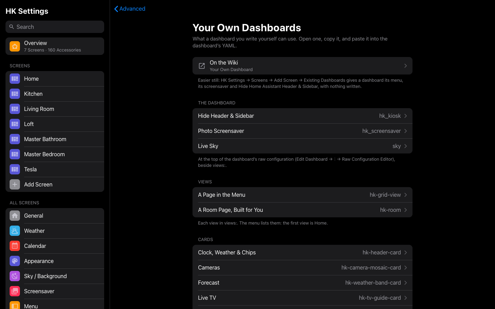
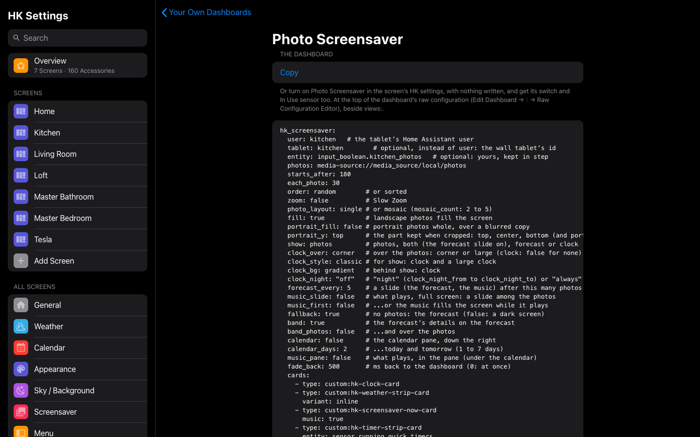

# Your own dashboard

HK Frontend’s features aren’t only for the screens it builds. A dashboard you
made yourself, in Home Assistant’s editor or in YAML, can have them too, in
three ways, easiest first:

1. **Its HK settings, with nothing written.** HK Settings → Screens → Add
   Screen → **Existing Dashboards** (every dashboard you have, Home
   Assistant’s own **Overview** too) gives it a page of settings like any
   screen’s: the menu, Home Assistant Header & Sidebar, the photo
   screensaver and more (the table below). The Overview keeps Home
   Assistant’s name for it; it can’t be renamed from HK Settings.
2. **A few lines at the top of its YAML**, for what its settings don’t reach.
3. **HK cards in its views.** Every card is in the card picker too, with a
   visual editor ([Card library](Card-Library.md)).

Everything on this page is also in HK Settings, under **Advanced → Your Own
Dashboards → YAML Reference**, ready to copy, and a dashboard of your own has
a link to it at the bottom of its page in HK Settings.



Each snippet opens on a page of its own, filled in from your home (your
weather, a tablet user of yours), with **Copy**:



**Where the YAML goes.** For a dashboard made in Home Assistant’s editor:
open it, then **Edit dashboard → ⋮ → Raw configuration editor**. A dashboard
in YAML mode: its file. The blocks under [The dashboard](#the-dashboard) go at
the top, beside `views:`.

## What reaches it, and how

| Feature | From its HK settings | In its YAML |
|---|---|---|
| Hide Home Assistant’s header and sidebar | Home Assistant Header & Sidebar | [`hk_kiosk:`](#hide-home-assistants-header-and-sidebar) |
| Photo screensaver (and the forecast) | Photo Screensaver, its options, and its switch and In Use sensor | [`hk_screensaver:`](#photo-screensaver) |
| Live sky | Sky / Background: its Background (Live Sky, Color or Photo) shows wherever the YAML puts the sky | [`sky:`](#live-sky) |
| The menu | The menu’s settings | [Views](#a-page-in-the-menu) say what it lists |
| Status chips, scenes, cameras | The lists the cards read | [The cards](#clock-weather-and-chips) |
| Room order on Home | Rooms | With the `custom:hk-grid-view` view type, each room’s section headed by an `hk-heading-card` with `area:` |
| Car browser, glass | Yes | — |
| Return to Home, Sleep Screen | A [wall tablet](Wall-Tablets.md)’s own: set on the tablet that runs it, as for any screen | — |
| [Notifications](Notifications.md) (banners, Do Not Disturb, waking the screen) | Yes: added under Existing Dashboards, or never | — |
| Detail sheets, pop-ups (Library and `hk_frontend.show_popup`) | Nothing to do: they work on any dashboard | — |
| Live TV, Clean Areas, Music, Timers, the forecast | — | [Their cards](#live-tv) |
| Favorites, generated pages, the now-playing bar | — (generated screens only) | Build them from cards |

**Which wins.** A block in the dashboard’s own YAML wins over its HK settings:
with `hk_screensaver:` written, the Photo Screensaver settings don’t apply to
it, and `hk_kiosk:` likewise. A `kiosk_mode:` block (the Kiosk Mode plugin’s,
from HACS) wins over both: that plugin hides the header and sidebar, and HK
Frontend leaves them alone.

## The dashboard

### Hide Home Assistant’s header and sidebar

```yaml
hk_kiosk:
  header: true        # Home Assistant’s header
  sidebar: true       # ...and its sidebar
  admins: true        # false: an admin still sees them
```

`hk_kiosk: true` hides both. An admin gets them hidden too unless
`admins: false`. Whatever is hidden, the menu’s **Home Assistant** section
still reaches Home Assistant. To see them on one visit, see
[For one visit](#for-one-visit).

HK Frontend does this itself, since 1.3: the Kiosk Mode plugin isn’t needed.
Leaving the dashboard (for Settings, say) always brings them back.

### Photo screensaver

```yaml
hk_screensaver:
  user: Kitchen Tablet   # the tablet’s Home Assistant user
  tablet: kitchen        # optional, instead of user: the wall tablet’s id
  entity: input_boolean.kitchen_photos   # optional: yours, kept in step
  photos: media-source://media_source/local/photos
  starts_after: 180
  each_photo: 30
  order: random        # or sorted
  zoom: false          # Slow Zoom
  photo_layout: single # or mosaic (mosaic_count: 2 to 5)
  fill: true           # landscape photos fill the screen
  portrait_fill: false # portrait photos whole, over a blurred copy
  portrait_y: top      # the part kept when cropped: top, center, bottom (and portrait_x)
  show: photos         # photos, both (the forecast slide on), forecast or clock
  clock_over: corner   # over the photos: corner or large (clock: false for none)
  clock_style: classic # for show: clock and a large clock
  clock_bg: gradient   # behind show: clock
  clock_night: "off"   # "night" (clock_night_from to clock_night_to) or "always"
  forecast_every: 5    # a slide (the forecast, the music) after this many photos
  music_slide: false   # what plays, full screen: a slide among the photos
  music_first: false   # ...or the music fills the screen while it plays
  fallback: true       # no photos: the forecast (false: a dark screen)
  band: true           # the forecast’s details on the forecast
  band_photos: false   # ...and over the photos
  calendar: false      # the calendar pane, down the right
  calendar_days: 2     # ...today and tomorrow (1 to 7 days)
  music_pane: false    # what plays, in the pane (under the calendar)
  fade_back: 500       # ms back to the dashboard (0: at once)
  cards:
    - type: custom:hk-clock-card
    - type: custom:hk-weather-strip-card
      variant: inline
    - type: custom:hk-screensaver-now-card
      music: true
    - type: custom:hk-timer-strip-card
      entity: sensor.running_quick_timers
      fixed: true
    - type: custom:hk-screensaver-status-card
```

Only `user` (or `tablet`) is needed: the screensaver runs only in a browser
signed in as that user, or, with `tablet`, only on that
[wall tablet](Wall-Tablets.md#which-tablet-a-browser-is), so a desk opening
the same dashboard never gets it. `entity` is
optional: an `input_boolean` or `switch` of yours, turned on while the photos
show and off when someone taps them; turning it on starts them. `cards` are
what shows over the photos — HK cards only (`custom:hk-…`); any other card in
the list is left out; under a big clock (`show: clock` or `clock_over:
large`), leave out `hk-clock-card` or give it `music_only: true`, so it shows
only while the music covers the big clock. Everything else, the photo,
mosaic and clock options too, is as on
[Screensaver & idle](Screensaver-and-Idle.md#on-a-dashboard-of-your-own).

With Photo Screensaver on in the dashboard’s HK settings instead, there is
nothing to write: add the wall tablet that runs it, and HK Frontend makes the
tablet’s switch and In Use sensor for your automations, as for any screen.

### Live sky

```yaml
sky:
  enable: input_boolean.live_sky   # optional: off hides the sky
views:
  - title: Home
    path: home
    type: custom:hk-grid-view
    sky: true
    cards: []
```

`sky: {}` on its own is enough to opt in. A view can instead take one of the
still washes with `sky_variant:` (see [The live sky](Live-Sky.md)).

## Views

### A page in the menu

```yaml
- title: Kitchen
  path: kitchen
  type: custom:hk-grid-view
  area: kitchen       # a room, in the menu’s Rooms
  menu: top           # right under Home (false: not listed)
  cards: []
```

`area:` makes the view a room, named by its title and pictured by the area’s
icon; `menu:` places it. All the menu’s view keys are on
[The menu](Menu.md#the-menu-on-your-own-dashboard).

### A room page, built for you

```yaml
- title: Kitchen
  path: room-kitchen
  subview: true
  strategy:
    type: custom:hk-room
    area: kitchen
```

To make a room heading on Home open it, give an `hk-heading-card` the same
`area:`.

## Cards

In a view’s `cards:`. A card with no entity of its own reads what HK Settings
chose (the weather, the alarm), so one card works on every dashboard.

**From the card picker.** In Home Assistant’s editor, **Add card** lists HK
Frontend’s cards under names that start with **HK**. Each opens with a visual
editor and a starting setup drawn from your home (a switch for the toggle
pill, three cameras for the camera strip, a sensor of the right kind for a
graph). The screensaver’s two cards are left out of the picker; they belong
in `hk_screensaver:` (above).

**In a Sections view** each card takes a size of its own: the tiles, chips
and reading tiles half a section, two side by side; the header, the chip and
scene rows, the Music page, the calendar and the other page-wide cards the
whole width; the rest a full column. Change it in the card’s **Layout** tab.
In a narrow section the wall header stacks: the clock, the weather, then the
security line.

**With Home Assistant’s light theme**, the cards take the Home app’s light
look: gray glass, the theme’s own text colors and a white plate for whatever
is on. With the dark theme, or the live sky behind them, they look as they do
on HK Frontend’s screens. Sheets and pop-ups stay dark either way.

Every card and its options: [Card Library](Card-Library.md).

### Clock, weather and chips

```yaml
- type: custom:hk-header-card
- type: custom:hk-chips-card
- type: custom:hk-scenes-card
```

The chips, and the scenes, follow the lists in the dashboard’s HK settings;
without any, every kind the house has.

### Cameras

```yaml
- type: custom:hk-camera-mosaic-card
```

### Forecast

```yaml
- type: custom:hk-weather-band-card
  entity: weather.home
```

### Live TV

```yaml
- type: custom:hk-tv-guide-card
  title: Live TV
```

Needs the [Live TV](Live-TV.md) feature.

### Clean Areas

```yaml
- type: custom:hk-area-select-card
```

Needs the [Clean Areas](Clean-Areas.md) feature.

### Music

```yaml
- type: custom:hk-music-card   # the whole Music page
# ...or just what is playing:
# - type: custom:hk-now-playing-card
#   music: true
```

The whole Music page as one card: what plays and where (Speakers, Volume,
Queue), with Browse Music beside it. For just what is playing, the
now-playing card alone. Needs the [Music](Music.md) feature.

### The Now Playing Bar

```yaml
- type: custom:hk-popup-card
  hash: '#media'
  position: bottom
  modal: false
  dock: true
  padding: '0'
  radius: '0'
  width: 100%
  max_width: 100%
  background: transparent
  vars:
    hk-np-height: calc(104px + env(safe-area-inset-bottom, 0px))
    hk-np-pad: 12px 24px calc(12px + env(safe-area-inset-bottom, 0px))
    hk-np-radius: '0'
    hk-np-plate: rgb(22,23,26)
    hk-np-areas: '"art title . spk prev play next stop brw . meta" "art artist . spk prev play next stop brw . meta" "art sub . spk prev play next stop brw . meta"'
    hk-np-cols: 72px minmax(220px, max-content) 1fr 56px 64px 64px 64px 64px 56px 1fr minmax(0, 380px)
    hk-np-rows: auto auto auto
    hk-np-gap: 14px
  trigger:             # open while the music plays...
    - condition: state
      entity_from:
        music: true
      state: playing
      grace: 20
  trigger_close: true # ...and close when it stops
  dismissable: true   # swiped down, it stays away until the music stops
  dismiss_scope:
    - music: true
  stash:              # ...with a button in the corner to bring it back
    icon: hk:homepod
    label: Show Now Playing
  cards:
    - type: custom:hk-now-playing-card
      bar: true
      music: true
      hide_idle: true
      meta_card:
        type: custom:hk-media-control-card
        color: purple
        bare: true
        parts: [volume]
        entity_from:
          music: true
      sub_card:
        type: custom:hk-media-control-card
        color: purple
        bare: true
        parts: [progress]
        phone_times: false
        entity_from:
          music: true
```

The player docked along the bottom of the screen while music plays, as on the
screens HK Frontend builds. It shows on the views it is placed in, so put it in
each view that should have it. Needs the [Music](Music.md) feature.

### Timers

```yaml
- type: custom:hk-timers-page-card
```

Quick start and New Timer need HK Frontend’s timer helpers
(`helpers/quick_timers.yaml`); without them they say so and start nothing.

### Energy

```yaml
- type: custom:hk-energy-period-card   # the tabs: add it first
- type: custom:hk-energy-hero-card
- type: custom:hk-energy-day-card
```

The Energy page’s cards, following the tabs. Needs the [Energy](Energy.md)
feature.

## Automations

### Clean some rooms

```yaml
action: hk_frontend.clean_areas
data:
  areas:
    - kitchen
    - dining_room
```

Each vacuum cleans the rooms on its own map. `dry_run: true` only answers with
the plan ([Clean Areas](Clean-Areas.md#action-hk_frontendclean_areas)).

### Start or stop the photos

```yaml
action: switch.turn_on
target:
  entity_id: switch.kitchen_photo_screensaver
```

The switch HK Frontend makes for each wall tablet, named after the tablet
(here, Kitchen): on starts the photos (bedtime, say), off closes them (the
doorbell). Its In Use sensor is beside it. With an `hk_screensaver:` block of
your own, turn your own `entity` on and off instead.

## The address

### For one visit

```
/dashboard-kitchen/0?hk_kiosk=off   # the header and sidebar, until a reload
/dashboard-kitchen/0?hk_saver=off   # no screensaver on this page
```

Either lasts until the page is reloaded, so a tablet you are working on keeps
Home Assistant’s header and sidebar while you move around it, and a reload
(**Reload** on the tablet’s page in Wall Tablets, say) is the screen as set again.
`?hk_kiosk=on` does the opposite: both hidden, whatever the screen says.
